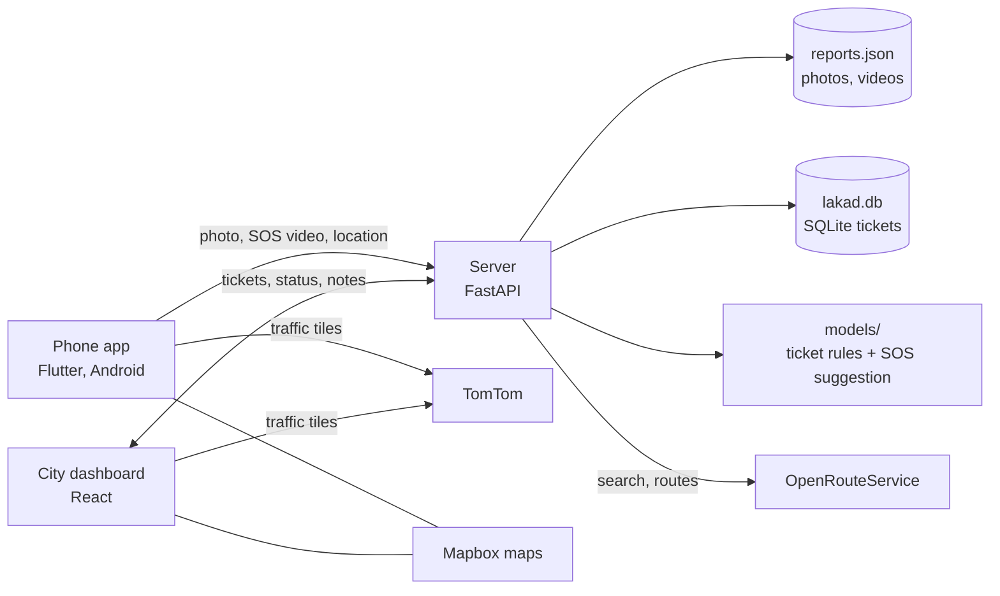
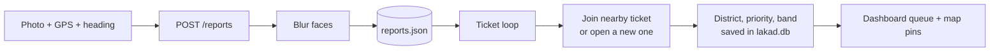
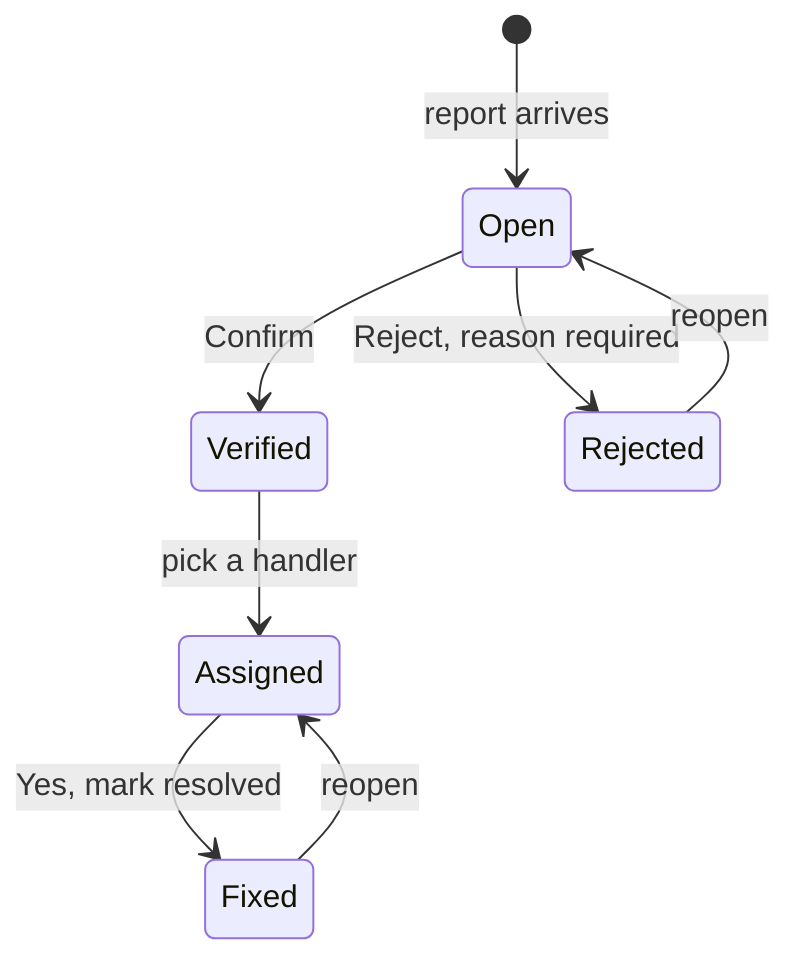
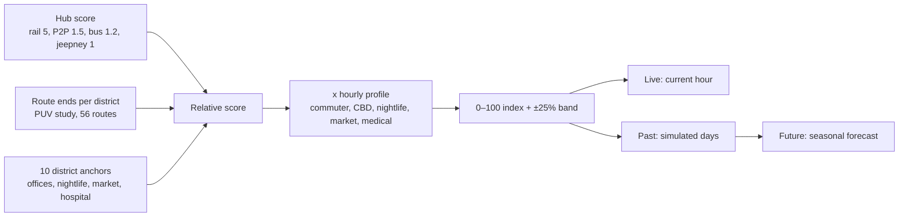
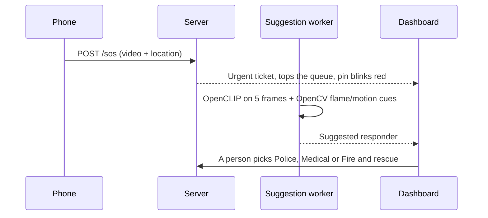

# Lakad

Walking navigation and crowd reporting for Makati. Commuters pick a destination, compare walking routes that steer around reported hazards, choose a commute and are tracked along the trip. They photograph problems in an AR camera view, or hold the camera button to send an SOS video. The city sees the reports as a ranked ticket queue, with traffic and foot-traffic layers beside it.

Smart Urban Living Hackathon · iACADEMY MPH · Oct 6–7, 2026 · Team **Lakad Kinetic Development**
Project documentation: [Google Doc](https://docs.google.com/document/d/1-KtQXQGzGgUjQvdE_HK4or0s5GL7DViF/) · Setup: [SETUP.md](SETUP.md)

## How it fits together

| Folder | What it holds |
|---|---|
| `mobile/` | Flutter app (Android only) |
| `dashboard/` | React + Vite + TypeScript dashboard on Mapbox GL |
| `server/` | FastAPI API, report store, face blur, ticket loop and SOS worker |
| `models/` | Ticketing rules (matching, priority, note classification) with an evaluation, and the SOS suggestion |

## The six core features

### 1. Traffic congestion layer (dashboard, and in the app)
Live TomTom Traffic Flow, drawn as vector tiles: one thin line per carriageway, coloured by how slow it is against free flow (green to red). On the dashboard the lines are cut at Makati's edge. Toggle it in the layer panel (dashboard) or the map menu (phone). It is a coloured road-line layer, not a blurred heatmap. Calls TomTom directly from the client with a free-tier key.

### 2. Snapshot reporting with geotag (phone)
Tap the camera button for an AR-style camera view: reticle, GPS accuracy, compass heading, and category chips. Hazards: pothole, open manhole, flooded drain, blocked sidewalk, broken streetlight. Accessibility barriers: missing ramp, blocked tactile paving, broken elevator, steep or broken sidewalk. The photo goes to the server with latitude, longitude, heading and an optional note, and only inside Makati. The server blurs faces in the photo before saving it.

### 3. Ticket handling (dashboard)
Each report is matched to others at the same place, so one hazard is one ticket with many sightings. The queue ranks by priority band (Critical, High, Medium, Low), SOS first, with a search box (by `LKD-xxxxxx` ID), status chips and a category filter. The detail view shows the photo (click to enlarge), the sightings and the history.

A note for the reporter goes with each decision. The reporter reads it, and the ticket's status, in **My tickets** on the phone, and gets a local notification when it changes. Every report of a ticket follows its status. Nothing is deleted.

### 4. Insights (dashboard)
One panel computed from the live ticket list: backlog by status, what is breaking (by category and severity), how long open tickets have waited, created vs fixed over 7 days, median fix time and oldest open ticket, handler workload, SOS by responder, and the top hotspots (about 220 m grid cells, with "Show on map"). Rejected tickets are not counted.

### 5. Foot-traffic heatmap and forecast (dashboard)
A heat layer over the transit hubs and ten district anchors, with a ring per district, and a Forecast panel: drag along the chart to see past and future for a zone, and the map follows. **This is predicted, not measured.** There are no cameras or sensors behind it. The API says so (`kind: "estimate"`, `history_source: "simulated"`).

The weights, anchors and profiles are our judgement (see `server/data/footfall/hotspots.json`). Don't quote values as people per hour.

### 6. SOS snapshot reporting (phone, then dashboard)
Hold the camera button: the app records a silent video (up to 30 s) while the screen turns red from the edges. Release to send it at once, with no form. Slide up to the X to cancel and delete it.

An SOS never joins another ticket and is never scored: priority 100, band Critical. It is hidden from the public `/reports` list so the app never shows where someone called for help. The model only *suggests* a response type; a person always chooses. **Nothing alerts anyone**: the city sees it only while the dashboard is open. This is not an emergency service.

## Also in the app

- **Routes.** Search a destination, then compare Fastest, Walkable (steers around unresolved hazards) and Accessible (OpenRouteService wheelchair profile, also avoids ramp, tactile-paving and elevator reports), with time, distance and hazard counts.
- **Commute.** Up to three walk-ride-walk options built from the PUV study (jeepney, city bus, MRT-3, LRT-1), quickest marked. Rides use assumed speeds and waits.
- **Trip.** A navigation bar with the next turn and time left, the map turns with the phone's heading, the screen stays on, and the walk is re-planned if the user strays. A compass chip and map menu (2D, 3D, traffic) sit on the map.
- **Barangays.** A dashboard menu for Makati's 23 barangays (OpenStreetMap outlines). Picking one zooms to it and narrows the tickets, pins and Insights. Everything outside Makati is dimmed.

## Limits

- **No accounts.** Anyone who can reach the API can file reports or triage. Put the dashboard behind a login before real use.
- **Not tested on a physical phone:** AR camera, SOS recording, compass, trip tracking, notifications. Notifications are local, not push, so nothing arrives once Android closes the app.
- **Estimates, not data:** commute ride times, foot traffic, and the SOS suggestion (not evaluated on real footage).
- **Stubs, not built:** "Still there?" verification, exports, barangay leaderboard, report heatmap, satellite toggle, hazard-photo CLIP tagging.
- **Evaluation data is synthetic** (AI-written notes and rater judgments, plus Chicago 311 for the matcher), and is labelled as such in [EVALUATION.md](models/tickets/EVALUATION.md).
- SOS clips are stored unencrypted in `db/videos/`. Word lists (English and Filipino) were not reviewed by a native speaker.

## Technology, AI and API disclosure

| Part | Used | Disclose as |
|---|---|---|
| Mobile | Flutter, mapbox_maps_flutter, camera, geolocator, sensors_plus, wakelock_plus, shared_preferences, flutter_local_notifications, http | Open source. Mapbox free tier |
| Dashboard | React, Vite, TypeScript, mapbox-gl | Open source. Mapbox free tier |
| Server | Python 3.11, FastAPI, Uvicorn, httpx, Pydantic; JSON report store and SQLite ticket database | Open source |
| Face blur, SOS suggestion | OpenCV (Haar-cascade face blur, flame and motion cues), OpenCLIP ViT-B-32 on PyTorch, Pillow, NumPy. Weights download on first use; no video leaves the server | Pretrained open model; a person decides |
| Traffic | TomTom Traffic flow tiles | Third-party API, free-tier key |
| Search and routing | OpenRouteService, called by our server | Third-party API, free-tier key |
| Map data | OpenStreetMap: MRT-3 and LRT-1 stations, 23 barangay outlines, 719 places used in ticket priority | Open data (ODbL). Credit OSM |
| Transit | "PUV Routes in Makati" (Ayala Land; SYSTRA Philippines, Makati BRT Study, 2025), Makati Data Hub | Organizer-provided, hackathon use only |
| Foot traffic, ticket rules | Hand-written Python rules and curves. No machine-learning model ships | Predicted, not measured |
| Evaluation | City of Chicago 311 requests; numpy, scipy, scikit-learn, matplotlib, pytest; AI-written notes and judgments | Open data, evaluation only |
| AI coding assistant | Claude (Anthropic), via Claude Code | Add every assistant anyone on the team uses |

## Validation

| Assumption | Quick test | Pass mark | Result |
|---|---|---|---|
| Commuters accept a slightly longer route to stay on a sidewalk | Show 5 people two routes | Most pick Walkable at about +150 m or less | |
| Transfers are a real pain, not only the last mile | Ask 5 for their worst Makati transfer; ask the mentor which hubs get complaints | Named hubs and quotable problems | |
| People will photograph problems if it leads to a fix | Ask if they would snap a photo if the city fixed it | Most say yes and name a spot | |
| The city would act on crowd reports | Ask the mentor what makes a report actionable | A list of required report fields | |

Never commit keys: `.env*` and `mobile/env.json` are git-ignored; copy the `*.example` files.

Map data © OpenStreetMap contributors. Maps by Mapbox. Traffic data © TomTom.
