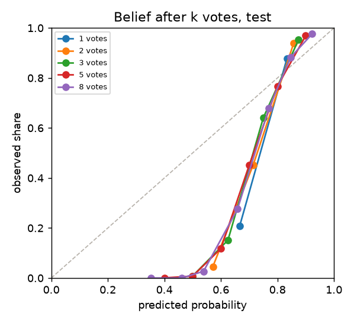
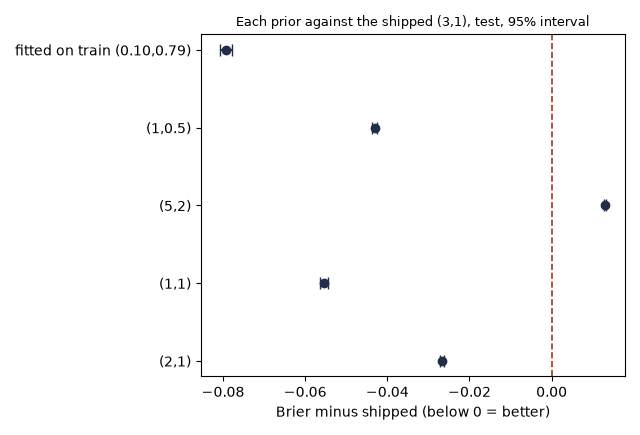
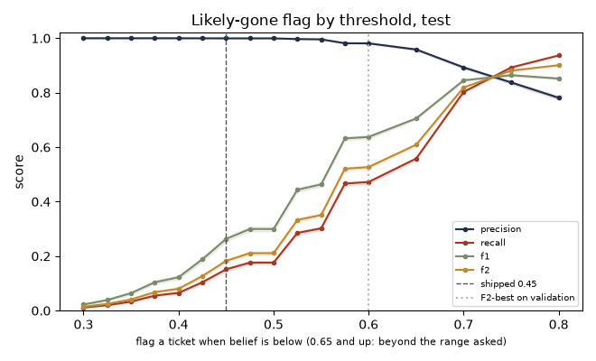
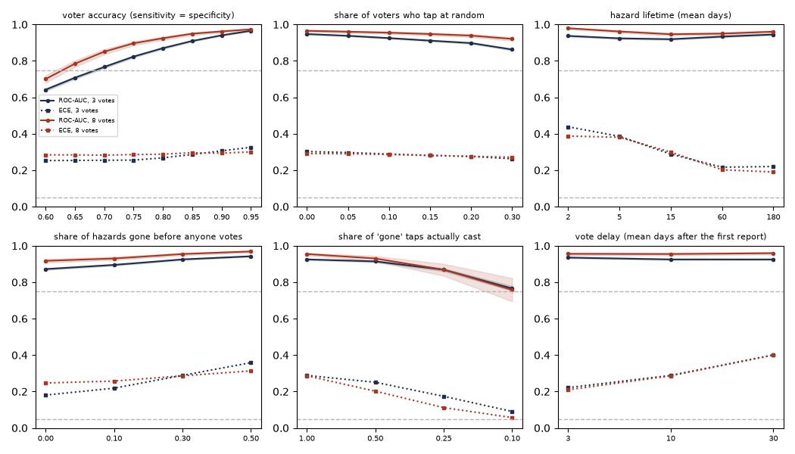
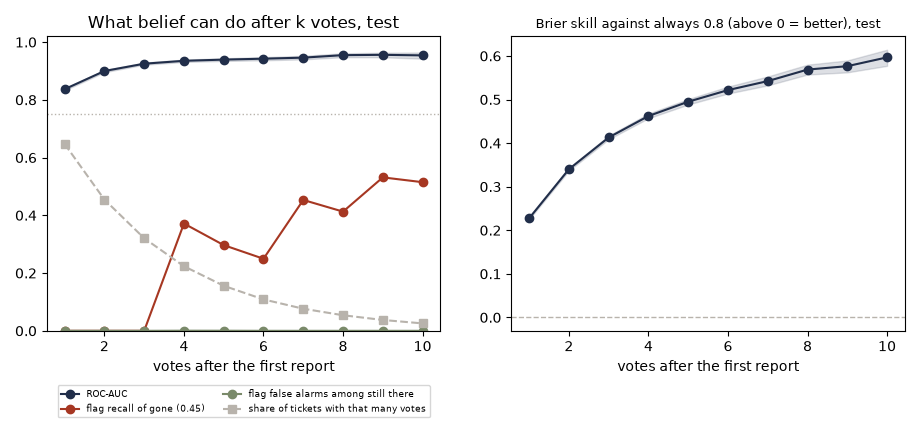

# Belief, evaluated with a vote simulator

**Status: results of the one test run (2026-10-06).** Every vote here is simulated, so the numbers say how belief behaves in the world set out under "What was simulated", not how it will behave in Makati. The targets are the ones written in `../../EVALUATION.md` before any result existed. Code: `simulator.py` and `evaluate.py`; tests: `tests/`; raw numbers and figures: `../results/lifecycle_*.json` and `lifecycle_*.png`.

Belief is `lifecycle.belief(yes, no)`: the mean of a Beta(3, 1) prior updated with every reporter and every "still there" tap as a yes and every "gone" tap as a no. It feeds the gate (`lifecycle.gate`, a multiplier on the priority score) and the "likely gone" flag (`lifecycle.likely_gone`, belief under 0.45).

## Bottom line

| Pre-registered target | Test result (95% interval) | Verdict |
|---|---|---|
| ECE at most 0.05 | 1 vote 0.247 [0.242, 0.251], 3 votes 0.288 [0.282, 0.294], 8 votes 0.286 [0.274, 0.299]. All five vote counts sit between 0.25 and 0.29 | **Missed** at every vote count, by roughly a factor of five |
| Brier below the always-0.8 baseline | belief minus baseline: 1 vote -0.071 [-0.072, -0.070], 3 votes -0.156 [-0.159, -0.153], 8 votes -0.251 [-0.260, -0.243] | Met at every vote count |
| ROC-AUC at least 0.75 once there are 3 votes | 3 votes 0.925 [0.922, 0.929], 5 votes 0.939 [0.935, 0.944], 8 votes 0.955 [0.948, 0.961] | Met, and met with 1 vote too (0.837 [0.833, 0.841]) |

- **Belief ranks tickets well but its number is not a probability.** After one fresh report and one "gone" tap it says 0.667, and 20.9% of such hazards are still there. After the reporter and three "gone" taps it says 0.500 and 0.8% are. Belief moves less than 1/(4 + n) per tap when n people have been counted, whatever the accuracy of the voters, so it never gets confident, while three agreeing voters are almost always right. A plain majority of the votes has a *lower* Brier than belief at 1, 2, 3 and 5 votes (belief minus majority 0.054 [0.053, 0.056] at 1 vote, 0.060 [0.057, 0.063] at 3), although belief ranks better from 2 votes on (ROC-AUC 0.040 [0.037, 0.042] higher at 3 votes).
- **Prior: yes, something beats the shipped (3, 1).** (1, 1) is the validation choice and on test it lowers the Brier by 0.055 (paired difference -0.0554 [-0.0564, -0.0545]). (1, 0.5) and (2, 1) also win, (5, 2) loses, and the shipped prior is not the best in any of the four simulated worlds tried. No candidate gets near the ECE target: the lowest of the five at 3 votes, (1, 1), still has 0.205 [0.199, 0.210]. Swapping the prior alone would also change every fresh ticket's gate, so it is not recommended on its own (section 7).
- **The flag is safe but slow.** At the shipped 0.45 it flags 3 of 49,079 still-there votes and catches only 0.151 [0.146, 0.157] of gone ones, and it cannot fire before the 4th vote. The F2-best threshold on validation within the range asked is 0.60: on test recall 0.472 [0.466, 0.479], precision 0.981 [0.979, 0.983], and 1.1% [1.0, 1.2] of still-there votes flagged by mistake.
- **The gate rarely hurts a real hazard.** At the shipped likely-gone line (a gate of 0.30) it demoted 3 of 49,079 still-there votes and 15.1% [14.6, 15.7] of gone ones. Cut to half or worse: 0.1% [0.1, 0.2] of still-there, 30.2% [29.5, 30.8] of gone.
- **Honest limitation.** With reporters only (the usual case), belief goes 0.80, 0.83, 0.86 ... 0.92 for 1 to 8 reporters and the gate stays at exactly 1.0, so it never changes a rank. In the simulation, where passers-by tap "gone" as readily as "still there", 35% of tickets get no vote at all, and on day 30 80.7% [80.3, 81.0] of hazards are gone but the flag has caught 6.5% [6.3, 6.8] of them. Belief carries ranking information from the first vote, the shipped flag only from the fourth, and no number of votes makes it a probability.
- **Recommended change to `settings.py`:** `LIKELY_GONE_BELOW` from 0.45 to 0.60. Keep `BELIEF_PRIOR` and the gate settings. Details and reasons in section 7.

## What was simulated

| Part | Assumption | Where it comes from |
|---|---|---|
| Hazards gone before anyone votes | 30% (the first report always happens while the hazard exists) | the evaluation brief ("say 30%") |
| Other hazards | 25% are fixed by staff at a random time, uniform from day 2 to day 45 after the first report; the rest fade by themselves after an exponential time with a mean of 5, 15 or 60 days (one third each) | the evaluation brief |
| After a hazard ends | the ticket stays open and passers-by keep voting (in the app, staff closing a fixed ticket would stop that) | assumption |
| Votes per ticket | 35% get no extra vote; the rest get 1 plus a geometric number (mean 3.3), cut at 16. Most tickets get few | the evaluation brief ("most tickets get few") |
| When votes come | each vote comes an exponential delay after the first report, mean 10 days; tickets with more votes get them sooner | assumption, swept (3, 10, 30 days) |
| Passers-by | tap "still there" with probability 0.85 when it is there (sensitivity) and "gone" with probability 0.90 when it is gone (specificity) | the evaluation brief |
| Noise | 10% of taps are at random, half "still there" and half "gone"; swept from 0 to 30% | the evaluation brief (5 to 15%) |
| People | every voter is a different person and sees the hazard (or its absence) on their own; nobody sees the current belief or the earlier votes | assumption |
| Reporters | the first report is always a real hazard and always a yes; matching never merges or splits wrongly; no false reports | the evaluation brief |
| Truth | the hazard is there until its end time and is gone from that moment on; it never comes back | assumption |

What this world looks like: the hazard is still there at 55% of first votes, falling to 33% of eighth votes. That base rate is a consequence of the assumptions above and it drives the calibration results, which is why they are swept. The mean vote delay (10 days) is the one free parameter that moves it most; it was fixed before any model score was computed.

## How the numbers were produced

- **Seeds.** Each split is five seeds of 10,000 tickets: train 1000 to 1004, validation 2000 to 2004, test 3000 to 3004. The same seed always gives the same data (tested). Train was used only to describe the simulator and to fit one reference prior (section 2). Validation chose the prior (lowest Brier of the five given) and the flag threshold (best F2 between 0.30 and 0.60). While building, the full pipeline was run on validation only; the test seeds were used once, at the end, and nothing was changed after seeing them. The sweeps use the test seeds too but tune nothing. Seeds, simulator configuration and settings are stored in every results file.
- **Votes.** "k votes" is k taps after the first report, which counts as one yes as it does in the engine (`yes = 1 + still-there taps`, `no = gone taps`). If the reporter is counted as the first vote, the "3 votes" row of the target is the 2-vote row below, and the verdicts do not change. At each vote, belief is computed from the counts so far and compared with whether the hazard is truly there at that moment.
- **Real functions.** Belief, the gate and the flag are always the functions in `ranking/lifecycle.py`. Other priors and flag thresholds are tried by overriding that one setting for the length of a call; `settings.py` was not edited.
- **Metrics.** All from `eval/common/metrics.py`: Brier, ECE with 10 bins, ROC-AUC, PR-AUC, precision, recall, F1, F2, precision at a recall. Baselines: always 0.8 (the fresh-report value) and the simple majority of the votes, forecast as 1 if more yes than no, 0 if fewer, 0.5 on a tie.
- **Intervals.** 95% percentile bootstrap, 1,000 resamples, resampling whole tickets (the votes of one ticket are not independent), paired where two models are compared. A rate with no events has a degenerate interval, so the counts are shown beside it. A target counts as **met only when the whole interval is on the passing side**. Shares that describe the simulated data rather than a score (tickets that get k votes, share of votes cast while the hazard was there in the sweeps) are plain counts with no interval.

## 1. Belief against the three pre-registered targets

| Votes | Tickets | Still there | ECE (target at most 0.05) | Brier, belief | Brier, always 0.8 | Belief minus always 0.8 | ROC-AUC (target at least 0.75 from 3 votes) | PR-AUC | Verdict |
|---|---|---|---|---|---|---|---|---|---|
| 1 | 32,361 | 55% [54, 55] | 0.247 [0.242, 0.251] | 0.240 [0.238, 0.243] | 0.311 [0.307, 0.314] | -0.071 [-0.072, -0.070] | 0.837 [0.833, 0.841] | 0.815 [0.810, 0.820] | ECE **missed**, Brier met, AUC n/a |
| 2 | 22,732 | 48% [47, 49] | 0.290 [0.285, 0.295] | 0.232 [0.230, 0.235] | 0.352 [0.348, 0.356] | -0.120 [-0.122, -0.118] | 0.900 [0.896, 0.903] | 0.850 [0.844, 0.856] | ECE **missed**, Brier met, AUC n/a |
| 3 | 16,034 | 44% [43, 44] | 0.288 [0.282, 0.294] | 0.222 [0.219, 0.225] | 0.378 [0.374, 0.383] | -0.156 [-0.159, -0.153] | 0.925 [0.922, 0.929] | 0.865 [0.858, 0.872] | ECE **missed**, Brier met, AUC met |
| 5 | 7,798 | 38% [37, 39] | 0.284 [0.276, 0.292] | 0.208 [0.204, 0.212] | 0.412 [0.406, 0.419] | -0.204 [-0.209, -0.200] | 0.939 [0.935, 0.944] | 0.863 [0.853, 0.874] | ECE **missed**, Brier met, AUC met |
| 8 | 2,697 | 33% [31, 35] | 0.286 [0.274, 0.299] | 0.191 [0.184, 0.197] | 0.442 [0.431, 0.453] | -0.251 [-0.260, -0.243] | 0.955 [0.948, 0.961] | 0.873 [0.853, 0.892] | ECE **missed**, Brier met, AUC met |

Verdict per target: **ECE missed, Brier met, ROC-AUC met.**



What belief says against what is true, after 1 and 3 votes:

| Votes | Belief says | Share truly still there | Tickets |
|---|---|---|---|
| 1 | 0.667 | 0.209 | 15,890 |
| 1 | 0.833 | 0.877 | 16,471 |
| 3 | 0.500 | 0.008 | 4,270 |
| 3 | 0.625 | 0.152 | 3,735 |
| 3 | 0.750 | 0.641 | 4,009 |
| 3 | 0.875 | 0.954 | 4,020 |

**Why ECE misses.** Belief is the Beta mean of the share of people who say yes. Each tap moves it by less than 1/(4 + n) when n people have been counted, whatever the voters' accuracy, so after three "gone" taps it still says 0.5. A hazard is either there or not, so the truth after three agreeing taps is close to 0%. The better the voters, the bigger the gap: ECE at 3 votes rises from 0.253 [0.246, 0.261] at voter accuracy 0.60 to 0.326 [0.321, 0.331] at 0.95 (section 5).

**Why ROC-AUC passes, and what that means.** At a fixed number of votes belief is an increasing function of the number of "gone" taps, so **every prior gives the same ROC-AUC**: the target tests the voters, not the model. At one vote it equals 0.5 + 0.5 (1 - noise)(sensitivity + specificity - 1) = 0.8375, and the measured value is 0.837 [0.833, 0.841]. The same formula gives 0.875 without noise (measured 0.875 [0.871, 0.878]), 0.7625 with 30% noise (0.764 [0.759, 0.768]), 0.590 at voter accuracy 0.60 (0.591 [0.586, 0.596]) and 0.905 at 0.95 (0.906 [0.902, 0.908]). So the simulator does what its configuration says.

### Baselines

| Votes | Majority: Brier | Majority: ECE | Majority: ROC-AUC | Majority: PR-AUC | Always 0.8: PR-AUC (= share still there; its ROC-AUC is 0.50) | Brier, belief minus majority (above 0 = belief worse) | ROC-AUC, belief minus majority |
|---|---|---|---|---|---|---|---|
| 1 | 0.186 [0.183, 0.188] | 0.206 [0.202, 0.210] | 0.837 [0.833, 0.841] | 0.815 [0.810, 0.820] | 0.549 [0.543, 0.554] | 0.054 [0.053, 0.056] | 0.000 [0.000, 0.000] |
| 2 | 0.214 [0.209, 0.220] | 0.214 [0.209, 0.220] | 0.793 [0.788, 0.797] | 0.693 [0.685, 0.700] | 0.480 [0.473, 0.486] | 0.018 [0.014, 0.022] | 0.107 [0.104, 0.111] |
| 3 | 0.162 [0.157, 0.166] | 0.185 [0.179, 0.190] | 0.885 [0.881, 0.890] | 0.779 [0.770, 0.788] | 0.437 [0.429, 0.444] | 0.060 [0.057, 0.063] | 0.040 [0.037, 0.042] |
| 5 | 0.168 [0.161, 0.175] | 0.186 [0.178, 0.193] | 0.882 [0.876, 0.888] | 0.724 [0.711, 0.738] | 0.379 [0.369, 0.390] | 0.040 [0.035, 0.045] | 0.058 [0.054, 0.061] |
| 8 | 0.192 [0.178, 0.207] | 0.192 [0.178, 0.207] | 0.855 [0.844, 0.865] | 0.631 [0.606, 0.657] | 0.330 [0.312, 0.348] | -0.002 [-0.012, 0.008] | 0.100 [0.091, 0.110] |

- **Always 0.8** never ranks anything (ROC-AUC 0.50) and is beaten by belief on Brier at every vote count. The two forecasts are identical for a ticket with no vote (the belief of one report is exactly 0.8), so belief can only be better after the first tap.
- **Simple majority** has the same ROC-AUC as belief at 1 vote (the same ranking) and a lower one from 2 votes on (it cannot tell 3 yes from 2 yes, belief can). On Brier the majority is better than belief at 1, 2, 3 and 5 votes (intervals above 0 in the column "belief minus majority") and not different at 8 votes. Read together: belief earns its place over a plain majority as a ranking score, not as a probability.

### Checks that the good ROC-AUC is not a leak

1. **Hand maths.** A unit test builds a world in which no hazard ever ends and checks the Brier and ECE of belief at one vote against the values worked out by hand (belief 5/6 or 4/6, with probability 0.85 or 0.15). Perfect voters give ROC-AUC exactly 1 and coin-flip voters 0.50. The one-vote ROC-AUC matches the formula above in five simulator settings.
2. **A label that shares no moment with the last tap.** The rows below ask whether belief after k votes predicts the hazard at the moment of the *next* vote, which is closer to how belief is used (read some time after the last vote). It is lower, as it should be, and still above 0.75 from 1 vote:

| Votes | Tickets | Still there at the next vote | ECE | Brier, belief minus always 0.8 | ROC-AUC |
|---|---|---|---|---|---|
| 1 | 22,732 | 48% [47, 49] | 0.277 [0.271, 0.283] | -0.064 [-0.065, -0.063] | 0.769 [0.763, 0.774] |
| 2 | 16,034 | 44% [43, 44] | 0.284 [0.277, 0.291] | -0.110 [-0.113, -0.108] | 0.842 [0.836, 0.847] |
| 3 | 11,184 | 40% [40, 41] | 0.289 [0.281, 0.296] | -0.146 [-0.149, -0.143] | 0.876 [0.870, 0.882] |
| 5 | 5,439 | 36% [34, 37] | 0.295 [0.285, 0.305] | -0.193 [-0.199, -0.188] | 0.899 [0.891, 0.906] |
| 8 | 1,879 | 32% [30, 34] | 0.288 [0.272, 0.304] | -0.236 [-0.246, -0.226] | 0.926 [0.914, 0.937] |

3. **Seed to seed.** The five test seeds at 3 votes:

| Test seed | Tickets with 3 votes | Brier | ECE | ROC-AUC |
|---|---|---|---|---|
| 3000 | 3,238 | 0.2208 | 0.2857 | 0.9253 |
| 3001 | 3,123 | 0.2228 | 0.2934 | 0.9288 |
| 3002 | 3,230 | 0.2220 | 0.2917 | 0.9250 |
| 3003 | 3,243 | 0.2273 | 0.2904 | 0.9188 |
| 3004 | 3,200 | 0.2162 | 0.2811 | 0.9281 |

   The spread across seeds (standard deviation: Brier 0.0040, ECE 0.0050, ROC-AUC 0.0040) is the size the bootstrap intervals imply for one seed (0.0033, 0.0068, 0.0041), so the intervals are neither too narrow nor too wide.
4. **Splits.** The train, validation and test seeds share no number (tested).

## 2. Prior comparison

Choose on validation by Brier, report on test, with the paired-bootstrap interval of the difference to the shipped prior:

| Prior (yes, no) | a, b | Brier on validation | Brier on test | Test: minus the shipped prior | Reading | ECE at 3 votes, test |
|---|---|---|---|---|---|---|
| (3,1) shipped | 3.00, 1.00 | 0.2232 | 0.2232 [0.2214, 0.2250] |  |  | 0.288 [0.282, 0.294] |
| (2,1) | 2.00, 1.00 | 0.1966 | 0.1965 [0.1950, 0.1980] | -0.0267 [-0.0272, -0.0263] | better, interval below 0 | 0.252 [0.247, 0.258] |
| (1,1) | 1.00, 1.00 | 0.1680 | 0.1678 [0.1665, 0.1690] | -0.0554 [-0.0564, -0.0545] | better, interval below 0 | 0.205 [0.199, 0.210] |
| (5,2) | 5.00, 2.00 | 0.2361 | 0.2361 [0.2343, 0.2379] | 0.0129 [0.0127, 0.0132] | worse, interval above 0 | 0.312 [0.306, 0.318] |
| (1,0.5) | 1.00, 0.50 | 0.1801 | 0.1801 [0.1785, 0.1816] | -0.0431 [-0.0438, -0.0425] | better, interval below 0 | 0.219 [0.214, 0.225] |
| fitted on train (0.10,0.79) | 0.10, 0.79 | 0.1442 | 0.1440 [0.1428, 0.1451] | -0.0792 [-0.0807, -0.0778] | better, interval below 0 | 0.153 [0.149, 0.159] |



- **Chosen on validation: (1,1).** The Brier is pooled over every vote of every ticket and resampled by ticket.
- **Does any prior beat the shipped one with the interval clear of zero? Yes.** (1, 1), (1, 0.5) and (2, 1) do, by 0.055, 0.043 and 0.027 of Brier. (5, 2) is worse. The same order holds at each of the five vote counts: (1, 1) is better by 0.044 to 0.062 with every interval below 0, and (5, 2) is worse by 0.004 to 0.020.
- **Fitted on train (reference only, not a candidate).** The Brier-optimal Beta prior runs to the edge of the range allowed (a = 0.1, b = 0.79): the data want almost no prior weight, belief close to the raw share of yes. Even that fit has an ECE of 0.153 [0.149, 0.159] at 3 votes, so the prior is not what stops belief from meeting the ECE target; the shape is (a mean of vote shares).
- **It is not a base-rate artefact.** The share of hazards gone before anyone votes is the main thing a prior has to guess. Over four values of it, the shipped (3, 1) is never the best:

| Hazards gone before anyone votes | Votes cast while still there | (2,1) minus shipped | (1,1) minus shipped | (5,2) minus shipped | (1,0.5) minus shipped | Best by point |
|---|---|---|---|---|---|---|
| 0% | 65% | -0.010 [-0.011, -0.010] | -0.018 [-0.019, -0.017] | 0.010 [0.010, 0.010] | -0.021 [-0.021, -0.020] | (1,0.5) |
| 10% | 58% | -0.016 [-0.016, -0.015] | -0.030 [-0.031, -0.029] | 0.011 [0.011, 0.011] | -0.028 [-0.029, -0.028] | (1,1) |
| 30% | 45% | -0.027 [-0.027, -0.026] | -0.055 [-0.056, -0.054] | 0.013 [0.013, 0.013] | -0.043 [-0.044, -0.043] | (1,1) |
| 50% | 33% | -0.037 [-0.038, -0.037] | -0.079 [-0.080, -0.078] | 0.014 [0.014, 0.015] | -0.057 [-0.058, -0.057] | (1,1) |

- **Why this does not decide the setting.** A prior also sets what a fresh ticket's belief and gate are. Under (1, 1) a fresh single report has belief 0.667 and, with the gate as shipped, a gate of 0.733: every new ticket would lose 27% of its score before anyone voted, and one wrong "gone" tap (belief 0.5, gate 0.4) would cut it by 60% instead of 27%. 18.7% [18.1, 19.3] of still-there first votes are such a wrong tap. The prior and the gate have to be re-derived together.

## 3. The "likely gone" flag

The flag as a classifier of hazards that are truly gone (positive = gone, flagged = belief below the threshold). Every vote of every ticket is a row, resampled by ticket. Shipped line and the F2-best on validation within 0.30 to 0.60 in bold.

| Flag when belief is below | Precision | Recall of gone | F1 | F2 | Still-there votes flagged by mistake | F2 on validation |
|---|---|---|---|---|---|---|
| 0.300 | 1.000 [1.000, 1.000] | 0.011 [0.010, 0.013] | 0.022 [0.019, 0.026] | 0.014 [0.012, 0.016] | 0.0% [0.0, 0.0] (0 of 49,079) | 0.012 |
| 0.325 | 1.000 [1.000, 1.000] | 0.020 [0.018, 0.022] | 0.039 [0.035, 0.043] | 0.025 [0.022, 0.027] | 0.0% [0.0, 0.0] (0 of 49,079) | 0.022 |
| 0.350 | 1.000 [1.000, 1.000] | 0.033 [0.030, 0.036] | 0.064 [0.059, 0.069] | 0.041 [0.038, 0.045] | 0.0% [0.0, 0.0] (0 of 49,079) | 0.037 |
| 0.375 | 1.000 [1.000, 1.000] | 0.055 [0.051, 0.059] | 0.104 [0.098, 0.111] | 0.068 [0.063, 0.072] | 0.0% [0.0, 0.0] (0 of 49,079) | 0.062 |
| 0.400 | 1.000 [1.000, 1.000] | 0.065 [0.061, 0.069] | 0.122 [0.115, 0.130] | 0.080 [0.075, 0.085] | 0.0% [0.0, 0.0] (0 of 49,079) | 0.074 |
| 0.425 | 1.000 [1.000, 1.000] | 0.104 [0.099, 0.109] | 0.188 [0.180, 0.196] | 0.127 [0.120, 0.133] | 0.0% [0.0, 0.0] (1 of 49,079) | 0.120 |
| **0.450** | 1.000 [0.999, 1.000] | 0.151 [0.146, 0.157] | 0.263 [0.254, 0.271] | 0.182 [0.176, 0.189] | 0.0% [0.0, 0.0] (3 of 49,079) | 0.176 |
| 0.475 | 1.000 [0.999, 1.000] | 0.176 [0.170, 0.182] | 0.299 [0.291, 0.308] | 0.211 [0.204, 0.217] | 0.0% [0.0, 0.0] (4 of 49,079) | 0.205 |
| 0.500 | 1.000 [0.999, 1.000] | 0.176 [0.170, 0.182] | 0.300 [0.291, 0.308] | 0.211 [0.204, 0.217] | 0.0% [0.0, 0.0] (4 of 49,079) | 0.205 |
| 0.525 | 0.997 [0.996, 0.998] | 0.285 [0.279, 0.292] | 0.444 [0.436, 0.451] | 0.333 [0.326, 0.340] | 0.1% [0.1, 0.1] (50 of 49,079) | 0.327 |
| 0.550 | 0.996 [0.995, 0.997] | 0.302 [0.295, 0.308] | 0.463 [0.455, 0.471] | 0.351 [0.344, 0.358] | 0.1% [0.1, 0.2] (72 of 49,079) | 0.346 |
| 0.575 | 0.982 [0.980, 0.984] | 0.466 [0.460, 0.472] | 0.632 [0.626, 0.638] | 0.521 [0.514, 0.527] | 1.0% [0.9, 1.1] (510 of 49,079) | 0.518 |
| **0.600** | 0.981 [0.979, 0.983] | 0.472 [0.466, 0.479] | 0.638 [0.631, 0.643] | 0.527 [0.520, 0.533] | 1.1% [1.0, 1.2] (530 of 49,079) | 0.525 |
| 0.650 (beyond the range asked) | 0.959 [0.955, 0.962] | 0.558 [0.552, 0.564] | 0.705 [0.701, 0.710] | 0.609 [0.604, 0.614] | 2.9% [2.6, 3.1] (1,415 of 49,079) | 0.607 |
| 0.700 (beyond the range asked) | 0.893 [0.889, 0.897] | 0.803 [0.799, 0.807] | 0.846 [0.842, 0.849] | 0.819 [0.816, 0.823] | 11.6% [11.1, 12.0] (5,670 of 49,079) | 0.819 |
| 0.750 (beyond the range asked) | 0.838 [0.833, 0.843] | 0.893 [0.890, 0.896] | 0.864 [0.861, 0.868] | 0.881 [0.878, 0.884] | 20.7% [20.1, 21.3] (10,183 of 49,079) | 0.881 |
| 0.800 (beyond the range asked) | 0.781 [0.776, 0.787] | 0.937 [0.935, 0.939] | 0.852 [0.848, 0.856] | 0.901 [0.899, 0.904] | 31.4% [30.7, 32.2] (15,427 of 49,079) | 0.902 |
| flag every vote | 0.545 [0.539, 0.551] | 1.000 [1.000, 1.000] | 0.706 [0.701, 0.711] | 0.857 [0.854, 0.860] | 100% |  |



- **F2-best on validation: 0.60**, the edge of the range asked (the validation F2 plateau is [0.6]). Against the shipped 0.45 it gains 0.344 [0.341, 0.348] of F2 on test.
- **Precision at recall 0.8: 0.894 [0.883, 0.899].** It needs the flag to fire when belief is at most 0.688, which is about as soon as "gone" taps match the yes taps (one reporter and one "gone" tap is enough). It then marks 11.6% [11.1, 12.0] of still-there votes (row 0.70).
- **F2 flatters flagging everything here.** 55% of simulated votes are on gone hazards, so flagging every vote already scores an F2 of 0.857 [0.854, 0.860]. The F2 curve keeps rising past 0.60 to 0.901 [0.899, 0.904] at 0.80, where 31.4% [30.7, 32.2] of still-there votes are flagged. Use the false-alarm column, not F2, to decide how far to go.
- **The shipped flag needs four unanimous "gone" taps** (belief 0.444 with the reporter alone as the one yes), six against two yes, seven against three. At 0.60 it needs two against one, three against two, four against three.

By vote count (tickets with exactly that many votes):

| Votes | Flag when belief is below | Precision | Recall of gone | F2 | Still-there tickets flagged by mistake |
|---|---|---|---|---|---|
| 1 | 0.45 (shipped) | 0.000 [0.000, 0.000] | 0.000 [0.000, 0.000] | 0.000 [0.000, 0.000] | 0.0% [0.0, 0.0] (0 of 17,762) |
| 1 | 0.60 (F2-best on validation) | 0.000 [0.000, 0.000] | 0.000 [0.000, 0.000] | 0.000 [0.000, 0.000] | 0.0% [0.0, 0.0] (0 of 17,762) |
| 2 | 0.45 (shipped) | 0.000 [0.000, 0.000] | 0.000 [0.000, 0.000] | 0.000 [0.000, 0.000] | 0.0% [0.0, 0.0] (0 of 10,901) |
| 2 | 0.60 (F2-best on validation) | 0.954 [0.950, 0.959] | 0.618 [0.609, 0.626] | 0.665 [0.656, 0.672] | 3.2% [2.9, 3.6] (349 of 10,901) |
| 3 | 0.45 (shipped) | 0.000 [0.000, 0.000] | 0.000 [0.000, 0.000] | 0.000 [0.000, 0.000] | 0.0% [0.0, 0.0] (0 of 7,004) |
| 3 | 0.60 (F2-best on validation) | 0.992 [0.989, 0.995] | 0.469 [0.458, 0.480] | 0.524 [0.514, 0.535] | 0.5% [0.3, 0.7] (34 of 7,004) |
| 5 | 0.45 (shipped) | 0.999 [0.998, 1.000] | 0.297 [0.285, 0.310] | 0.345 [0.332, 0.359] | 0.0% [0.0, 0.1] (1 of 2,957) |
| 5 | 0.60 (F2-best on validation) | 0.996 [0.993, 0.998] | 0.597 [0.583, 0.610] | 0.649 [0.636, 0.661] | 0.4% [0.2, 0.7] (12 of 2,957) |
| 8 | 0.45 (shipped) | 1.000 [1.000, 1.000] | 0.413 [0.391, 0.435] | 0.468 [0.445, 0.491] | 0.0% [0.0, 0.0] (0 of 890) |
| 8 | 0.60 (F2-best on validation) | 0.995 [0.992, 0.998] | 0.716 [0.696, 0.737] | 0.759 [0.740, 0.777] | 0.7% [0.2, 1.2] (6 of 890) |

## 4. The gate: false demotions

A demotion is judged three ways, because the gate is a smooth multiplier and "dropped" needs a line. At the shipped threshold (belief under 0.45, where the gate is 0.30) the two rates asked for are in the first row. Harmful = the hazard is truly still there; wanted = it is truly gone. Every vote of every ticket is a row, resampled by ticket.

| What counts as a demotion | Truly still there (harmful) | Truly gone (wanted) |
|---|---|---|
| flag: belief under the likely-gone line | 0.0% [0.0, 0.0] (3 of 49,079) | 15.1% [14.6, 15.7] (8,916 of 58,861) |
| gate at most 0.5: score halved or worse | 0.1% [0.1, 0.2] (72 of 49,079) | 30.2% [29.5, 30.8] (17,769 of 58,861) |
| gate below 1: any cut | 31.4% [30.7, 32.2] (15,427 of 49,079) | 93.7% [93.5, 93.9] (55,143 of 58,861) |
| mean score cut (1 - gate) | 0.058 [0.057, 0.060] | 0.397 [0.393, 0.400] |

- **At the shipped line the gate almost never hurts a real hazard** (3 of 49,079) and demotes 15.1% [14.6, 15.7] of gone ones.
- **Cutting the score in half or worse** hits 0.1% [0.1, 0.2] of still-there votes (first possible at 3 votes: three "gone" taps against the reporter) and 30.2% [29.5, 30.8] of gone ones.
- **Any cut at all** hits 31.4% [30.7, 32.2] of still-there votes, mostly the first wrong "gone" tap (belief 0.667, gate 0.733, a 27% cut), against 93.7% [93.5, 93.9] of gone ones. On average a real hazard loses 5.8% of its score and a gone one 39.7%.
- **What that means in the ranking.** For a lone open manhole on a busy street, three days old (computed with `ranking/priority.py`), the score is 67.0 (High) with no tap, 49.1 (Medium) after one "gone" tap and 36.4 (Low) after two. The floors (62 for a manhole) are multiplied by the gate too, so they do not protect it.

By vote count:

| Votes | What counts as a demotion | Truly still there (harmful) | Truly gone (wanted) |
|---|---|---|---|
| 1 | flag: belief under the likely-gone line | 0.0% [0.0, 0.0] (0 of 17,762) | 0.0% [0.0, 0.0] (0 of 14,599) |
| 1 | gate at most 0.5: score halved or worse | 0.0% [0.0, 0.0] (0 of 17,762) | 0.0% [0.0, 0.0] (0 of 14,599) |
| 1 | gate below 1: any cut | 18.7% [18.1, 19.3] (3,323 of 17,762) | 86.1% [85.5, 86.6] (12,567 of 14,599) |
| 2 | flag: belief under the likely-gone line | 0.0% [0.0, 0.0] (0 of 10,901) | 0.0% [0.0, 0.0] (0 of 11,831) |
| 2 | gate at most 0.5: score halved or worse | 0.0% [0.0, 0.0] (0 of 10,901) | 0.0% [0.0, 0.0] (0 of 11,831) |
| 2 | gate below 1: any cut | 33.8% [32.9, 34.7] (3,688 of 10,901) | 96.0% [95.6, 96.3] (11,354 of 11,831) |
| 3 | flag: belief under the likely-gone line | 0.0% [0.0, 0.0] (0 of 7,004) | 0.0% [0.0, 0.0] (0 of 9,030) |
| 3 | gate at most 0.5: score halved or worse | 0.5% [0.3, 0.7] (34 of 7,004) | 46.9% [45.8, 48.0] (4,236 of 9,030) |
| 3 | gate below 1: any cut | 45.2% [44.1, 46.4] (3,169 of 7,004) | 98.0% [97.6, 98.2] (8,845 of 9,030) |
| 5 | flag: belief under the likely-gone line | 0.0% [0.0, 0.1] (1 of 2,957) | 29.7% [28.5, 31.0] (1,437 of 4,841) |
| 5 | gate at most 0.5: score halved or worse | 0.4% [0.2, 0.7] (12 of 2,957) | 59.7% [58.3, 61.0] (2,889 of 4,841) |
| 5 | gate below 1: any cut | 22.5% [21.0, 24.2] (666 of 2,957) | 91.9% [91.1, 92.6] (4,449 of 4,841) |
| 8 | flag: belief under the likely-gone line | 0.0% [0.0, 0.0] (0 of 890) | 41.3% [39.1, 43.5] (746 of 1,807) |
| 8 | gate at most 0.5: score halved or worse | 0.7% [0.2, 1.2] (6 of 890) | 71.6% [69.6, 73.7] (1,294 of 1,807) |
| 8 | gate below 1: any cut | 43.1% [39.8, 46.1] (384 of 890) | 97.5% [96.8, 98.2] (1,762 of 1,807) |

## 5. Sensitivity sweeps: where the targets fail

Test seeds, one run per setting, the same hazards and vote times in every setting (only the swept thing changes); everything else at the default. "Still there at 3 votes" is the share of third votes cast while the hazard was there. The last column lists the targets missed at 3 and at 8 votes.

**Where each target fails**

- **ECE (at most 0.05) fails everywhere.** The lowest value anywhere is 0.057 [0.035, 0.080], at 8 votes when only 10% of "gone" taps are cast, and there belief looks calibrated only because it hardly moves (79% of hazards are still there, close to the 0.8 it starts from). A forecast that never moves can pass ECE, so read ECE next to ROC-AUC. ECE gets worse as voters get better, as hazards fade sooner, as more are gone early and as votes come later.
- **Brier below the always-0.8 baseline never fails.** The smallest margin is -0.019 [-0.021, -0.016], at 5 votes with 10% of "gone" taps.
- **ROC-AUC (at least 0.75 from 3 votes) fails in two places.** (a) Voter accuracy: at 3 votes it fails at 0.60 (0.642 [0.634, 0.650]) and 0.65 (0.708 [0.700, 0.715]) and passes from 0.70 (0.767 [0.760, 0.774]); at 8 votes it fails at 0.60 (0.701 [0.680, 0.721]) and passes from 0.65 (0.785 [0.768, 0.803]). (b) Rare "gone" taps: with 10% of them cast it only just passes at 3 votes (0.766 [0.753, 0.779]) and its interval reaches below 0.75 at 5 votes (0.764 [0.739, 0.789]) and at 8 votes (0.758 [0.695, 0.822]). Noise up to 30% (0.863 [0.857, 0.868] at 3 votes), hazard lifetime and vote delay do not break it.



Voter accuracy (sensitivity = specificity; noise stays at 10%):

| Value | Still there at 3 votes | ROC-AUC, 3 votes | ROC-AUC, 8 votes | ECE, 3 votes | ECE, 8 votes | Brier, belief minus always 0.8, 3 votes | Targets missed at 3 and 8 votes |
|---|---|---|---|---|---|---|---|
| 0.60 | 44% | 0.642 [0.634, 0.650] | 0.701 [0.680, 0.721] | 0.253 [0.246, 0.261] | 0.284 [0.267, 0.302] | -0.084 [-0.087, -0.081] | 3: ECE, AUC; 8: ECE, AUC |
| 0.65 | 44% | 0.708 [0.700, 0.715] | 0.785 [0.768, 0.803] | 0.254 [0.247, 0.261] | 0.284 [0.268, 0.300] | -0.097 [-0.100, -0.094] | 3: ECE, AUC; 8: ECE |
| 0.70 | 44% | 0.767 [0.760, 0.774] | 0.851 [0.836, 0.864] | 0.255 [0.248, 0.262] | 0.283 [0.268, 0.299] | -0.109 [-0.112, -0.106] | 3: ECE; 8: ECE |
| 0.75 | 44% | 0.824 [0.818, 0.829] | 0.897 [0.885, 0.908] | 0.255 [0.249, 0.263] | 0.285 [0.273, 0.302] | -0.122 [-0.125, -0.119] | 3: ECE; 8: ECE |
| 0.80 | 44% | 0.870 [0.865, 0.875] | 0.924 [0.915, 0.934] | 0.268 [0.261, 0.275] | 0.288 [0.277, 0.303] | -0.134 [-0.137, -0.131] | 3: ECE; 8: ECE |
| 0.85 | 44% | 0.910 [0.905, 0.914] | 0.949 [0.942, 0.956] | 0.286 [0.280, 0.292] | 0.296 [0.283, 0.309] | -0.146 [-0.149, -0.143] | 3: ECE; 8: ECE |
| 0.90 | 44% | 0.940 [0.937, 0.944] | 0.962 [0.955, 0.968] | 0.306 [0.301, 0.312] | 0.294 [0.284, 0.308] | -0.157 [-0.160, -0.155] | 3: ECE; 8: ECE |
| 0.95 | 44% | 0.965 [0.963, 0.967] | 0.973 [0.968, 0.978] | 0.326 [0.321, 0.331] | 0.300 [0.289, 0.312] | -0.168 [-0.171, -0.166] | 3: ECE; 8: ECE |

Share of voters who tap at random:

| Value | Still there at 3 votes | ROC-AUC, 3 votes | ROC-AUC, 8 votes | ECE, 3 votes | ECE, 8 votes | Brier, belief minus always 0.8, 3 votes | Targets missed at 3 and 8 votes |
|---|---|---|---|---|---|---|---|
| 0.00 | 44% | 0.947 [0.945, 0.950] | 0.965 [0.959, 0.971] | 0.302 [0.297, 0.308] | 0.291 [0.279, 0.303] | -0.165 [-0.168, -0.163] | 3: ECE; 8: ECE |
| 0.05 | 44% | 0.938 [0.935, 0.941] | 0.960 [0.954, 0.966] | 0.297 [0.291, 0.303] | 0.290 [0.278, 0.302] | -0.161 [-0.164, -0.158] | 3: ECE; 8: ECE |
| 0.10 | 44% | 0.925 [0.922, 0.929] | 0.955 [0.948, 0.961] | 0.288 [0.282, 0.294] | 0.286 [0.274, 0.299] | -0.156 [-0.159, -0.153] | 3: ECE; 8: ECE |
| 0.15 | 44% | 0.911 [0.908, 0.915] | 0.948 [0.940, 0.955] | 0.282 [0.276, 0.288] | 0.281 [0.269, 0.295] | -0.151 [-0.154, -0.148] | 3: ECE; 8: ECE |
| 0.20 | 44% | 0.898 [0.893, 0.902] | 0.939 [0.931, 0.947] | 0.275 [0.269, 0.282] | 0.276 [0.265, 0.291] | -0.147 [-0.149, -0.144] | 3: ECE; 8: ECE |
| 0.30 | 44% | 0.863 [0.857, 0.868] | 0.921 [0.911, 0.930] | 0.263 [0.256, 0.269] | 0.271 [0.260, 0.287] | -0.136 [-0.139, -0.133] | 3: ECE; 8: ECE |

Hazard lifetime (every fading hazard gets this mean, in days; staff fixes and the 30% gone early stay):

| Value | Still there at 3 votes | ROC-AUC, 3 votes | ROC-AUC, 8 votes | ECE, 3 votes | ECE, 8 votes | Brier, belief minus always 0.8, 3 votes | Targets missed at 3 and 8 votes |
|---|---|---|---|---|---|---|---|
| 2 | 19% | 0.937 [0.933, 0.941] | 0.979 [0.975, 0.984] | 0.438 [0.434, 0.443] | 0.388 [0.380, 0.396] | -0.233 [-0.236, -0.231] | 3: ECE; 8: ECE |
| 5 | 28% | 0.924 [0.920, 0.928] | 0.961 [0.955, 0.968] | 0.386 [0.381, 0.392] | 0.381 [0.371, 0.392] | -0.197 [-0.200, -0.195] | 3: ECE; 8: ECE |
| 15 | 44% | 0.919 [0.915, 0.923] | 0.946 [0.939, 0.954] | 0.288 [0.282, 0.294] | 0.299 [0.287, 0.313] | -0.152 [-0.155, -0.149] | 3: ECE; 8: ECE |
| 60 | 59% | 0.933 [0.930, 0.937] | 0.950 [0.942, 0.957] | 0.217 [0.211, 0.222] | 0.202 [0.191, 0.214] | -0.118 [-0.121, -0.115] | 3: ECE; 8: ECE |
| 180 | 64% | 0.945 [0.942, 0.948] | 0.960 [0.952, 0.968] | 0.220 [0.215, 0.225] | 0.190 [0.180, 0.201] | -0.108 [-0.110, -0.105] | 3: ECE; 8: ECE |

Share of hazards gone before anyone votes:

| Value | Still there at 3 votes | ROC-AUC, 3 votes | ROC-AUC, 8 votes | ECE, 3 votes | ECE, 8 votes | Brier, belief minus always 0.8, 3 votes | Targets missed at 3 and 8 votes |
|---|---|---|---|---|---|---|---|
| 0.00 | 62% | 0.872 [0.867, 0.877] | 0.917 [0.908, 0.928] | 0.180 [0.175, 0.186] | 0.247 [0.233, 0.261] | -0.081 [-0.083, -0.079] | 3: ECE; 8: ECE |
| 0.10 | 56% | 0.895 [0.891, 0.900] | 0.930 [0.922, 0.940] | 0.218 [0.212, 0.225] | 0.257 [0.244, 0.271] | -0.106 [-0.109, -0.104] | 3: ECE; 8: ECE |
| 0.30 | 44% | 0.925 [0.922, 0.929] | 0.955 [0.948, 0.961] | 0.288 [0.282, 0.294] | 0.286 [0.274, 0.299] | -0.156 [-0.159, -0.153] | 3: ECE; 8: ECE |
| 0.50 | 32% | 0.943 [0.939, 0.946] | 0.969 [0.963, 0.974] | 0.359 [0.353, 0.364] | 0.313 [0.303, 0.325] | -0.203 [-0.206, -0.201] | 3: ECE; 8: ECE |

Share of "gone" taps actually cast (the other people who see nothing say nothing):

| Value | Still there at 3 votes | ROC-AUC, 3 votes | ROC-AUC, 8 votes | ECE, 3 votes | ECE, 8 votes | Brier, belief minus always 0.8, 3 votes | Targets missed at 3 and 8 votes |
|---|---|---|---|---|---|---|---|
| 1.00 | 44% | 0.925 [0.922, 0.929] | 0.955 [0.948, 0.961] | 0.288 [0.282, 0.294] | 0.286 [0.274, 0.299] | -0.156 [-0.159, -0.153] | 3: ECE; 8: ECE |
| 0.50 | 55% | 0.914 [0.909, 0.919] | 0.930 [0.915, 0.944] | 0.251 [0.244, 0.257] | 0.202 [0.188, 0.226] | -0.104 [-0.107, -0.101] | 3: ECE; 8: ECE |
| 0.25 | 68% | 0.869 [0.860, 0.876] | 0.869 [0.835, 0.901] | 0.174 [0.166, 0.181] | 0.112 [0.088, 0.136] | -0.056 [-0.058, -0.053] | 3: ECE; 8: ECE |
| 0.10 | 79% | 0.766 [0.753, 0.779] | 0.758 [0.695, 0.822] | 0.090 [0.082, 0.099] | 0.057 [0.035, 0.080] | -0.022 [-0.024, -0.021] | 3: ECE; 8: ECE, AUC |

Vote delay (mean days after the first report):

| Value | Still there at 3 votes | ROC-AUC, 3 votes | ROC-AUC, 8 votes | ECE, 3 votes | ECE, 8 votes | Brier, belief minus always 0.8, 3 votes | Targets missed at 3 and 8 votes |
|---|---|---|---|---|---|---|---|
| 3 | 58% | 0.935 [0.931, 0.939] | 0.956 [0.948, 0.963] | 0.221 [0.215, 0.227] | 0.209 [0.197, 0.221] | -0.120 [-0.123, -0.117] | 3: ECE; 8: ECE |
| 10 | 44% | 0.925 [0.922, 0.929] | 0.955 [0.948, 0.961] | 0.288 [0.282, 0.294] | 0.286 [0.274, 0.299] | -0.156 [-0.159, -0.153] | 3: ECE; 8: ECE |
| 30 | 26% | 0.925 [0.921, 0.929] | 0.959 [0.952, 0.966] | 0.401 [0.396, 0.407] | 0.400 [0.390, 0.410] | -0.205 [-0.208, -0.203] | 3: ECE; 8: ECE |

## 6. How many votes before belief carries information, and the honest limitation



| Votes | Tickets that get that many | Still there | ROC-AUC | Brier skill against always 0.8 | Shipped flag: gone hazards caught | Shipped flag: still-there hazards flagged |
|---|---|---|---|---|---|---|
| 1 | 64.7% | 55% | 0.837 [0.833, 0.841] | 0.227 [0.225, 0.230] | 0.0% [0.0, 0.0] | 0.0% [0.0, 0.0] |
| 2 | 45.5% | 48% | 0.900 [0.896, 0.903] | 0.340 [0.337, 0.343] | 0.0% [0.0, 0.0] | 0.0% [0.0, 0.0] |
| 3 | 32.1% | 44% | 0.925 [0.922, 0.929] | 0.413 [0.409, 0.417] | 0.0% [0.0, 0.0] | 0.0% [0.0, 0.0] |
| 4 | 22.4% | 40% | 0.935 [0.931, 0.939] | 0.462 [0.457, 0.468] | 37.2% [36.0, 38.3] | 0.0% [0.0, 0.1] |
| 5 | 15.6% | 38% | 0.939 [0.935, 0.944] | 0.495 [0.489, 0.501] | 29.7% [28.5, 31.0] | 0.0% [0.0, 0.1] |
| 6 | 10.9% | 36% | 0.943 [0.937, 0.948] | 0.522 [0.514, 0.530] | 25.0% [23.6, 26.5] | 0.0% [0.0, 0.0] |
| 7 | 7.6% | 35% | 0.946 [0.940, 0.952] | 0.542 [0.533, 0.553] | 45.3% [43.4, 47.3] | 0.0% [0.0, 0.0] |
| 8 | 5.4% | 33% | 0.955 [0.948, 0.961] | 0.569 [0.557, 0.580] | 41.3% [39.1, 43.5] | 0.0% [0.0, 0.0] |
| 9 | 3.8% | 32% | 0.956 [0.948, 0.963] | 0.577 [0.562, 0.590] | 53.1% [50.4, 55.8] | 0.0% [0.0, 0.0] |
| 10 | 2.6% | 32% | 0.954 [0.943, 0.964] | 0.597 [0.577, 0.614] | 51.5% [47.9, 54.7] | 0.0% [0.0, 0.0] |

- **Ranking: from the first vote.** ROC-AUC 0.837 [0.833, 0.841] after one vote; the Brier skill against always-0.8 is 0.227 [0.225, 0.230] after one vote and 0.413 [0.409, 0.417] after three.
- **The shipped flag: from the fourth vote**, and only when those votes are all "gone". It catches 37.2% [36.0, 38.3] of gone hazards at 4 votes and between 25% and 53% from 5 votes on (it zigzags with the parity of the vote count). Only 22.4% of tickets ever get 4 votes in this world.
- **A probability: never.** ECE is 0.25 to 0.29 up to 8 votes and no candidate prior, nor the fitted one, brings it below 0.15.

**With reporters only** (the usual case in real use) belief hardly moves and the gate never acts:

| Reporters, no "gone" tap | 1 | 2 | 3 | 4 | 6 | 8 |
|---|---|---|---|---|---|---|
| belief | 0.800 | 0.833 | 0.857 | 0.875 | 0.900 | 0.917 |
| gate | 1.000 | 1.000 | 1.000 | 1.000 | 1.000 | 1.000 |
| flagged likely gone | no | no | no | no | no | no |

**What every ticket looks like on a given day**, including the ones nobody voted on (the number the app would show):

| Day | Hazards truly gone | Tickets with no vote yet | Belief ROC-AUC | Gone hazards the flag catches | Still-there hazards the flag hits | Gone hazards still at belief 0.8 or more | Gone hazards the gate cuts at all | Still-there hazards the gate cuts at all |
|---|---|---|---|---|---|---|---|---|
| 7 | 54% [53, 54] | 50% [50, 50] | 0.715 [0.711, 0.719] | 2.9% [2.7, 3.1] | 0.0% [0.0, 0.0] | 59% [58, 59] | 41% [41, 42] | 15% [14, 15] |
| 30 | 81% [80, 81] | 36% [36, 37] | 0.727 [0.722, 0.731] | 6.5% [6.3, 6.8] | 0.0% [0.0, 0.0] | 50% [50, 51] | 50% [49, 50] | 22% [21, 22] |

On day 30, 50.3% [49.8, 50.8] of gone hazards still show a belief of 0.8 or more, exactly like a fresh report, and nothing in belief ages. `is_stale` only covers low-danger categories by design (potholes and worse never go stale), and the priority score's "waiting" part keeps rising with age, so a gone pothole nobody votes on climbs the list. Belief's ROC-AUC over all tickets on one day is 0.727 [0.722, 0.731] (day 30) and 0.715 [0.711, 0.719] (day 7). That is not a target (the target is for tickets with 3 votes) but it is the number the app lives with, because so many tickets have fewer than 3.

## 7. Recommended changes to `settings.py` (not edited)

| Setting | Now | Recommendation | Evidence | Cost and side effects |
|---|---|---|---|---|
| `LIKELY_GONE_BELOW` | 0.45 | **0.60** | F2-best on validation within 0.30 to 0.60. On test, recall goes from 0.151 [0.146, 0.157] to 0.472 [0.466, 0.479], precision from 1.000 [0.999, 1.000] to 0.981 [0.979, 0.983], F2 up by 0.344 [0.341, 0.348]. The flag then works from the 2nd vote (0.618 [0.609, 0.626] of gone caught, 3.2% [2.9, 3.6] of still-there tickets flagged), where the shipped one cannot fire before the 4th | 1.1% [1.0, 1.2] of still-there votes get a "verify" they did not need (a wasted visit). The flag only asks staff to look, it never demotes. `tests/test_lifecycle.py` expects `(1, 3)` not to be flagged (belief 0.5), so that case must change. Real "gone" taps may be rarer and noisier than simulated: re-check on real data |
| `BELIEF_PRIOR` | (3, 1) | **keep for now** | (1, 1) is better calibrated (-0.0554 [-0.0564, -0.0545] of Brier) but still has an ECE of 0.205 [0.199, 0.210] at 3 votes, and nothing in `dashboard/`, `server/` or `mobile/` reads belief yet | A prior swap alone gives every fresh report belief 0.667 and gate 0.733 and breaks `test_a_fresh_single_report_is_not_penalised_by_the_belief_gate`. If belief is ever shown as a percentage, move to (1, 1) **and** set `GATE_LOW + GATE_SPAN = 0.667` so a fresh report keeps a gate of 1.0. That package's gate and flag behaviour was not evaluated here |
| `GATE_LOW`, `GATE_SPAN`, `GATE_MIN` | 0.30, 0.50, 0.25 | **keep** | Cutting a real hazard's score to half or worse happens to 0.1% [0.1, 0.2] of still-there votes; on average a real hazard loses 5.8% of its score, a gone one 39.7% | A steeper gate would catch more gone hazards at the price of real ones: 18.7% [18.1, 19.3] of real hazards already take a 27% cut at the first vote |

Not settings, but the evidence says so:

- **Do not show belief as a percentage.** Belief 0.667 is shown for a ticket that is still there 21% of the time. If staff or the public will see a number, recalibrate it on logged outcomes first.
- **Nothing ages.** Half of the gone hazards at day 30 look like fresh reports. A "verify" prompt for any high-ranked ticket with no tap for N days, whatever its category, would address the case belief cannot see. This was not simulated.
- **Log the truth.** Record the staff verification result (still there or gone) next to the yes and no counts at the time. A few hundred of those would give the real calibration table, the real gone share at the first vote (which sets the prior) and the real voter accuracy.

## 8. Limitations: everything is simulated

- The world in "What was simulated" is an assumption from end to end. The intervals describe the sampling noise of 50,000 simulated tickets, not the uncertainty about the assumptions. The sweeps cover voter accuracy, noise, lifetime, the share gone early, the share of "gone" taps and the vote delay. They do not cover correlated voters, herding, other vote-count distributions, or hazard types with different lifetimes per category.
- Train, validation and test are seeds of one generator, so they guard against tuning on the answer, not against the generator being wrong.
- **Votes come from independent honest-or-random people.** No bad actor who votes "gone" on every ticket in a street, no group, no one who votes twice (the engine counts unique people, the simulator never repeats one), no false first report, no hazard that comes back, no partly repaired hazard.
- **Truth is sharp and measured at the vote.** Belief is evaluated at the moment of each vote (the label is the hazard at that moment); the next-vote rows above show the lower number for a later reading. No time decay is modelled because there is none in belief.
- **Tickets stay open after the fix.** If staff close fixed tickets promptly, the "gone" taps counted here would not be cast; if they do not, they would.
- **People who see nothing are assumed to say so**, unless the "gone taps cast" sweep says otherwise. Real use is likely closer to the 0.10 end of that sweep, where ECE looks better only because belief barely moves and ROC-AUC is at the edge of the target.
- One ticket is one hazard: matching errors (a hazard split in two tickets, or two merged) are not simulated.
- Nothing here replaces people: before relying on any number, staff-verified outcomes for a sample of real tickets with votes (section 7) are needed.

## Reproduce

```
models/.venv/bin/pytest models/tickets/eval/lifecycle -q -p no:warnings                                # 37 tests
PYTHONPATH=. models/.venv/bin/python -m models.tickets.eval.lifecycle.evaluate                          # validation only, prints a summary
PYTHONPATH=. models/.venv/bin/python -m models.tickets.eval.lifecycle.evaluate --split test --write    # the test run, about 14 minutes
```

`--split test` refuses to run without `--write`, so a test run is never thrown away. It writes `../results/lifecycle_targets.json`, `lifecycle_priors.json`, `lifecycle_flag.json`, `lifecycle_gate.json`, `lifecycle_information.json`, `lifecycle_sweeps.json` and five figures. `meta.git_commit` in each file is the commit the code was based on, not a commit that contains it.
