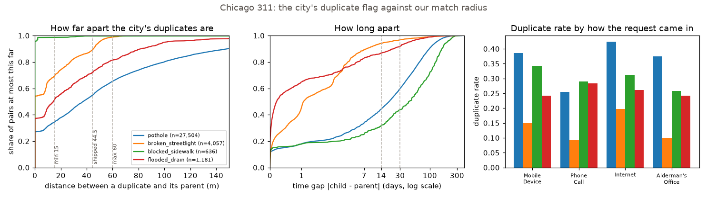
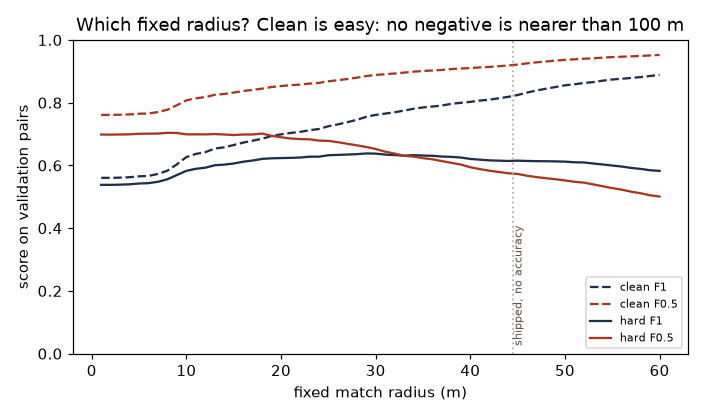
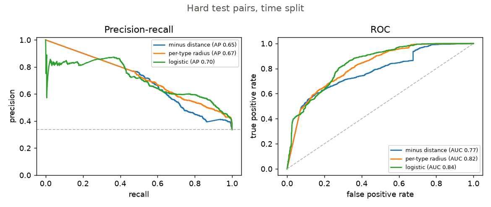
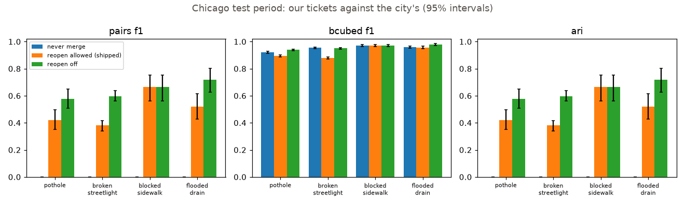
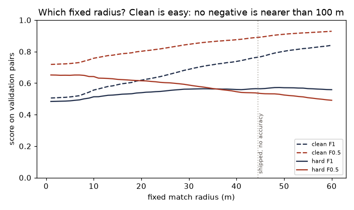

# Same-place matcher against real Chicago 311 data

This is the Chicago row of the matcher plan in `models/tickets/EVALUATION.md`, run on 2026-10-06. The code is in this folder. Every number below comes from `models/tickets/eval/results/matching_chicago_*.json` (plots beside them). Intervals are 95% bootstrap intervals with 1,000 resamples, from `common.metrics.bootstrap_ci` and `paired_bootstrap_diff`, unless the text says otherwise. The city's duplicate flag is its own address rule, so this is a realism check and a comparison of variants, not proof about Makati.

## The answers in one screen

1. **The city's duplicates are not all close.** At the shipped no-accuracy radius (44.5 m) the matcher can reach 55% of pothole duplicates, 89% of street-light, 99.7% of sidewalk and 72% of water-on-street duplicates. Pothole duplicates sit a median 37 m from their parent and 17 days after it; street-light ones sit at 0 m and 1.1 days. A radius up to the 60 m cap can recall at most 65% of the pothole duplicates.
2. **Against nearby non-duplicates, distance only half separates.** Hard set, test: PR-AUC 0.646 (0.619 to 0.671), ROC-AUC 0.774 (0.758 to 0.789). The clean set says 0.993 and 0.986 and means nothing (see "Read this first").
3. **The shipped 44.5 m is looser than the data prefer, by how much depends on the category mix.** Chosen on validation, the best F1 radius is 29 m on the time split and 49 m on the map-block split (where 82% of the duplicates are potholes); the F0.5 radii are 8 m and 1 m. On the time split's test quarter the shipped radius has F1 0.583 (0.564 to 0.603) against 0.617 (0.597 to 0.637), a paired difference of -0.034 (-0.046 to -0.022; wards -0.047 to -0.021); on the map-block test it is within 0.006 of the best (-0.006, -0.010 to -0.003). In F0.5, the plan's own view (a wrong merge costs more), it is behind in both: -0.177 and -0.101. The 31.2 m radius that accuracy 10 m would give beats it by +0.067 and +0.054 F0.5, and by +0.033 and +0.004 F1. No fixed radius wins clearly.
4. **Time adds nothing. Type adds a base rate.** A 14- or 30-day window and the time gap as a logistic feature do not help. Type raises pooled PR-AUC by 0.034 but cannot change a ranking inside a category; the usable form is a radius per category (potholes and water widest, then street lights, then sidewalks, which want the same address). It is clear for sidewalks and water on the time split's test quarter, for street lights and sidewalks on the map-block hold-out, and +0.034 F1 overall there.
5. **Replay, test period.** With reopen off, pairwise F1 against the city's tickets is 0.576 (0.506 to 0.651) for potholes, 0.598 (0.560 to 0.637) for street lights, 0.664 (0.560 to 0.755) for sidewalks and 0.717 (0.628 to 0.803) for water. With reopen allowed, as shipped, it is 0.421, 0.381, 0.664 and 0.521: a drop of 0.155, 0.217, 0.000 and 0.196. Reopening merges are 37%, 45%, 2% and 33% of the merges, and the city cannot judge them.
6. **Our merges the city did not flag**, reopen off: 40%, 58%, 63% and 48% of our merges (potholes, street lights, sidewalks, water). Of those, 30%, 43%, 41% and 55% are on the same street within 4 street numbers, the city's own buffer.
7. **Map-block hold-out:** the ceiling carries over (distance alone: PR-AUC 0.643, 0.632 to 0.654, ROC-AUC 0.757), time still adds nothing (a 14-day window loses 0.142 F1), and type helps only as a radius per category, now clearly: +0.034 F1 over the pooled best radius (+0.030 to +0.039; wards +0.024 to +0.049), with the same order of radii (potholes and water widest, street lights, then sidewalks). The pooled best radius does not carry over.
8. **Settings:** no change is justified by this data alone (section 10). The one number it leans towards is `DEFAULT_ACCURACY_M` 15 to 10, and reopening is the question that needs people, not Chicago.

## Read this first

1. **The labels are the city's rule, not the truth.** "Duplicate" is Chicago's own flag. For potholes a request is a duplicate when an open request exists within 4 addresses; for street lights, when it falls in the same group within 30 days. A pair we call wrong is wrong against that rule, and the rule is about addresses, not about hazards. Inside 60 m the gap between street numbers on the same street ranks the label better than the geocoded distance does (ROC-AUC 0.87 against 0.74 over all four types, 0.90 against 0.71 for potholes; table in section 1), so a good part of the label is an address relation that a phone cannot see.
2. **The coordinates are geocoded addresses, not phone GPS.** A distance of exactly 0 means the same address: 26% of pothole duplicates, 54% of street-light ones, 78% of sidewalk ones. There is no GPS error and no stand-off here. Nothing in this report tests the accuracy-aware part of the matcher (every report gets the same accuracy in the runs below, so "accuracy 10 m" is only a fixed radius of 31.2 m), and radii under about 15 m measure address granularity, not GPS. Chicago is not Makati.
3. **Near negatives are ambiguous. Read the clean and the hard results side by side, and never quote the hard precision as a false-merge rate.** A near negative is an open ticket within 60 m that the city did *not* name as the parent. The city's rule may simply have missed it. Over all splits, 7% of pothole near negatives sit at the very same geocode as the open ticket, and 13% are on the same street within 4 street numbers (street lights 7% and 19%, sidewalks 1% and 27%, water 23% and 43%), the city's own buffer, and were still not flagged.
4. **The clean negatives are easy by construction.** A far negative is at least 100 m away, so any radius up to 100 m makes no false positive, precision is exactly 1.000 for every variant, and PR-AUC 0.99 only says that 100-500 m is far from 0-60 m.
5. **No variant merges beyond 60 m** (`settings.MATCH_MAX_M`, the matcher's own ceiling). The construction leaves 60-100 m without any negative pair, so a radius there would look free and "best radius" would run to the edge of the grid. A city duplicate further than 60 m apart is a miss for every variant. For potholes that caps recall at 65%.
6. **Pairs and tickets live inside one split, which drops the long-lived tickets.** In validation 58% of pothole duplicates, and in test 45%, have a parent created in an earlier split, so their pair is dropped (table in section 1). The dropped pairs are the long-gap ones, a median 79 days against 8.9 (validation) and 2.5 (test) for the kept ones, and for potholes they are also farther apart, so in-split recall is flattered by about 3 points (test, inside 44.5 m: 62% kept against 55% dropped). The replay (sections 5 and 6) does not have this problem: it runs over the whole history.
7. **Validation numbers are in-sample** for every operating point picked on them (best radii, thresholds, per-category radii); only the test numbers are out-of-sample. While building this I ran the evaluation several times with 20 bootstrap resamples, so I saw those tables, test included. The one design change that followed was the 60 m cap, and it came from the construction (the empty 60-100 m ring), not from a test number. The final runs use 1,000 resamples. After a first set of final runs I added the sensitivity option and a few checks, deleted the caches, and re-ran every script on the final code: every number matched the first runs (the json files differ only by a new flag in `config`, and the sensitivity file no longer carries a within-category comparison it never needed).

## What was built

| file | what it does |
|---|---|
| `prepare.py` | reads the four csv files into numpy arrays in time order; the city's ticket label (parent's sr_number if duplicate, else its own); time splits and map-block splits; the street-number parser |
| `pairs.py` | builds the positive, far and near pairs for any split; counts what the split boundary drops; writes the split manifest and the pair cache to `eval/data/cache/` (git-ignored) |
| `eda.py` | section 1: rows, duplicate rates, distances, time gaps, how much of the label is an address relation; JSON and PNG |
| `evaluate.py` | sections 2-4 and 7: the variants as pair classifiers on the time split and on the map-block split, with intervals and paired comparisons |
| `replay.py` | sections 5-6: one category through `find_match` in time order, a grid index from `geo.box`, cluster metrics, extra merges and the address buffer |
| `tests/` | 62 unit tests on a 16-request hand-made fixture and on small synthetic data (`models/.venv/bin/pytest models/tickets/eval/matching/chicago -q -p no:warnings`) |
| `eval/results/matching_chicago_*` | json: `eda`, `pairs_time`, `pairs_geo`, `evaluate_time`, `evaluate_time_anyother` (sensitivity), `evaluate_geo`, `replay`; png: `eda`, `evaluate_time_radius`, `evaluate_time_curves`, `evaluate_geo_radius`, `evaluate_geo_curves`, `replay` |

To reproduce, from the repo root: `models/.venv/bin/python -m models.tickets.eval.matching.chicago.pairs`, then `.eda`, `.evaluate --split both`, `.evaluate --split time --near-any` (the sensitivity run) and `.replay` (a few minutes each, the map-block evaluation longest; `--boot 20` is a quick look). `git_commit` in each json is the commit the working tree was on, not one that contains this code.

## Pairs and splits

A **positive** is (child, parent) for a request the city flagged as a duplicate whose parent is in the file. A **far negative** pairs a positive's child with a random open ticket 100-500 m away (one per positive). A **near negative** pairs a request with every open ticket under 60 m that is not its parent. Three choices need saying:

- "Ticket" means a non-duplicate request. The matcher compares a new report with tickets, and the city's children point at their parent, so a request already merged into some ticket is not a separate place to match against. This leaves out the pairs in which the other request was itself a duplicate: 42,719 pothole near pairs would exist (all splits) if any request could be the other, and 18,006 are used.
- "Open" means still open when the child was created, for the far negatives too. Without it the time gap would separate the classes by itself (the matcher never sees a ticket closed long ago). Every one of the city's duplicate pairs satisfies it: the earlier request of the pair was open when the later one arrived in 100% of them.
- For positives the order is the city's. 8.6% of pothole duplicates name a *later* request as their parent, so the time gap used as a feature is absolute; the signed gap is in the pair data.

Splits are by creation month: train 2024-01 to 2025-06, validation 2025-07 to 2025-09, test 2025-10 to 2025-12 (the other three types only have 2025 and use the same month boundaries). Each request is in exactly one split and both ends of a pair are in it; `pairs.py` asserts that no request is in two splits. The map-block hold-out (section 7) uses 0.02-degree blocks, one block map for all four types, a 60% / 20% / 20% split for train / validation / test, by block and over all periods.

| split | duplicates (positives) | far negatives | near negatives | pairs in the hard set | share positive (hard) | pairs in the clean set | share positive (clean) |
|---|---|---|---|---|---|---|---|
| train | 25,792 | 23,689 | 22,075 | 71,556 | 36.0% | 49,481 | 52.1% |
| validation | 2,985 | 2,253 | 2,826 | 8,064 | 37.0% | 5,238 | 57.0% |
| test | 1,414 | 903 | 1,884 | 4,201 | 33.7% | 2,317 | 61.0% |

Duplicates per split and category (the positives):

| split | potholes | street lights | sidewalks | water on street |
|---|---|---|---|---|
| train | 22,582 | 2,336 | 217 | 657 |
| validation | 1,571 | 944 | 93 | 377 |
| test | 589 | 695 | 49 | 81 |

The test set is small for sidewalks (49 positives) and water on street (81), and the test quarter is the quietest of the year for potholes.

## 1. Where the city's duplicate pairs sit, against our radius

Chicago's own flag marks between 11% (street lights) and 32% (potholes) of requests as duplicates. For potholes and street lights nearly every parent is in the file; for sidewalks and water it mostly is not (those parents are older than 2025), so only the duplicates whose parent is in the file have a distance and a gap.

| category | rows | duplicate rate | duplicates | parent in the file | pairs used (parent in file, both located) |
|---|---|---|---|---|---|
| potholes | 95,972 | 32.2% | 30,950 | 27,508 (88.9%) | 27,504 |
| street lights | 35,939 | 11.5% | 4,129 | 4,057 (98.3%) | 4,057 |
| sidewalks | 7,899 | 30.2% | 2,388 | 636 (26.6%) | 636 |
| water on street | 10,983 | 25.5% | 2,797 | 1,181 (42.2%) | 1,181 |

Duplicate rate by how the request came in:

| category | Mobile Device | Phone Call | Internet | Alderman's Office | other origins |
|---|---|---|---|---|---|
| potholes | 38.5% (n=26,452) | 25.5% (n=31,685) | 42.3% (n=19,245) | 37.4% (n=9,593) | 10.5% (n=8,997) |
| street lights | 15.0% (n=5,651) | 9.3% (n=23,066) | 19.7% (n=5,191) | 10.0% (n=1,066) | 1.2% (n=965) |
| sidewalks | 34.3% (n=1,905) | 29.1% (n=1,889) | 31.2% (n=2,683) | 25.8% (n=1,258) | 14.0% (n=164) |
| water on street | 24.1% (n=3,410) | 28.4% (n=3,389) | 26.1% (n=3,354) | 24.2% (n=508) | 4.7% (n=322) |

**Distance between a duplicate and its parent, metres, with the share of pairs inside each radius.** The shipped matcher uses 44.5 m when a phone sends no accuracy (`DEFAULT_ACCURACY_M` 15), and between 15 m and 60 m otherwise.

| category | p50 | p75 | p90 | p95 | p99 | exactly 0 m | inside 15 m | 25 m | 31 m | 45 m | 60 m | inside the shipped 44.5 m |
|---|---|---|---|---|---|---|---|---|---|---|---|---|
| potholes | 37.1 | 82.9 | 148.7 | 191.2 | 7400.7 | 25.5% | 34.4% | 40.8% | 45.7% | 55.1% | 65.4% | 54.8% |
| street lights | 0.0 | 21.4 | 45.2 | 49.5 | 60.9 | 53.6% | 69.3% | 78.0% | 83.0% | 89.8% | 98.9% | 89.1% |
| sidewalks | 0.0 | 0.0 | 0.0 | 0.0 | 27.1 | 77.7% | 98.6% | 98.6% | 99.1% | 99.7% | 99.7% | 99.7% |
| water on street | 14.2 | 48.3 | 82.1 | 100.1 | 186.0 | 35.6% | 50.8% | 59.1% | 64.1% | 72.4% | 81.4% | 72.1% |

Share of the city's duplicate pairs inside the radius the shipped matcher would use if every phone reported the same accuracy:

| category | no accuracy (44.5 m) | accuracy 5 m (19.1 m) | accuracy 10 m (31.2 m) | accuracy 20 m (58.2 m) | at most 60 m |
|---|---|---|---|---|---|
| potholes | 54.8% | 37.4% | 45.9% | 64.3% | 65.4% |
| street lights | 89.1% | 73.5% | 83.2% | 98.6% | 98.9% |
| sidewalks | 99.7% | 98.6% | 99.1% | 99.7% | 99.7% |
| water on street | 72.1% | 55.0% | 64.1% | 80.8% | 81.4% |

**Time gap, child minus parent, days** (negative: the city named a later request as the parent):

| category | p1 | p5 | p25 | p50 | p75 | p90 | p95 | p99 | child before parent | within 14 days | within 30 days |
|---|---|---|---|---|---|---|---|---|---|---|---|
| potholes | -60.8 | -0.1 | 1.7 | 16.7 | 52.4 | 96.2 | 127.6 | 193.7 | 8.6% | 44.4% | 59.9% |
| street lights | 0.0 | 0.0 | 0.2 | 1.1 | 3.0 | 7.7 | 17.2 | 94.4 | 0.0% | 94.1% | 96.8% |
| sidewalks | 0.0 | 0.0 | 6.1 | 42.0 | 109.8 | 161.9 | 199.3 | 255.9 | 0.9% | 31.9% | 43.7% |
| water on street | 0.0 | 0.0 | 0.0 | 0.2 | 3.0 | 22.8 | 41.2 | 109.6 | 0.7% | 86.9% | 91.9% |

What it says:

- **Potholes.** The city's duplicates are spread: median 37 m, a quarter beyond 83 m, one in twenty beyond 191 m, and 2.3% beyond 500 m (mis-geocoded addresses; the largest is 34 km). Only 55% fall inside the shipped 44.5 m, and 65% inside 60 m, so no radius the matcher may use can recall more than 65% of them. They also wait: median 17 days, 95th percentile 128 days, and only 44% / 60% are within 14 / 30 days. A time window would throw away the rest.
- **Street lights.** The city's rule looks like a hard radius of about 50-60 m: median 0 m, 95th percentile 49.5 m, 99th 60.9 m, none beyond 90 m. The shipped radius reaches 89%, a 60 m radius 99%. The gaps are short (median 1.1 days, 94% within 14 days).
- **Sidewalks** are the same address: 78% at exactly 0 m, 98.6% within 15 m, almost no spread, but the parents are old (median gap 42 days) and only 27% of the duplicates have a parent in the file.
- **Water on street** sits in between: median 14 m, 72% inside 44.5 m, 81% inside 60 m, short gaps (median 0.2 days).
- **Against the shipped radii.** Accuracy 5, 10 and 20 m give 19.1, 31.2 and 58.2 m; the city's pothole duplicates fall inside them 37%, 46% and 64% of the time, street lights 74%, 83% and 99%.
- **By channel.** Duplicate rates differ (potholes: 25.5% by phone call, 38.5% from the mobile app, 42.3% from the web form, 37.4% from an alderman's office). The pairs differ too: pothole and water duplicates that came through an alderman's office are much farther from their parent (median 52 m and 51 m, against 34 m and 9-28 m for the others), so a pooled recall depends on the channel mix. Mobile-app duplicates look like web-form ones.
- **The "4 addresses" are not 4 street numbers.** 97% of pothole duplicates are on the same street as their parent, but they are a median 6 street numbers apart (75th percentile 23, 95th percentile 54), and only 45% are within 4. For street lights it is 77% and for sidewalks 99%. The buffer used in section 6 is the one the task names (same street, at most 4 numbers apart); the city does not apply exactly that.

| category | same street | street numbers apart (same street): p50 / p75 / p90 / p95 | within 4 numbers |
|---|---|---|---|
| potholes | 97.1% | 6 / 23 / 42 / 54 | 45.1% |
| street lights | 92.7% | 0 / 3 / 7 / 10 | 76.9% |
| sidewalks | 99.2% | 0 / 0 / 0 / 0 | 99.2% |
| water on street | 89.0% | 2 / 10 / 29 / 49 | 56.6% |

**How much of the label is an address relation.** Among the pairs under 60 m (the duplicates inside 60 m and all near negatives), the street-number gap ranks the city's label better than distance for potholes (0.90 against 0.71) and for water (0.67 against 0.63), and distance is as good for street lights and sidewalks:

| category | pairs under 60 m | duplicates among them | ROC-AUC of minus distance | ROC-AUC of minus street-number gap | median distance: duplicates / near negatives (m) |
|---|---|---|---|---|---|
| potholes | 34,248 | 16,242 | 0.708 | 0.898 | 11.6 / 34.7 |
| street lights | 10,860 | 3,929 | 0.835 | 0.823 | 0.0 / 40.1 |
| sidewalks | 1,585 | 357 | 0.987 | 0.992 | 0.0 / 36.0 |
| water on street | 1,523 | 903 | 0.625 | 0.669 | 8.0 / 20.4 |
| all four | 48,216 | 21,431 | 0.740 | 0.866 | 8.4 / 36.1 |

**What the split boundary costs.** Duplicates whose parent was created in an earlier split cannot be paired inside a split (read-this-first item 6):

| category | split | duplicates with parent in the file | pair kept inside the split | dropped | median gap, kept / dropped (days) | inside 44.5 m, kept / dropped |
|---|---|---|---|---|---|---|
| potholes | validation | 3,749 | 1,571 | 2,178 (58%) | 8.9 / 79.0 | 56% / 51% |
| potholes | test | 1,078 | 589 | 489 (45%) | 2.5 / 78.7 | 62% / 55% |
| street lights | validation | 986 | 944 | 42 (4%) | 1.0 / 39.1 | 91% / 100% |
| street lights | test | 735 | 695 | 40 (5%) | 0.9 / 47.6 | 86% / 98% |
| sidewalks | validation | 248 | 93 | 155 (62%) | 7.2 / 110.0 | 100% / 100% |
| sidewalks | test | 170 | 49 | 121 (71%) | 4.2 / 128.8 | 100% / 100% |
| water on street | validation | 429 | 377 | 52 (12%) | 0.1 / 38.3 | 67% / 83% |
| water on street | test | 95 | 81 | 14 (15%) | 0.1 / 73.4 | 75% / 93% |

## 2. The variants on validation and test

Every variant is a pair classifier: score = minus distance (minus distance over the radius for the accuracy-derived ones), and a yes/no at its own operating point. Fixed radii 10, 15, 25, 40 and 60 m; the shipped radius for no accuracy and for accuracy 5, 10 and 20 m as if every phone had reported it (44.5, 19.1, 31.2 and 58.2 m); the best fixed radius chosen on validation by F1 and by F0.5 (grid 1-60 m, 1 m steps, the smallest radius among ties); a logistic regression on distance, log distance, time gap and type, trained on the train split and cut at the F1-best threshold on validation; and a time window (merge only if the gap is at most 14 or 30 days) on the shipped radius. All of them are capped at 60 m. Every cell is the point estimate with its 95% interval from resampling pairs. PR-AUC and ROC-AUC are the same for every distance rule, because they depend on the ranking only.

Operating points chosen on validation:

| operating point (chosen on validation) | clean set | hard set |
|---|---|---|
| best F1 radius | 60 m | 29 m |
| best F0.5 radius | 60 m | 8 m |
| lowest-cost radius, wrong merge : wrong split = 1:1 | 60 m | 18 m |
| lowest-cost radius, wrong merge : wrong split = 3:1 | 60 m | 5 m |
| lowest-cost radius, wrong merge : wrong split = 5:1 | 60 m | 1 m |
| radius per category (F1): potholes, street lights, sidewalks, water on street | 60, 60, 28, 60 m | 60, 25, 1, 60 m |

On the clean set the best radius is the cap (60 m) for every rule: no negative is nearer than 100 m, so a wider radius never costs anything. Only the hard set can tell radii apart.

### Hard set (positives + far + near negatives), test

| variant | precision | recall | F1 | F0.5 | PR-AUC | ROC-AUC |
|---|---|---|---|---|---|---|
| fixed 10 m | 0.716 (0.688-0.744) | 0.537 (0.510-0.564) | 0.614 (0.591-0.636) | 0.671 (0.649-0.695) | 0.646 (0.619-0.671) | 0.774 (0.758-0.789) |
| fixed 15 m | 0.683 (0.656-0.709) | 0.574 (0.547-0.602) | 0.624 (0.602-0.646) | 0.658 (0.635-0.680) | 0.646 (0.619-0.671) | 0.774 (0.758-0.789) |
| fixed 25 m | 0.609 (0.585-0.635) | 0.637 (0.613-0.663) | 0.623 (0.603-0.643) | 0.615 (0.593-0.637) | 0.646 (0.619-0.671) | 0.774 (0.758-0.789) |
| fixed 40 m | 0.495 (0.473-0.516) | 0.736 (0.712-0.759) | 0.592 (0.573-0.611) | 0.529 (0.509-0.550) | 0.646 (0.619-0.671) | 0.774 (0.758-0.789) |
| fixed 60 m | 0.394 (0.375-0.411) | 0.865 (0.846-0.882) | 0.541 (0.522-0.558) | 0.442 (0.423-0.459) | 0.646 (0.619-0.671) | 0.774 (0.758-0.789) |
| shipped no accuracy: 44.5 m | 0.473 (0.452-0.494) | 0.759 (0.735-0.781) | 0.583 (0.564-0.603) | 0.511 (0.491-0.533) | 0.646 (0.619-0.671) | 0.774 (0.758-0.789) |
| shipped accuracy 5 m: 19.1 m | 0.654 (0.627-0.680) | 0.605 (0.578-0.631) | 0.628 (0.607-0.650) | 0.643 (0.620-0.665) | 0.646 (0.619-0.671) | 0.774 (0.758-0.789) |
| shipped accuracy 10 m: 31.2 m | 0.556 (0.533-0.579) | 0.691 (0.667-0.715) | 0.616 (0.596-0.636) | 0.578 (0.557-0.600) | 0.646 (0.619-0.671) | 0.774 (0.758-0.789) |
| shipped accuracy 20 m: 58.2 m | 0.402 (0.384-0.419) | 0.859 (0.840-0.876) | 0.548 (0.530-0.565) | 0.450 (0.431-0.467) | 0.646 (0.619-0.671) | 0.774 (0.758-0.789) |
| best F1 radius (29 m) | 0.570 (0.546-0.595) | 0.672 (0.647-0.698) | 0.617 (0.597-0.637) | 0.588 (0.566-0.611) | 0.646 (0.619-0.671) | 0.774 (0.758-0.789) |
| best F0.5 radius (8 m) | 0.764 (0.735-0.793) | 0.493 (0.466-0.519) | 0.599 (0.576-0.623) | 0.689 (0.664-0.712) | 0.646 (0.619-0.671) | 0.774 (0.758-0.789) |
| logistic distance only | 0.570 (0.545-0.595) | 0.670 (0.646-0.697) | 0.616 (0.596-0.637) | 0.587 (0.565-0.610) | 0.646 (0.620-0.671) | 0.774 (0.759-0.790) |
| logistic + time + type | 0.573 (0.550-0.596) | 0.721 (0.696-0.746) | 0.638 (0.619-0.658) | 0.598 (0.577-0.618) | 0.704 (0.677-0.731) | 0.837 (0.824-0.850) |
| shipped radius + dt <= 14 d | 0.488 (0.466-0.510) | 0.677 (0.653-0.702) | 0.567 (0.547-0.587) | 0.517 (0.497-0.539) | 0.649 (0.623-0.675) | 0.739 (0.722-0.756) |
| shipped radius + dt <= 30 d | 0.488 (0.467-0.510) | 0.742 (0.718-0.765) | 0.589 (0.569-0.609) | 0.524 (0.503-0.546) | 0.666 (0.642-0.690) | 0.776 (0.760-0.792) |

### Hard set, validation (in-sample for the best radii and the logistic threshold)

| variant | precision | recall | F1 | F0.5 | PR-AUC | ROC-AUC |
|---|---|---|---|---|---|---|
| fixed 10 m | 0.806 (0.788-0.824) | 0.456 (0.439-0.474) | 0.583 (0.566-0.598) | 0.699 (0.682-0.713) | 0.711 (0.695-0.726) | 0.789 (0.780-0.798) |
| fixed 15 m | 0.774 (0.754-0.792) | 0.498 (0.481-0.515) | 0.606 (0.590-0.621) | 0.697 (0.680-0.711) | 0.711 (0.695-0.726) | 0.789 (0.780-0.798) |
| fixed 25 m | 0.713 (0.695-0.729) | 0.569 (0.551-0.585) | 0.632 (0.618-0.645) | 0.678 (0.662-0.693) | 0.711 (0.695-0.726) | 0.789 (0.780-0.798) |
| fixed 40 m | 0.578 (0.561-0.594) | 0.670 (0.655-0.686) | 0.621 (0.608-0.634) | 0.594 (0.579-0.609) | 0.711 (0.695-0.726) | 0.789 (0.780-0.798) |
| fixed 60 m | 0.458 (0.445-0.472) | 0.800 (0.786-0.815) | 0.583 (0.570-0.595) | 0.501 (0.488-0.514) | 0.711 (0.695-0.726) | 0.789 (0.780-0.798) |
| shipped no accuracy: 44.5 m | 0.549 (0.534-0.565) | 0.697 (0.681-0.713) | 0.614 (0.601-0.627) | 0.574 (0.559-0.589) | 0.711 (0.695-0.726) | 0.789 (0.780-0.798) |
| shipped accuracy 5 m: 19.1 m | 0.750 (0.730-0.766) | 0.534 (0.517-0.551) | 0.624 (0.608-0.638) | 0.694 (0.677-0.708) | 0.711 (0.695-0.726) | 0.789 (0.780-0.798) |
| shipped accuracy 10 m: 31.2 m | 0.647 (0.629-0.664) | 0.620 (0.603-0.637) | 0.633 (0.620-0.647) | 0.642 (0.626-0.657) | 0.711 (0.695-0.726) | 0.789 (0.780-0.798) |
| shipped accuracy 20 m: 58.2 m | 0.468 (0.455-0.482) | 0.789 (0.775-0.804) | 0.588 (0.575-0.600) | 0.510 (0.496-0.523) | 0.711 (0.695-0.726) | 0.789 (0.780-0.798) |
| best F1 radius (29 m) | 0.674 (0.656-0.691) | 0.606 (0.589-0.623) | 0.638 (0.624-0.652) | 0.659 (0.644-0.674) | 0.711 (0.695-0.726) | 0.789 (0.780-0.798) |
| best F0.5 radius (8 m) | 0.856 (0.838-0.872) | 0.412 (0.394-0.429) | 0.556 (0.538-0.574) | 0.704 (0.687-0.720) | 0.711 (0.695-0.726) | 0.789 (0.780-0.798) |
| logistic distance only | 0.674 (0.657-0.692) | 0.606 (0.589-0.623) | 0.638 (0.624-0.652) | 0.659 (0.644-0.674) | 0.714 (0.698-0.729) | 0.793 (0.784-0.802) |
| logistic + time + type | 0.633 (0.617-0.648) | 0.725 (0.709-0.740) | 0.676 (0.662-0.688) | 0.649 (0.635-0.662) | 0.777 (0.762-0.791) | 0.868 (0.860-0.874) |
| shipped radius + dt <= 14 d | 0.574 (0.555-0.592) | 0.549 (0.532-0.569) | 0.561 (0.546-0.578) | 0.569 (0.552-0.585) | 0.670 (0.654-0.686) | 0.714 (0.702-0.726) |
| shipped radius + dt <= 30 d | 0.561 (0.544-0.579) | 0.631 (0.614-0.648) | 0.594 (0.580-0.609) | 0.574 (0.558-0.590) | 0.690 (0.672-0.705) | 0.746 (0.734-0.757) |

### Clean set (positives + far negatives), test. Precision is 1.000 by construction.

| variant | precision | recall | F1 | F0.5 | PR-AUC | ROC-AUC |
|---|---|---|---|---|---|---|
| fixed 10 m | 1.000 (1.000-1.000) | 0.537 (0.512-0.563) | 0.699 (0.677-0.721) | 0.853 (0.840-0.866) | 0.993 (0.991-0.995) | 0.986 (0.982-0.990) |
| fixed 15 m | 1.000 (1.000-1.000) | 0.574 (0.549-0.600) | 0.730 (0.709-0.750) | 0.871 (0.859-0.882) | 0.993 (0.991-0.995) | 0.986 (0.982-0.990) |
| fixed 25 m | 1.000 (1.000-1.000) | 0.637 (0.612-0.663) | 0.778 (0.759-0.797) | 0.898 (0.888-0.908) | 0.993 (0.991-0.995) | 0.986 (0.982-0.990) |
| fixed 40 m | 1.000 (1.000-1.000) | 0.736 (0.713-0.758) | 0.848 (0.832-0.862) | 0.933 (0.925-0.940) | 0.993 (0.991-0.995) | 0.986 (0.982-0.990) |
| fixed 60 m | 1.000 (1.000-1.000) | 0.865 (0.849-0.884) | 0.928 (0.918-0.939) | 0.970 (0.966-0.975) | 0.993 (0.991-0.995) | 0.986 (0.982-0.990) |
| shipped no accuracy: 44.5 m | 1.000 (1.000-1.000) | 0.759 (0.737-0.781) | 0.863 (0.849-0.877) | 0.941 (0.933-0.947) | 0.993 (0.991-0.995) | 0.986 (0.982-0.990) |
| shipped accuracy 5 m: 19.1 m | 1.000 (1.000-1.000) | 0.605 (0.579-0.631) | 0.754 (0.734-0.774) | 0.884 (0.873-0.895) | 0.993 (0.991-0.995) | 0.986 (0.982-0.990) |
| shipped accuracy 10 m: 31.2 m | 1.000 (1.000-1.000) | 0.691 (0.667-0.714) | 0.817 (0.800-0.833) | 0.918 (0.909-0.926) | 0.993 (0.991-0.995) | 0.986 (0.982-0.990) |
| shipped accuracy 20 m: 58.2 m | 1.000 (1.000-1.000) | 0.859 (0.842-0.879) | 0.924 (0.914-0.935) | 0.968 (0.964-0.973) | 0.993 (0.991-0.995) | 0.986 (0.982-0.990) |
| best F1 radius (60 m) | 1.000 (1.000-1.000) | 0.865 (0.849-0.884) | 0.928 (0.918-0.939) | 0.970 (0.966-0.975) | 0.993 (0.991-0.995) | 0.986 (0.982-0.990) |
| best F0.5 radius (60 m) | 1.000 (1.000-1.000) | 0.865 (0.849-0.884) | 0.928 (0.918-0.939) | 0.970 (0.966-0.975) | 0.993 (0.991-0.995) | 0.986 (0.982-0.990) |
| logistic distance only | 1.000 (1.000-1.000) | 0.864 (0.848-0.883) | 0.927 (0.917-0.938) | 0.970 (0.965-0.974) | 0.993 (0.991-0.995) | 0.987 (0.984-0.991) |
| logistic + time + type | 1.000 (1.000-1.000) | 0.864 (0.848-0.883) | 0.927 (0.918-0.938) | 0.970 (0.965-0.974) | 0.998 (0.997-0.998) | 0.996 (0.994-0.997) |
| shipped radius + dt <= 14 d | 1.000 (1.000-1.000) | 0.677 (0.654-0.701) | 0.808 (0.790-0.824) | 0.913 (0.904-0.921) | 0.957 (0.950-0.963) | 0.905 (0.892-0.918) |
| shipped radius + dt <= 30 d | 1.000 (1.000-1.000) | 0.742 (0.720-0.764) | 0.852 (0.837-0.867) | 0.935 (0.928-0.942) | 0.984 (0.980-0.987) | 0.964 (0.955-0.972) |

### Clean set, validation

| variant | precision | recall | F1 | F0.5 | PR-AUC | ROC-AUC |
|---|---|---|---|---|---|---|
| fixed 10 m | 1.000 (1.000-1.000) | 0.456 (0.439-0.474) | 0.627 (0.610-0.643) | 0.807 (0.796-0.819) | 0.991 (0.989-0.992) | 0.984 (0.981-0.987) |
| fixed 15 m | 1.000 (1.000-1.000) | 0.498 (0.481-0.516) | 0.665 (0.649-0.681) | 0.832 (0.822-0.842) | 0.991 (0.989-0.992) | 0.984 (0.981-0.987) |
| fixed 25 m | 1.000 (1.000-1.000) | 0.569 (0.551-0.586) | 0.725 (0.710-0.739) | 0.868 (0.860-0.876) | 0.991 (0.989-0.992) | 0.984 (0.981-0.987) |
| fixed 40 m | 1.000 (1.000-1.000) | 0.670 (0.654-0.686) | 0.803 (0.791-0.814) | 0.910 (0.904-0.916) | 0.991 (0.989-0.992) | 0.984 (0.981-0.987) |
| fixed 60 m | 1.000 (1.000-1.000) | 0.800 (0.786-0.813) | 0.889 (0.880-0.897) | 0.952 (0.948-0.956) | 0.991 (0.989-0.992) | 0.984 (0.981-0.987) |
| shipped no accuracy: 44.5 m | 1.000 (1.000-1.000) | 0.697 (0.680-0.712) | 0.821 (0.810-0.832) | 0.920 (0.914-0.925) | 0.991 (0.989-0.992) | 0.984 (0.981-0.987) |
| shipped accuracy 5 m: 19.1 m | 1.000 (1.000-1.000) | 0.534 (0.515-0.552) | 0.697 (0.680-0.712) | 0.852 (0.842-0.860) | 0.991 (0.989-0.992) | 0.984 (0.981-0.987) |
| shipped accuracy 10 m: 31.2 m | 1.000 (1.000-1.000) | 0.620 (0.603-0.637) | 0.765 (0.752-0.779) | 0.891 (0.883-0.898) | 0.991 (0.989-0.992) | 0.984 (0.981-0.987) |
| shipped accuracy 20 m: 58.2 m | 1.000 (1.000-1.000) | 0.789 (0.775-0.803) | 0.882 (0.873-0.891) | 0.949 (0.945-0.953) | 0.991 (0.989-0.992) | 0.984 (0.981-0.987) |
| best F1 radius (60 m) | 1.000 (1.000-1.000) | 0.800 (0.786-0.813) | 0.889 (0.880-0.897) | 0.952 (0.948-0.956) | 0.991 (0.989-0.992) | 0.984 (0.981-0.987) |
| best F0.5 radius (60 m) | 1.000 (1.000-1.000) | 0.800 (0.786-0.813) | 0.889 (0.880-0.897) | 0.952 (0.948-0.956) | 0.991 (0.989-0.992) | 0.984 (0.981-0.987) |
| logistic distance only | 1.000 (1.000-1.000) | 0.800 (0.786-0.813) | 0.889 (0.880-0.897) | 0.952 (0.948-0.956) | 0.993 (0.991-0.994) | 0.989 (0.987-0.991) |
| logistic + time + type | 1.000 (1.000-1.000) | 0.800 (0.786-0.813) | 0.889 (0.880-0.897) | 0.952 (0.948-0.956) | 0.996 (0.996-0.997) | 0.995 (0.994-0.996) |
| shipped radius + dt <= 14 d | 1.000 (1.000-1.000) | 0.549 (0.532-0.566) | 0.709 (0.695-0.723) | 0.859 (0.850-0.867) | 0.913 (0.906-0.920) | 0.846 (0.836-0.856) |
| shipped radius + dt <= 30 d | 1.000 (1.000-1.000) | 0.631 (0.614-0.647) | 0.774 (0.761-0.785) | 0.895 (0.888-0.901) | 0.949 (0.944-0.954) | 0.898 (0.889-0.908) |

### More variants, hard set, test (cost radii, one radius per category, logistic ablations; the validation versions of these and of the paired tables are in the json)

| variant | precision | recall | F1 | F0.5 | PR-AUC | ROC-AUC |
|---|---|---|---|---|---|---|
| cost 1:1 radius (18 m) | 0.667 (0.640-0.693) | 0.593 (0.567-0.619) | 0.628 (0.607-0.649) | 0.651 (0.627-0.673) | 0.646 (0.619-0.671) | 0.774 (0.758-0.789) |
| cost 3:1 radius (5 m) | 0.768 (0.737-0.795) | 0.470 (0.444-0.495) | 0.583 (0.559-0.607) | 0.681 (0.657-0.705) | 0.646 (0.619-0.671) | 0.774 (0.758-0.789) |
| cost 5:1 radius (1 m) | 0.770 (0.740-0.798) | 0.465 (0.439-0.492) | 0.580 (0.556-0.605) | 0.681 (0.657-0.704) | 0.646 (0.619-0.671) | 0.774 (0.758-0.789) |
| per-type best F1 radius (sidewalk 1, streetlight 25, drain 60, pothole 60 m) | 0.557 (0.534-0.580) | 0.742 (0.719-0.766) | 0.636 (0.617-0.655) | 0.586 (0.565-0.608) | 0.670 (0.644-0.694) | 0.819 (0.805-0.832) |
| logistic + time | 0.573 (0.549-0.599) | 0.667 (0.642-0.693) | 0.617 (0.597-0.637) | 0.590 (0.568-0.613) | 0.612 (0.584-0.642) | 0.772 (0.756-0.788) |
| logistic + type | 0.558 (0.535-0.581) | 0.739 (0.715-0.763) | 0.636 (0.617-0.655) | 0.587 (0.566-0.608) | 0.680 (0.654-0.706) | 0.831 (0.819-0.844) |
| logistic + time + type + origin | 0.576 (0.553-0.600) | 0.726 (0.702-0.750) | 0.642 (0.623-0.662) | 0.601 (0.579-0.623) | 0.734 (0.711-0.757) | 0.839 (0.827-0.852) |

The logistic variants that use type (or origin) are a pooled ranking across categories, which a matcher that only ever compares inside one category does not do; section 4 shows what is and is not left of their gain inside a category. "Origin" is how the city received the request; in the app it is always the phone, so it is not a usable feature, only a diagnostic.

### Sensitivity: the literal near-negative definition

The task defines a near negative as a pair under 60 m where "the other request was still open when the child was created and is not its parent". I restricted "the other" to a ticket (a non-duplicate request) and said why in "Pairs and splits". Here is the same evaluation with the literal reading, where any open request may be the other (siblings, and the parent, still excluded); `evaluate.py --split time --near-any`, tables only, no paired comparisons. It adds 649 near negatives to the test set (2,533 instead of 1,884) and 5,293 instead of 2,826 to validation, so the share of duplicates in the hard set falls from 33.7% to 29.1% on test. Hard set, test, selected variants:

| variant | precision | recall | F1 | F0.5 | PR-AUC | ROC-AUC |
|---|---|---|---|---|---|---|
| fixed 10 m | 0.651 (0.623-0.678) | 0.537 (0.510-0.563) | 0.588 (0.564-0.611) | 0.624 (0.601-0.648) | 0.591 (0.566-0.617) | 0.757 (0.741-0.773) |
| fixed 15 m | 0.615 (0.590-0.643) | 0.574 (0.549-0.599) | 0.594 (0.572-0.616) | 0.607 (0.584-0.631) | 0.591 (0.566-0.617) | 0.757 (0.741-0.773) |
| fixed 25 m | 0.538 (0.515-0.564) | 0.637 (0.612-0.661) | 0.583 (0.564-0.604) | 0.555 (0.534-0.579) | 0.591 (0.566-0.617) | 0.757 (0.741-0.773) |
| fixed 40 m | 0.420 (0.401-0.440) | 0.736 (0.712-0.758) | 0.535 (0.516-0.552) | 0.460 (0.440-0.479) | 0.591 (0.566-0.617) | 0.757 (0.741-0.773) |
| fixed 60 m | 0.326 (0.310-0.341) | 0.865 (0.847-0.882) | 0.473 (0.457-0.490) | 0.372 (0.356-0.389) | 0.591 (0.566-0.617) | 0.757 (0.741-0.773) |
| shipped no accuracy: 44.5 m | 0.401 (0.382-0.419) | 0.759 (0.737-0.782) | 0.525 (0.507-0.543) | 0.443 (0.424-0.461) | 0.591 (0.566-0.617) | 0.757 (0.741-0.773) |
| shipped accuracy 5 m: 19.1 m | 0.586 (0.561-0.612) | 0.605 (0.579-0.630) | 0.595 (0.574-0.617) | 0.589 (0.567-0.613) | 0.591 (0.566-0.617) | 0.757 (0.741-0.773) |
| shipped accuracy 10 m: 31.2 m | 0.484 (0.462-0.506) | 0.691 (0.667-0.716) | 0.569 (0.549-0.588) | 0.515 (0.493-0.535) | 0.591 (0.566-0.617) | 0.757 (0.741-0.773) |
| shipped accuracy 20 m: 58.2 m | 0.332 (0.317-0.348) | 0.859 (0.841-0.876) | 0.479 (0.463-0.497) | 0.379 (0.362-0.396) | 0.591 (0.566-0.617) | 0.757 (0.741-0.773) |
| best F1 radius (18 m) | 0.600 (0.575-0.626) | 0.593 (0.566-0.618) | 0.596 (0.574-0.618) | 0.598 (0.575-0.622) | 0.591 (0.566-0.617) | 0.757 (0.741-0.773) |
| best F0.5 radius (3 m) | 0.730 (0.698-0.757) | 0.466 (0.440-0.493) | 0.569 (0.543-0.594) | 0.656 (0.630-0.679) | 0.591 (0.566-0.617) | 0.757 (0.741-0.773) |

Distance alone now reaches PR-AUC 0.591 (0.566 to 0.617) and ROC-AUC 0.757 (0.741 to 0.773), against 0.646 and 0.774. The best F1 radius moves down from 29 m to 18 m (test F1 0.596, 0.574 to 0.618) and the best F0.5 radius from 8 m to 3 m. The shipped radius is further behind (F1 0.525, 0.507 to 0.543, with unpaired intervals that no longer touch the best radius's). The picture in section 3 is unchanged (the radii that do best get smaller, since there are more near pairs to avoid) and so is the main picture in section 4: the logistic with type and time reaches PR-AUC 0.640 against 0.591 for distance, and the windows do not clearly help (test F1 0.518 for 14 days and 0.534 for 30, against 0.525 for the shipped radius alone). Only the tables were rerun, not the paired intervals.

## 3. Which fixed radius wins, and how the shipped one compares

**No fixed radius wins clearly on the hard set.** On test, F1 is 0.614 at 10 m, 0.624 at 15 m, 0.623 at 25 m, 0.592 at 40 m and 0.541 at 60 m; F0.5 is highest at the smallest radius (0.671 at 10 m). The F1 curve on validation peaks at 29 m (0.638) and is flat from 20 m to 40 m. The radius picked on validation by F1 is 29 m (test F1 0.617, interval 0.597 to 0.637) and by F0.5 8 m (test F0.5 0.689). The cost-weighted choice is 18 m at 1:1, 5 m at 3:1 and 1 m at 5:1; the last two are the same-address radius that the city's geocoding makes available and are not something a GPS fix can use.

**The shipped no-accuracy radius is looser than the hard set prefers, on the time split.** Paired differences on the test pairs. Each cell is the difference with its interval from resampling pairs, then the interval from resampling wards, then the verdict; the first two columns compare each score with the radius chosen on validation for that score, the last two compare with the shipped default.

| variant | F1 minus the best-F1 radius | F0.5 minus the best-F0.5 radius | F1 minus the shipped default | F0.5 minus the shipped default |
|---|---|---|---|---|
| shipped no accuracy: 44.5 m | -0.034 (-0.046 to -0.022); wards -0.047 to -0.021 **worse** | -0.177 (-0.199 to -0.155); wards -0.217 to -0.139 **worse** |  |  |
| shipped accuracy 5 m: 19.1 m | +0.011 (-0.001 to +0.022); wards -0.004 to +0.024 **no clear difference** | -0.045 (-0.062 to -0.029); wards -0.072 to -0.022 **worse** | +0.045 (+0.029 to +0.062); wards +0.022 to +0.065 **better** | +0.132 (+0.115 to +0.148); wards +0.106 to +0.156 **better** |
| shipped accuracy 10 m: 31.2 m | -0.001 (-0.006 to +0.005); wards -0.007 to +0.005 **no clear difference** | -0.110 (-0.130 to -0.089); wards -0.149 to -0.077 **worse** | +0.033 (+0.022 to +0.044); wards +0.023 to +0.044 **better** | +0.067 (+0.057 to +0.078); wards +0.055 to +0.081 **better** |
| shipped accuracy 20 m: 58.2 m | -0.069 (-0.085 to -0.053); wards -0.090 to -0.050 **worse** | -0.239 (-0.262 to -0.216); wards -0.283 to -0.198 **worse** | -0.035 (-0.046 to -0.025); wards -0.048 to -0.022 **worse** | -0.061 (-0.071 to -0.052); wards -0.074 to -0.050 **worse** |
| shipped radius + dt <= 14 d | -0.050 (-0.066 to -0.035); wards -0.068 to -0.030 **worse** | -0.172 (-0.196 to -0.148); wards -0.218 to -0.124 **worse** | -0.015 (-0.025 to -0.006); wards -0.031 to +0.001 **no clear difference** | +0.005 (-0.003 to +0.013); wards -0.009 to +0.021 **no clear difference** |
| shipped radius + dt <= 30 d | -0.028 (-0.041 to -0.014); wards -0.043 to -0.014 **worse** | -0.165 (-0.187 to -0.141); wards -0.207 to -0.122 **worse** | +0.006 (+0.001 to +0.011); wards -0.001 to +0.013 **no clear difference** | +0.012 (+0.008 to +0.017); wards +0.006 to +0.020 **better** |
| per-type best F1 radius | +0.019 (+0.007 to +0.033); wards -0.003 to +0.038 **no clear difference** | -0.102 (-0.125 to -0.082); wards -0.147 to -0.062 **worse** |  |  |

- The shipped 44.5 m has test F1 0.583 (0.564-0.603) against 0.617 (0.597-0.637) for the validation-picked 29 m; the paired difference is **-0.034** (-0.046 to -0.022; wards -0.047 to -0.021). Its F0.5 is 0.511 against 0.689 for the 8 m radius, a difference of -0.177 (-0.199 to -0.155). It is "worse" on validation too (-0.024 and -0.131).
- The radius that accuracy 10 m would give, 31.2 m, beats the shipped default by **+0.033** F1 (+0.022 to +0.044; wards +0.023 to +0.044) and +0.067 F0.5 on test, and by +0.019 and +0.068 on validation. The 19.1 m radius (accuracy 5 m) beats it by +0.045 and +0.132. The 58.2 m radius (accuracy 20 m) is worse than it by -0.035.
- **This depends on the category mix and does not carry to the map-block hold-out** (section 7): there the best F1 radius is 49 m and the shipped radius is within 0.006 F1 of it, because 82% of the duplicates are potholes. In F0.5 the shipped radius is behind in both (-0.177 here, -0.101 there), and the 31.2 m radius beats it in both (+0.067 and +0.054).
- On the clean set the order flips: the shipped radius loses 0.064 F1 to 60 m (recall 0.759 against 0.865), and the 58.2 m radius gains 0.061 over it. The loose and the tight view bracket the shipped radius; the hard set is the one with negatives that matter.
- By category (test, hard set, F1 of the shipped 44.5 m minus F1 of the pooled 29 m): potholes +0.009 (no clear difference), street lights -0.069 (worse), sidewalks -0.057 (worse), water +0.073 (better). Potholes and water want the larger radius, street lights and sidewalks the smaller one.

**A logistic regression on distance alone is a radius.** Its F1 differs from the best radius by -0.001 and its PR-AUC by 0.000 on test, as it must: a monotone score cannot rank differently, and the threshold is then a radius.

## 4. Does time or type add anything?

Rule 2 of `EVALUATION.md`: the simple rule stays unless the complex one wins with the 95% interval of the paired difference clear of zero. The tables give two intervals for each difference, from resampling pairs and from resampling wards (pairs of one ward share tickets and days, so the second is the honest one); "better" and "worse" need both to exclude zero.

**Time: no.**

- The time gap as a logistic feature lowers PR-AUC on test by 0.034 (-0.044 to -0.022; wards -0.046 to -0.016) and does nothing on validation (-0.004, interval -0.011 to +0.004). Inside any one category it adds nothing to the ranking, and for street lights it costs 0.051 PR-AUC (-0.063 to -0.035); at its operating point no category gains more than 0.015 F1 from it on either split. The test period has a different gap distribution from train (in-split pairs are short, section 1), which is how a time feature turns harmful.
- A time window on the shipped radius merges only when the gap is at most 14 or 30 days. On test its F1 against the same radius without a window is -0.015 (-0.025 to -0.006; wards -0.031 to +0.001) for 14 days and +0.006 (+0.001 to +0.011; wards -0.001 to +0.013) for 30 days, no clear difference; the F0.5 gain for 30 days is small (+0.012, wards +0.006 to +0.020) and on validation both windows lose F1 (-0.053 and -0.020). It cuts recall because pothole duplicates wait: 44% are within 14 days of their parent and 60% within 30. The window is not worth having, and on the map-block hold-out it is worse (-0.142 and -0.088 F1 against the same radius).

**Type: a base rate per category, not a better ranking.**

- Adding type to the logistic raises pooled PR-AUC on test by 0.034 (+0.024 to +0.045; wards +0.014 to +0.055), and with the time gap by 0.058 (wards +0.028 to +0.093). That gain is the different base rate of duplicates among nearby pairs in each category (duplicates are 59% of the pairs under 60 m for water, 47% for potholes, 36% for street lights and 23% for sidewalks; table in section 1). Inside one category a type feature only moves the intercept, so it cannot change a ranking. A matcher compares inside one category, so the pooled PR-AUC gain does not carry over.
- The usable form of type is a radius per category. Chosen on validation per category it is 60 m for potholes and water, 25 m for street lights and 1 m (same address) for sidewalks. On the time split's test quarter it improves F1 over the pooled best radius by +0.019 (+0.007 to +0.033; wards -0.003 to +0.038), no clear difference once wards are resampled; on the map-block hold-out the gain is +0.034 (+0.030 to +0.039; wards +0.024 to +0.049), clear (section 7). Inside categories it is clear for sidewalks (+0.340, interval +0.257 to +0.430) and water (+0.099, +0.029 to +0.181), and not for street lights (+0.011) or potholes (+0.014). The two clear ones rest on 49 and 81 positive pairs on test. The sidewalk result looks too good (F1 0.980, 0.946 to 1.000, at a 1 m radius) and is: it is the city flagging the same address, which geocoding turns into distance 0, not something a phone can reproduce.
- Origin (how the city received the request) lifts PR-AUC further (+0.088 with type and time) because duplicate rates and distances differ by channel. It is not available to the app.

| logistic model | PR-AUC minus PR-AUC of minus-distance | F1 minus the best-F1 radius |
|---|---|---|
| distance only | +0.000 (+0.000 to +0.000); wards +0.000 to +0.000 **no clear difference** | -0.001 (-0.002 to +0.000); wards -0.002 to +0.000 **no clear difference** |
| + time | -0.034 (-0.044 to -0.022); wards -0.046 to -0.016 **worse** | -0.000 (-0.003 to +0.002); wards -0.003 to +0.002 **no clear difference** |
| + type | +0.034 (+0.024 to +0.045); wards +0.014 to +0.055 **better** | +0.019 (+0.006 to +0.032); wards -0.004 to +0.039 **no clear difference** |
| + time + type | +0.058 (+0.043 to +0.074); wards +0.028 to +0.093 **better** | +0.022 (+0.007 to +0.036); wards -0.004 to +0.044 **no clear difference** |
| + time + type + origin | +0.088 (+0.075 to +0.102); wards +0.059 to +0.122 **better** | +0.025 (+0.011 to +0.039); wards +0.001 to +0.047 **better** |

Inside each category, test, hard set (the same comparisons, per category):

| category | positives | comparison | PR-AUC difference | F1 difference against the pooled best radius |
|---|---|---|---|---|
| sidewalks | 49 | shipped 44.5 m | +0.000 (+0.000 to +0.000) **no clear difference** | -0.057 (-0.087 to -0.030) **worse** |
| sidewalks | 49 | radius picked for this category | +0.000 (+0.000 to +0.000) **no clear difference** | +0.340 (+0.257 to +0.430) **better** |
| sidewalks | 49 | logistic with time gap | -0.007 (-0.059 to +0.043) **no clear difference** | +0.004 (+0.000 to +0.014) **no clear difference** |
| street lights | 695 | shipped 44.5 m | +0.000 (+0.000 to +0.000) **no clear difference** | -0.069 (-0.085 to -0.053) **worse** |
| street lights | 695 | radius picked for this category | +0.000 (+0.000 to +0.000) **no clear difference** | +0.011 (-0.001 to +0.022) **no clear difference** |
| street lights | 695 | logistic with time gap | -0.051 (-0.063 to -0.035) **worse** | +0.002 (-0.002 to +0.005) **no clear difference** |
| water on street | 81 | shipped 44.5 m | +0.000 (+0.000 to +0.000) **no clear difference** | +0.073 (+0.011 to +0.139) **better** |
| water on street | 81 | radius picked for this category | +0.000 (+0.000 to +0.000) **no clear difference** | +0.099 (+0.029 to +0.181) **better** |
| water on street | 81 | logistic with time gap | -0.008 (-0.046 to +0.045) **no clear difference** | -0.009 (-0.031 to +0.000) **no clear difference** |
| potholes | 589 | shipped 44.5 m | +0.000 (+0.000 to +0.000) **no clear difference** | +0.009 (-0.012 to +0.029) **no clear difference** |
| potholes | 589 | radius picked for this category | +0.000 (+0.000 to +0.000) **no clear difference** | +0.014 (-0.013 to +0.040) **no clear difference** |
| potholes | 589 | logistic with time gap | -0.002 (-0.018 to +0.017) **no clear difference** | -0.003 (-0.008 to +0.002) **no clear difference** |

Precision, recall and F1 by category, test, hard set:

| variant | category | positives | precision | recall | F1 |
|---|---|---|---|---|---|
| best F1 radius (29 m) | potholes | 589 | 0.599 (0.557-0.639) | 0.519 (0.478-0.561) | 0.556 (0.521-0.591) |
| best F1 radius (29 m) | street lights | 695 | 0.554 (0.523-0.584) | 0.787 (0.755-0.817) | 0.650 (0.624-0.675) |
| best F1 radius (29 m) | sidewalks | 49 | 0.471 (0.375-0.564) | 1.000 (1.000-1.000) | 0.640 (0.545-0.722) |
| best F1 radius (29 m) | water on street | 81 | 0.762 (0.650-0.863) | 0.593 (0.482-0.701) | 0.667 (0.567-0.750) |
| per-type best F1 radius (sidewalk 1, streetlight 25, drain 60, pothole 60 m) | potholes | 589 | 0.479 (0.444-0.511) | 0.706 (0.671-0.743) | 0.571 (0.539-0.598) |
| per-type best F1 radius (sidewalk 1, streetlight 25, drain 60, pothole 60 m) | street lights | 695 | 0.595 (0.564-0.627) | 0.744 (0.710-0.774) | 0.661 (0.634-0.686) |
| per-type best F1 radius (sidewalk 1, streetlight 25, drain 60, pothole 60 m) | sidewalks | 49 | 0.961 (0.898-1.000) | 1.000 (1.000-1.000) | 0.980 (0.946-1.000) |
| per-type best F1 radius (sidewalk 1, streetlight 25, drain 60, pothole 60 m) | water on street | 81 | 0.713 (0.620-0.796) | 0.827 (0.738-0.901) | 0.766 (0.690-0.826) |
| shipped no accuracy: 44.5 m | potholes | 589 | 0.519 (0.482-0.556) | 0.620 (0.582-0.661) | 0.565 (0.533-0.596) |
| shipped no accuracy: 44.5 m | street lights | 695 | 0.439 (0.414-0.464) | 0.862 (0.835-0.887) | 0.581 (0.556-0.606) |
| shipped no accuracy: 44.5 m | sidewalks | 49 | 0.412 (0.325-0.500) | 1.000 (1.000-1.000) | 0.583 (0.491-0.667) |
| shipped no accuracy: 44.5 m | water on street | 81 | 0.726 (0.631-0.818) | 0.753 (0.654-0.844) | 0.739 (0.654-0.812) |

Recall by the origin of the child, test, hard set (positives only):

| variant | child origin | positives | recall |
|---|---|---|---|
| best F1 radius (29 m) | Alderman's Office | 59 | 0.288 (0.170-0.407) |
| best F1 radius (29 m) | Internet | 386 | 0.653 (0.609-0.700) |
| best F1 radius (29 m) | Mobile Device | 449 | 0.675 (0.630-0.717) |
| best F1 radius (29 m) | Phone Call | 499 | 0.732 (0.693-0.768) |
| per-type best F1 radius (sidewalk 1, streetlight 25, drain 60, pothole 60 m) | Alderman's Office | 59 | 0.559 (0.424-0.695) |
| per-type best F1 radius (sidewalk 1, streetlight 25, drain 60, pothole 60 m) | Internet | 386 | 0.715 (0.666-0.756) |
| per-type best F1 radius (sidewalk 1, streetlight 25, drain 60, pothole 60 m) | Mobile Device | 449 | 0.771 (0.728-0.808) |
| per-type best F1 radius (sidewalk 1, streetlight 25, drain 60, pothole 60 m) | Phone Call | 499 | 0.759 (0.719-0.798) |
| shipped no accuracy: 44.5 m | Alderman's Office | 59 | 0.508 (0.373-0.644) |
| shipped no accuracy: 44.5 m | Internet | 386 | 0.733 (0.692-0.777) |
| shipped no accuracy: 44.5 m | Mobile Device | 449 | 0.766 (0.722-0.806) |
| shipped no accuracy: 44.5 m | Phone Call | 499 | 0.808 (0.771-0.840) |

Mobile-app duplicates are recalled within a few points of phone-call and web-form ones; alderman's-office duplicates are much farther from their parent, so a radius picked on a mix of channels recalls them poorly (29 m radius: 0.288, interval 0.170 to 0.407).

## 5. Replay: the tickets our matcher builds against the city's

`replay.py` feeds one category's requests, in time order, through the shipped `find_match` with `Sighting(accuracy_m=None)` (radius 44.5 m). Open tickets live in a grid index, and `geo.box` finds the neighbours; a ticket keeps the spot of the request that started it and is fixed when that request was closed. The city's ticket for a request is its parent's sr_number if it is a duplicate, else its own. The replay runs over the whole history, so tickets open since before October are there to join, and the test period (2025-10 to 2025-12) is scored on its own requests. Left out of scoring are the duplicates whose parent is not in the file, whose city ticket cannot be told (potholes 3,442, street lights 72, sidewalks 1,752, water 1,616; they are replayed, only not scored). Two runs:

- **reopen allowed (as shipped):** a ticket fixed in the last 30 days can be joined, which reopens it until the joiner's own closing date.
- **reopen off:** a ticket closed before the report arrives is unavailable. This is the only thing the city can judge: it flags duplicates of open parents only, and in its data the parent was open in 100% of the pairs.

"Never merge" (every request its own ticket) is the reference line. Scored requests in the test period: potholes 5,433, street lights 8,019, sidewalks 1,097, water 1,087. Intervals resample whole groups of requests that the city's partition and ours tie together, not single requests.

| category | tickets | pair precision | pair recall | pair F1 | ARI |
|---|---|---|---|---|---|
| potholes | never merge | 1.000 (1.000-1.000) | 0.000 (0.000-0.000) | 0.000 (0.000-0.000) | 0.000 (0.000-0.000) |
| potholes | reopen allowed (as shipped) | 0.342 (0.268-0.428) | 0.549 (0.470-0.636) | 0.421 (0.352-0.498) | 0.421 (0.352-0.498) |
| potholes | reopen off | 0.616 (0.542-0.691) | 0.541 (0.457-0.634) | 0.576 (0.506-0.651) | 0.576 (0.506-0.651) |
| street lights | never merge | 1.000 (1.000-1.000) | 0.000 (0.000-0.000) | 0.000 (0.000-0.000) | 0.000 (0.000-0.000) |
| street lights | reopen allowed (as shipped) | 0.247 (0.215-0.277) | 0.829 (0.782-0.875) | 0.381 (0.341-0.417) | 0.381 (0.341-0.417) |
| street lights | reopen off | 0.468 (0.425-0.512) | 0.829 (0.784-0.874) | 0.598 (0.560-0.637) | 0.598 (0.560-0.637) |
| sidewalks | never merge | 1.000 (1.000-1.000) | 0.000 (0.000-0.000) | 0.000 (0.000-0.000) | 0.000 (0.000-0.000) |
| sidewalks | reopen allowed (as shipped) | 0.496 (0.389-0.606) | 1.000 (1.000-1.000) | 0.664 (0.560-0.755) | 0.663 (0.560-0.755) |
| sidewalks | reopen off | 0.496 (0.389-0.606) | 1.000 (1.000-1.000) | 0.664 (0.560-0.755) | 0.663 (0.560-0.755) |
| water on street | never merge | 1.000 (1.000-1.000) | 0.000 (0.000-0.000) | 0.000 (0.000-0.000) | 0.000 (0.000-0.000) |
| water on street | reopen allowed (as shipped) | 0.398 (0.308-0.500) | 0.756 (0.663-0.845) | 0.521 (0.429-0.615) | 0.521 (0.429-0.615) |
| water on street | reopen off | 0.702 (0.591-0.818) | 0.733 (0.634-0.826) | 0.717 (0.628-0.803) | 0.717 (0.628-0.803) |

| category | tickets | B-cubed precision | B-cubed recall | B-cubed F1 |
|---|---|---|---|---|
| potholes | never merge | 1.000 (1.000-1.000) | 0.856 (0.841-0.869) | 0.922 (0.914-0.930) |
| potholes | reopen allowed (as shipped) | 0.854 (0.840-0.868) | 0.940 (0.930-0.948) | 0.895 (0.886-0.903) |
| potholes | reopen off | 0.942 (0.934-0.949) | 0.938 (0.928-0.947) | 0.940 (0.933-0.946) |
| street lights | never merge | 1.000 (1.000-1.000) | 0.912 (0.904-0.920) | 0.954 (0.949-0.958) |
| street lights | reopen allowed (as shipped) | 0.795 (0.783-0.806) | 0.986 (0.983-0.990) | 0.880 (0.873-0.887) |
| street lights | reopen off | 0.917 (0.910-0.924) | 0.986 (0.983-0.989) | 0.950 (0.946-0.955) |
| sidewalks | never merge | 1.000 (1.000-1.000) | 0.944 (0.928-0.957) | 0.971 (0.963-0.978) |
| sidewalks | reopen allowed (as shipped) | 0.947 (0.931-0.960) | 1.000 (1.000-1.000) | 0.973 (0.964-0.980) |
| sidewalks | reopen off | 0.947 (0.931-0.960) | 1.000 (1.000-1.000) | 0.973 (0.964-0.980) |
| water on street | never merge | 1.000 (1.000-1.000) | 0.923 (0.908-0.939) | 0.960 (0.952-0.969) |
| water on street | reopen allowed (as shipped) | 0.934 (0.916-0.951) | 0.981 (0.973-0.989) | 0.957 (0.946-0.968) |
| water on street | reopen off | 0.978 (0.968-0.987) | 0.980 (0.971-0.988) | 0.979 (0.972-0.985) |

Differences on the same resamples (test period):

| category | comparison (test period) | pair F1 | B-cubed F1 | ARI |
|---|---|---|---|---|
| potholes | reopen off, best accuracy on validation (20) minus shipped | +0.018 (-0.002 to +0.039) | -0.003 (-0.006 to -0.001) | +0.018 (-0.002 to +0.039) |
| potholes | reopen off, shipped minus never merge | +0.576 (+0.506 to +0.651) | +0.017 (+0.011 to +0.025) | +0.576 (+0.506 to +0.651) |
| potholes | reopen on minus reopen off (shipped accuracy) | -0.155 (-0.191 to -0.122) | -0.045 (-0.050 to -0.040) | -0.155 (-0.191 to -0.122) |
| potholes | reopen on, best accuracy on validation (20) minus shipped | -0.004 (-0.019 to +0.013) | -0.015 (-0.018 to -0.012) | -0.004 (-0.019 to +0.013) |
| potholes | reopen on, shipped minus never merge | +0.421 (+0.352 to +0.498) | -0.028 (-0.036 to -0.019) | +0.421 (+0.352 to +0.498) |
| street lights | reopen off, best accuracy on validation (10) minus shipped | +0.055 (+0.040 to +0.070) | +0.012 (+0.010 to +0.015) | +0.055 (+0.040 to +0.070) |
| street lights | reopen off, shipped minus never merge | +0.598 (+0.560 to +0.637) | -0.004 (-0.009 to +0.002) | +0.598 (+0.560 to +0.637) |
| street lights | reopen on minus reopen off (shipped accuracy) | -0.217 (-0.247 to -0.190) | -0.070 (-0.076 to -0.065) | -0.217 (-0.247 to -0.190) |
| street lights | reopen on, best accuracy on validation (5) minus shipped | +0.052 (+0.033 to +0.071) | +0.038 (+0.035 to +0.042) | +0.052 (+0.033 to +0.071) |
| street lights | reopen on, shipped minus never merge | +0.381 (+0.341 to +0.417) | -0.073 (-0.082 to -0.066) | +0.381 (+0.341 to +0.417) |
| sidewalks | reopen off, best accuracy on validation (5) minus shipped | +0.130 (+0.080 to +0.188) | +0.014 (+0.009 to +0.019) | +0.130 (+0.080 to +0.188) |
| sidewalks | reopen off, shipped minus never merge | +0.664 (+0.560 to +0.755) | +0.002 (-0.010 to +0.013) | +0.663 (+0.560 to +0.755) |
| sidewalks | reopen on minus reopen off (shipped accuracy) | +0.000 (+0.000 to +0.000) | +0.000 (+0.000 to +0.000) | +0.000 (+0.000 to +0.000) |
| sidewalks | reopen on, best accuracy on validation (5) minus shipped | +0.130 (+0.080 to +0.188) | +0.014 (+0.009 to +0.019) | +0.130 (+0.080 to +0.188) |
| sidewalks | reopen on, shipped minus never merge | +0.664 (+0.560 to +0.755) | +0.002 (-0.010 to +0.013) | +0.663 (+0.560 to +0.755) |
| water on street | reopen off, best accuracy on validation (20) minus shipped | +0.026 (-0.005 to +0.065) | +0.001 (-0.001 to +0.004) | +0.026 (-0.005 to +0.065) |
| water on street | reopen off, shipped minus never merge | +0.717 (+0.628 to +0.803) | +0.019 (+0.011 to +0.028) | +0.717 (+0.628 to +0.803) |
| water on street | reopen on minus reopen off (shipped accuracy) | -0.196 (-0.265 to -0.136) | -0.022 (-0.030 to -0.015) | -0.196 (-0.265 to -0.136) |
| water on street | reopen on, best accuracy on validation (20) minus shipped | +0.002 (-0.027 to +0.032) | -0.002 (-0.005 to +0.001) | +0.002 (-0.027 to +0.032) |
| water on street | reopen on, shipped minus never merge | +0.521 (+0.429 to +0.615) | -0.003 (-0.015 to +0.009) | +0.521 (+0.429 to +0.615) |

How to read it:

- **B-cubed barely separates a matcher from doing nothing**, because most requests are alone in the city's data too (never merge already scores B-cubed recall 0.86 to 0.94 and B-cubed F1 0.92 to 0.97). Pairwise F1 and the adjusted Rand index are the sharper scores; they agree to within 0.001 here because nearly every ticket is a singleton, which puts the chance agreement near zero.
- **Reopen off.** Pairwise F1 against the city's tickets is 0.58 for potholes, 0.60 for street lights, 0.66 for sidewalks and 0.72 for water. Precision is 0.62, 0.47, 0.50 and 0.70; recall is 0.54, 0.83, 1.00 and 0.73. In B-cubed F1 the matcher is ahead of never-merge for potholes (+0.017, interval +0.011 to +0.025) and water (+0.019), and level with it for street lights (-0.004, interval -0.009 to +0.002) and sidewalks (+0.002).
- **Reopen allowed (as shipped).** Pairwise F1 drops by 0.155 for potholes (interval -0.191 to -0.122), 0.217 for street lights and 0.196 for water, and B-cubed F1 falls below never-merge for potholes (-0.028) and street lights (-0.073). Sidewalks do not move because only 9 of their merges reopen anything. The reason is that reopening merges make up 37% of the pothole merges (662 of 1,799), 45% of the street-light ones (1,125 of 2,482) and 33% of the water ones (68 of 208). The city cannot flag a duplicate of a closed parent, so every reopening merge counts against us **by construction**. That does not make them wrong: the reports arrive a median 11 days (potholes), 10 days (street lights) and 7.5 days (water) after the fix, 15% within one day, three quarters within 16 to 20 days; they may be a fix that did not hold or a new hazard at the same address. The city's flag cannot say which.

| category | reopening merges (test) | days after the fix: p25 / p50 / p75 / p90 | within one day of the fix |
|---|---|---|---|
| potholes | 662 | 3.1 / 11.3 / 20.1 / 25.9 | 15% |
| street lights | 1,125 | 2.9 / 10.0 / 18.7 / 24.4 | 15% |
| sidewalks | 9 | 8.3 / 22.7 / 24.2 / 29.3 | 11% |
| water on street | 68 | 2.0 / 7.5 / 15.9 / 23.9 | 18% |

- **How many of the city's duplicates end up with their parent** (reopen off): 601 of 1,078 for potholes (56%), 612 of 735 for street lights (83%), 167 of 170 for sidewalks (98%), 72 of 95 for water (76%). The pothole figure is held down by the radius: 35% of the city's pothole duplicates are more than 60 m from their parent.

**Other radii, chosen on validation (exploratory, to inform section 10).** The same replay with every phone reporting the same accuracy (5, 10, 20 m: radius 19.1, 31.2, 58.2 m). The accuracy with the best validation ARI in each mode was run on the test period once; the paired differences with the shipped default are in the table above and the numbers are here:

| category | setting | chosen on validation | validation ARI | test pair F1 | test B-cubed F1 | test ARI |
|---|---|---|---|---|---|---|
| potholes | no reopen, accuracy 20 | yes | 0.600 | 0.594 (0.533-0.656) | 0.937 (0.930-0.943) | 0.594 (0.533-0.656) |
| potholes | no reopen, accuracy None |  | 0.554 | 0.576 (0.506-0.651) | 0.940 (0.933-0.946) | 0.576 (0.506-0.651) |
| potholes | reopen, accuracy 20 | yes | 0.548 | 0.417 (0.357-0.484) | 0.880 (0.870-0.888) | 0.417 (0.357-0.484) |
| potholes | reopen, accuracy None |  | 0.518 | 0.421 (0.352-0.498) | 0.895 (0.886-0.903) | 0.421 (0.352-0.498) |
| street lights | no reopen, accuracy 10 | yes | 0.764 | 0.653 (0.609-0.696) | 0.963 (0.958-0.967) | 0.653 (0.609-0.696) |
| street lights | no reopen, accuracy None |  | 0.700 | 0.598 (0.560-0.637) | 0.950 (0.946-0.955) | 0.598 (0.560-0.637) |
| street lights | reopen, accuracy 5 | yes | 0.470 | 0.432 (0.387-0.474) | 0.919 (0.913-0.924) | 0.432 (0.387-0.474) |
| street lights | reopen, accuracy None |  | 0.415 | 0.381 (0.341-0.417) | 0.880 (0.873-0.887) | 0.381 (0.341-0.417) |
| sidewalks | no reopen, accuracy 5 | yes | 0.795 | 0.793 (0.702-0.874) | 0.986 (0.980-0.991) | 0.793 (0.702-0.874) |
| sidewalks | no reopen, accuracy None |  | 0.630 | 0.664 (0.560-0.755) | 0.973 (0.964-0.980) | 0.663 (0.560-0.755) |
| sidewalks | reopen, accuracy 5 | yes | 0.795 | 0.793 (0.702-0.874) | 0.986 (0.980-0.991) | 0.793 (0.702-0.874) |
| sidewalks | reopen, accuracy None |  | 0.629 | 0.664 (0.560-0.755) | 0.973 (0.964-0.980) | 0.663 (0.560-0.755) |
| water on street | no reopen, accuracy 20 | yes | 0.619 | 0.744 (0.660-0.818) | 0.980 (0.973-0.986) | 0.744 (0.660-0.818) |
| water on street | no reopen, accuracy None |  | 0.607 | 0.717 (0.628-0.803) | 0.979 (0.972-0.985) | 0.717 (0.628-0.803) |
| water on street | reopen, accuracy 20 | yes | 0.440 | 0.523 (0.437-0.613) | 0.955 (0.943-0.966) | 0.523 (0.437-0.613) |
| water on street | reopen, accuracy None |  | 0.437 | 0.521 (0.429-0.615) | 0.957 (0.946-0.968) | 0.521 (0.429-0.615) |

The validation sweep behind that choice (every setting, points only) is in the json under `validation_sweep`.

For street lights and sidewalks a narrower radius is clearly better than the shipped one (street lights, 31.2 m, reopen off: pairwise F1 +0.055, interval +0.040 to +0.070; sidewalks, 19.1 m: +0.130, interval +0.080 to +0.188). For potholes and water a wider radius (58.2 m) is ahead by +0.018 and +0.026 with intervals that include zero.

## 6. Our extra merges and the city's address buffer

An **extra merge** is a merge our matcher makes that the city did not flag: the request and the ticket it joined are in different city tickets. The city's own buffer, as the task defines it, is the same street and at most 4 street numbers apart. Test period:

| category | run | scored requests | our merges | of them reopening a fixed ticket | merges the city also flags | **extra merges (the city did not flag)** | extra: the city flagged it to another parent | extra: reopening | extra: at exactly the same geocode |
|---|---|---|---|---|---|---|---|---|---|
| potholes | reopen allowed (as shipped) | 5,433 | 1,799 | 662 | 531 | **1,268** | 286 | 662 | 27% |
| potholes | reopen off | 5,433 | 1,134 | 0 | 680 | **454** | 105 | 0 | 16% |
| street lights | reopen allowed (as shipped) | 8,019 | 2,482 | 1,125 | 482 | **2,000** | 185 | 1,125 | 45% |
| street lights | reopen off | 8,019 | 1,361 | 0 | 577 | **784** | 83 | 0 | 23% |
| sidewalks | reopen allowed (as shipped) | 1,097 | 375 | 9 | 134 | **241** | 36 | 9 | 8% |
| sidewalks | reopen off | 1,097 | 366 | 0 | 134 | **232** | 35 | 0 | 6% |
| water on street | reopen allowed (as shipped) | 1,087 | 208 | 68 | 63 | **145** | 13 | 68 | 40% |
| water on street | reopen off | 1,087 | 139 | 0 | 72 | **67** | 2 | 0 | 31% |

And how many of the extra merges sit inside the city's address buffer:

| category | run | extra: inside the 4-number buffer | outside | no street number | share inside | share inside, merges the city also flags | city duplicates put in their parent's ticket |
|---|---|---|---|---|---|---|---|
| potholes | reopen allowed (as shipped) | 562 | 700 | 6 | 45% | 73% | 617 of 1,078 |
| potholes | reopen off | 136 | 316 | 2 | 30% | 75% | 601 of 1,078 |
| street lights | reopen allowed (as shipped) | 1,217 | 778 | 5 | 61% | 80% | 612 of 735 |
| street lights | reopen off | 334 | 449 | 1 | 43% | 80% | 612 of 735 |
| sidewalks | reopen allowed (as shipped) | 97 | 140 | 4 | 41% | 99% | 168 of 170 |
| sidewalks | reopen off | 93 | 135 | 4 | 41% | 99% | 167 of 170 |
| water on street | reopen allowed (as shipped) | 85 | 60 | 0 | 59% | 70% | 74 of 95 |
| water on street | reopen off | 37 | 30 | 0 | 55% | 72% | 72 of 95 |

- **Reopen off**, extra merges are 454 of 1,134 (40%) for potholes, 784 of 1,361 (58%) for street lights, 232 of 366 (63%) for sidewalks and 67 of 139 (48%) for water. **30%, 43%, 41% and 55% of them are inside the 4-number buffer** (136, 334, 93 and 37; shares among the addresses that have a number). The rest are outside it. 16%, 23%, 6% and 31% of the extras are at exactly the same geocode as the ticket they joined.
- The merges the city also flags are inside the buffer 75%, 80%, 99% and 72% of the time. So extras are much less often inside the buffer than agreed merges, which is what one expects if many of them are different hazards. But "outside the buffer" is not evidence of a wrong merge: the city's own pothole duplicates are outside it 55% of the time (street lights 23%, water 44%), so the 4-number buffer is not what the city applies.
- Another 23% of the pothole extras (105 of 454) are requests the city did flag, to a different open parent near the one we picked.
- **Reopen allowed** adds the reopening merges to the extras (potholes 1,268, street lights 2,000, water 145), and more of the extras are then inside the buffer (45%, 61%, 59%): a repeat report at the same address after a fix is at distance 0 (the share of extras at the same geocode rises from 16% to 27% for potholes and from 23% to 45% for street lights).

## 7. Geographic hold-out

Does the result carry to other places? `pairs.py` splits the 208 blocks of 0.02 degrees (about 2 km) into 121 train, 46 validation and 41 test blocks (a 60% / 20% / 20% target, met by request count: 90,097 / 30,233 / 30,257 located requests), with one block map for all four types and all periods in play. A pair is built inside one split (a pair across two blocks is dropped), no request sits in two splits, the logistic regression is trained on the train blocks, radii and thresholds are chosen on the validation blocks, and the test blocks are read once. Same variants, same intervals, same two sets. Duplicates, far and near negatives per split:

| split | duplicates (positives) | far negatives | near negatives | pairs in the hard set | share positive (hard) | pairs in the clean set | share positive (clean) |
|---|---|---|---|---|---|---|---|
| train | 18,915 | 16,984 | 17,581 | 53,480 | 35.4% | 35,899 | 52.7% |
| validation | 6,896 | 6,232 | 5,992 | 19,120 | 36.1% | 13,128 | 52.5% |
| test | 6,771 | 6,047 | 6,085 | 18,903 | 35.8% | 12,818 | 52.8% |

Duplicates per split and category (the mix is very different from the time split's test quarter: potholes are 82% of the test duplicates here and 42% there):

| split | potholes | street lights | sidewalks | water on street |
|---|---|---|---|---|
| train | 15,416 | 2,445 | 351 | 703 |
| validation | 5,741 | 809 | 138 | 208 |
| test | 5,574 | 797 | 145 | 255 |

Operating points chosen on the validation blocks:

| operating point (chosen on validation) | clean set | hard set |
|---|---|---|
| best F1 radius | 60 m | 49 m |
| best F0.5 radius | 60 m | 1 m |
| lowest-cost radius, wrong merge : wrong split = 1:1 | 60 m | 7 m |
| lowest-cost radius, wrong merge : wrong split = 3:1 | 60 m | 1 m |
| lowest-cost radius, wrong merge : wrong split = 5:1 | 60 m | 1 m |
| radius per category (F1): potholes, street lights, sidewalks, water on street | 60, 60, 3, 58 m | 54, 23, 3, 49 m |

### Hard set, test blocks

| variant | precision | recall | F1 | F0.5 | PR-AUC | ROC-AUC |
|---|---|---|---|---|---|---|
| fixed 10 m | 0.749 (0.734-0.763) | 0.371 (0.360-0.382) | 0.496 (0.484-0.507) | 0.622 (0.610-0.633) | 0.643 (0.632-0.654) | 0.757 (0.750-0.763) |
| fixed 15 m | 0.703 (0.689-0.716) | 0.406 (0.394-0.417) | 0.514 (0.503-0.525) | 0.613 (0.601-0.624) | 0.643 (0.632-0.654) | 0.757 (0.750-0.763) |
| fixed 25 m | 0.645 (0.633-0.658) | 0.478 (0.466-0.489) | 0.549 (0.538-0.559) | 0.603 (0.592-0.614) | 0.643 (0.632-0.654) | 0.757 (0.750-0.763) |
| fixed 40 m | 0.526 (0.515-0.538) | 0.589 (0.578-0.600) | 0.556 (0.546-0.565) | 0.538 (0.527-0.548) | 0.643 (0.632-0.654) | 0.757 (0.750-0.763) |
| fixed 60 m | 0.448 (0.439-0.457) | 0.728 (0.717-0.738) | 0.554 (0.545-0.563) | 0.485 (0.476-0.494) | 0.643 (0.632-0.654) | 0.757 (0.750-0.763) |
| shipped no accuracy: 44.5 m | 0.502 (0.491-0.513) | 0.617 (0.606-0.628) | 0.554 (0.544-0.563) | 0.522 (0.511-0.532) | 0.643 (0.632-0.654) | 0.757 (0.750-0.763) |
| shipped accuracy 5 m: 19.1 m | 0.677 (0.663-0.691) | 0.438 (0.426-0.449) | 0.532 (0.520-0.542) | 0.610 (0.598-0.622) | 0.643 (0.632-0.654) | 0.757 (0.750-0.763) |
| shipped accuracy 10 m: 31.2 m | 0.588 (0.575-0.600) | 0.531 (0.520-0.543) | 0.558 (0.547-0.568) | 0.575 (0.564-0.586) | 0.643 (0.632-0.654) | 0.757 (0.750-0.763) |
| shipped accuracy 20 m: 58.2 m | 0.454 (0.445-0.463) | 0.717 (0.707-0.727) | 0.556 (0.547-0.564) | 0.490 (0.481-0.499) | 0.643 (0.632-0.654) | 0.757 (0.750-0.763) |
| best F1 radius (49 m) | 0.489 (0.479-0.500) | 0.656 (0.645-0.667) | 0.560 (0.551-0.570) | 0.515 (0.505-0.526) | 0.643 (0.632-0.654) | 0.757 (0.750-0.763) |
| best F0.5 radius (1 m) | 0.819 (0.804-0.833) | 0.317 (0.306-0.328) | 0.457 (0.445-0.469) | 0.622 (0.609-0.634) | 0.643 (0.632-0.654) | 0.757 (0.750-0.763) |
| logistic distance only | 0.490 (0.479-0.501) | 0.654 (0.643-0.665) | 0.560 (0.551-0.570) | 0.516 (0.505-0.526) | 0.644 (0.632-0.655) | 0.757 (0.751-0.764) |
| logistic + time + type | 0.520 (0.509-0.530) | 0.696 (0.685-0.707) | 0.595 (0.586-0.604) | 0.547 (0.538-0.557) | 0.674 (0.662-0.686) | 0.804 (0.798-0.809) |
| shipped radius + dt <= 14 d | 0.518 (0.503-0.533) | 0.342 (0.332-0.353) | 0.412 (0.401-0.423) | 0.470 (0.457-0.482) | 0.554 (0.542-0.565) | 0.653 (0.645-0.661) |
| shipped radius + dt <= 30 d | 0.517 (0.504-0.529) | 0.423 (0.412-0.435) | 0.466 (0.455-0.476) | 0.495 (0.484-0.506) | 0.574 (0.563-0.585) | 0.659 (0.651-0.667) |

### Clean set, test blocks

| variant | precision | recall | F1 | F0.5 | PR-AUC | ROC-AUC |
|---|---|---|---|---|---|---|
| fixed 10 m | 1.000 (1.000-1.000) | 0.371 (0.360-0.382) | 0.541 (0.529-0.553) | 0.747 (0.738-0.756) | 0.988 (0.986-0.989) | 0.983 (0.980-0.985) |
| fixed 15 m | 1.000 (1.000-1.000) | 0.406 (0.394-0.418) | 0.577 (0.565-0.589) | 0.773 (0.765-0.782) | 0.988 (0.986-0.989) | 0.983 (0.980-0.985) |
| fixed 25 m | 1.000 (1.000-1.000) | 0.478 (0.466-0.490) | 0.647 (0.635-0.657) | 0.821 (0.813-0.828) | 0.988 (0.986-0.989) | 0.983 (0.980-0.985) |
| fixed 40 m | 1.000 (1.000-1.000) | 0.589 (0.577-0.600) | 0.741 (0.732-0.750) | 0.877 (0.872-0.882) | 0.988 (0.986-0.989) | 0.983 (0.980-0.985) |
| fixed 60 m | 1.000 (1.000-1.000) | 0.728 (0.717-0.739) | 0.843 (0.835-0.850) | 0.930 (0.927-0.934) | 0.988 (0.986-0.989) | 0.983 (0.980-0.985) |
| shipped no accuracy: 44.5 m | 1.000 (1.000-1.000) | 0.617 (0.605-0.628) | 0.763 (0.754-0.772) | 0.890 (0.885-0.894) | 0.988 (0.986-0.989) | 0.983 (0.980-0.985) |
| shipped accuracy 5 m: 19.1 m | 1.000 (1.000-1.000) | 0.438 (0.425-0.449) | 0.609 (0.597-0.620) | 0.795 (0.787-0.803) | 0.988 (0.986-0.989) | 0.983 (0.980-0.985) |
| shipped accuracy 10 m: 31.2 m | 1.000 (1.000-1.000) | 0.531 (0.519-0.542) | 0.694 (0.683-0.703) | 0.850 (0.844-0.856) | 0.988 (0.986-0.989) | 0.983 (0.980-0.985) |
| shipped accuracy 20 m: 58.2 m | 1.000 (1.000-1.000) | 0.717 (0.706-0.728) | 0.835 (0.828-0.842) | 0.927 (0.923-0.930) | 0.988 (0.986-0.989) | 0.983 (0.980-0.985) |
| best F1 radius (60 m) | 1.000 (1.000-1.000) | 0.728 (0.717-0.739) | 0.843 (0.835-0.850) | 0.930 (0.927-0.934) | 0.988 (0.986-0.989) | 0.983 (0.980-0.985) |
| best F0.5 radius (60 m) | 1.000 (1.000-1.000) | 0.728 (0.717-0.739) | 0.843 (0.835-0.850) | 0.930 (0.927-0.934) | 0.988 (0.986-0.989) | 0.983 (0.980-0.985) |
| logistic distance only | 1.000 (1.000-1.000) | 0.728 (0.717-0.739) | 0.842 (0.835-0.850) | 0.930 (0.927-0.934) | 0.989 (0.987-0.990) | 0.985 (0.983-0.986) |
| logistic + time + type | 1.000 (1.000-1.000) | 0.728 (0.717-0.739) | 0.843 (0.835-0.850) | 0.930 (0.927-0.934) | 0.991 (0.989-0.992) | 0.987 (0.986-0.989) |
| shipped radius + dt <= 14 d | 1.000 (1.000-1.000) | 0.342 (0.331-0.352) | 0.510 (0.497-0.521) | 0.722 (0.712-0.731) | 0.838 (0.831-0.845) | 0.796 (0.789-0.804) |
| shipped radius + dt <= 30 d | 1.000 (1.000-1.000) | 0.423 (0.412-0.435) | 0.595 (0.583-0.606) | 0.786 (0.778-0.794) | 0.861 (0.855-0.867) | 0.796 (0.788-0.804) |

### More variants, hard set, test blocks

| variant | precision | recall | F1 | F0.5 | PR-AUC | ROC-AUC |
|---|---|---|---|---|---|---|
| cost 1:1 radius (7 m) | 0.803 (0.788-0.817) | 0.331 (0.320-0.342) | 0.469 (0.456-0.481) | 0.625 (0.612-0.637) | 0.643 (0.632-0.654) | 0.757 (0.750-0.763) |
| cost 3:1 radius (1 m) | 0.819 (0.804-0.833) | 0.317 (0.306-0.328) | 0.457 (0.445-0.469) | 0.622 (0.609-0.634) | 0.643 (0.632-0.654) | 0.757 (0.750-0.763) |
| cost 5:1 radius (1 m) | 0.819 (0.804-0.833) | 0.317 (0.306-0.328) | 0.457 (0.445-0.469) | 0.622 (0.609-0.634) | 0.643 (0.632-0.654) | 0.757 (0.750-0.763) |
| per-type best F1 radius (sidewalk 3, streetlight 23, drain 49, pothole 54 m) | 0.536 (0.525-0.547) | 0.668 (0.657-0.679) | 0.595 (0.585-0.604) | 0.558 (0.548-0.568) | 0.667 (0.656-0.678) | 0.793 (0.787-0.799) |
| logistic + time | 0.491 (0.480-0.501) | 0.651 (0.641-0.662) | 0.560 (0.551-0.569) | 0.516 (0.506-0.526) | 0.638 (0.625-0.649) | 0.757 (0.750-0.764) |
| logistic + type | 0.516 (0.506-0.525) | 0.706 (0.695-0.716) | 0.596 (0.587-0.605) | 0.545 (0.535-0.554) | 0.674 (0.663-0.686) | 0.803 (0.797-0.808) |
| logistic + time + type + origin | 0.549 (0.539-0.559) | 0.652 (0.641-0.663) | 0.596 (0.587-0.605) | 0.567 (0.557-0.577) | 0.688 (0.676-0.699) | 0.808 (0.802-0.814) |

### Paired comparisons, hard set, test blocks (same layout as in section 3)

| variant | F1 minus the best-F1 radius | F0.5 minus the best-F0.5 radius | F1 minus the shipped default | F0.5 minus the shipped default |
|---|---|---|---|---|
| shipped no accuracy: 44.5 m | -0.006 (-0.010 to -0.003); wards -0.012 to -0.001 **worse** | -0.101 (-0.112 to -0.088); wards -0.134 to -0.070 **worse** |  |  |
| shipped accuracy 5 m: 19.1 m | -0.029 (-0.038 to -0.019); wards -0.054 to +0.003 **no clear difference** | -0.012 (-0.021 to -0.003); wards -0.032 to +0.005 **no clear difference** | -0.022 (-0.031 to -0.014); wards -0.047 to +0.008 **no clear difference** | +0.089 (+0.080 to +0.097); wards +0.067 to +0.113 **better** |
| shipped accuracy 10 m: 31.2 m | -0.002 (-0.009 to +0.004); wards -0.020 to +0.018 **no clear difference** | -0.047 (-0.058 to -0.035); wards -0.070 to -0.025 **worse** | +0.004 (-0.002 to +0.010); wards -0.012 to +0.023 **no clear difference** | +0.054 (+0.047 to +0.060); wards +0.039 to +0.071 **better** |
| shipped accuracy 20 m: 58.2 m | -0.004 (-0.008 to -0.000); wards -0.012 to +0.002 **no clear difference** | -0.132 (-0.145 to -0.118); wards -0.170 to -0.097 **worse** | +0.002 (-0.003 to +0.007); wards -0.009 to +0.013 **no clear difference** | -0.032 (-0.037 to -0.027); wards -0.040 to -0.023 **worse** |
| shipped radius + dt <= 14 d | -0.148 (-0.159 to -0.139); wards -0.182 to -0.109 **worse** | -0.152 (-0.165 to -0.138); wards -0.175 to -0.129 **worse** | -0.142 (-0.151 to -0.132); wards -0.173 to -0.104 **worse** | -0.052 (-0.061 to -0.042); wards -0.079 to -0.022 **worse** |
| shipped radius + dt <= 30 d | -0.095 (-0.103 to -0.086); wards -0.122 to -0.064 **worse** | -0.127 (-0.139 to -0.113); wards -0.151 to -0.104 **worse** | -0.088 (-0.097 to -0.080); wards -0.116 to -0.060 **worse** | -0.026 (-0.035 to -0.019); wards -0.047 to -0.005 **worse** |
| per-type best F1 radius | +0.034 (+0.030 to +0.039); wards +0.024 to +0.049 **better** | -0.064 (-0.077 to -0.051); wards -0.095 to -0.035 **worse** |  |  |

| logistic model | PR-AUC minus PR-AUC of minus-distance | F1 minus the best-F1 radius |
|---|---|---|
| distance only | +0.001 (+0.000 to +0.001); wards +0.000 to +0.001 **better** | -0.000 (-0.001 to +0.001); wards -0.001 to +0.001 **no clear difference** |
| + time | -0.005 (-0.009 to -0.000); wards -0.012 to +0.002 **no clear difference** | -0.001 (-0.002 to +0.001); wards -0.002 to +0.001 **no clear difference** |
| + type | +0.031 (+0.028 to +0.035); wards +0.022 to +0.040 **better** | +0.035 (+0.030 to +0.041); wards +0.025 to +0.050 **better** |
| + time + type | +0.031 (+0.026 to +0.037); wards +0.022 to +0.041 **better** | +0.035 (+0.029 to +0.040); wards +0.024 to +0.048 **better** |
| + time + type + origin | +0.045 (+0.039 to +0.051); wards +0.035 to +0.055 **better** | +0.036 (+0.030 to +0.042); wards +0.027 to +0.048 **better** |

Inside each category:

| category | positives | comparison | PR-AUC difference | F1 difference against the pooled best radius |
|---|---|---|---|---|
| sidewalks | 145 | shipped 44.5 m | +0.000 (+0.000 to +0.000) **no clear difference** | +0.038 (+0.027 to +0.048) **better** |
| sidewalks | 145 | radius picked for this category | +0.000 (+0.000 to +0.000) **no clear difference** | +0.517 (+0.468 to +0.565) **better** |
| sidewalks | 145 | logistic with time gap | +0.012 (-0.005 to +0.035) **no clear difference** | +0.015 (+0.009 to +0.023) **better** |
| street lights | 797 | shipped 44.5 m | +0.000 (+0.000 to +0.000) **no clear difference** | +0.004 (-0.004 to +0.013) **no clear difference** |
| street lights | 797 | radius picked for this category | +0.000 (+0.000 to +0.000) **no clear difference** | +0.130 (+0.108 to +0.150) **better** |
| street lights | 797 | logistic with time gap | -0.022 (-0.040 to -0.002) **no clear difference** | -0.001 (-0.004 to +0.001) **no clear difference** |
| water on street | 255 | shipped 44.5 m | +0.000 (+0.000 to +0.000) **no clear difference** | +0.002 (-0.012 to +0.017) **no clear difference** |
| water on street | 255 | radius picked for this category | +0.000 (+0.000 to +0.000) **no clear difference** | +0.000 (+0.000 to +0.000) **no clear difference** |
| water on street | 255 | logistic with time gap | -0.046 (-0.063 to -0.021) **worse** | +0.005 (+0.001 to +0.009) **better** |
| potholes | 5574 | shipped 44.5 m | +0.000 (+0.000 to +0.000) **no clear difference** | -0.012 (-0.016 to -0.008) **worse** |
| potholes | 5574 | radius picked for this category | +0.000 (+0.000 to +0.000) **no clear difference** | +0.009 (+0.005 to +0.013) **better** |
| potholes | 5574 | logistic with time gap | -0.000 (-0.005 to +0.004) **no clear difference** | -0.002 (-0.003 to -0.000) **no clear difference** |

By category:

| variant | category | positives | precision | recall | F1 |
|---|---|---|---|---|---|
| best F1 radius (49 m) | potholes | 5574 | 0.528 (0.517-0.541) | 0.596 (0.583-0.609) | 0.560 (0.550-0.571) |
| best F1 radius (49 m) | street lights | 797 | 0.409 (0.387-0.430) | 0.961 (0.947-0.973) | 0.574 (0.551-0.595) |
| best F1 radius (49 m) | sidewalks | 145 | 0.293 (0.253-0.333) | 1.000 (1.000-1.000) | 0.453 (0.403-0.499) |
| best F1 radius (49 m) | water on street | 255 | 0.490 (0.443-0.536) | 0.804 (0.755-0.852) | 0.609 (0.565-0.649) |
| per-type best F1 radius (sidewalk 3, streetlight 23, drain 49, pothole 54 m) | potholes | 5574 | 0.516 (0.505-0.527) | 0.636 (0.623-0.648) | 0.570 (0.559-0.579) |
| per-type best F1 radius (sidewalk 3, streetlight 23, drain 49, pothole 54 m) | street lights | 797 | 0.635 (0.605-0.665) | 0.788 (0.759-0.816) | 0.703 (0.678-0.727) |
| per-type best F1 radius (sidewalk 3, streetlight 23, drain 49, pothole 54 m) | sidewalks | 145 | 0.947 (0.907-0.979) | 0.993 (0.978-1.000) | 0.970 (0.947-0.987) |
| per-type best F1 radius (sidewalk 3, streetlight 23, drain 49, pothole 54 m) | water on street | 255 | 0.490 (0.443-0.536) | 0.804 (0.755-0.852) | 0.609 (0.565-0.649) |
| shipped no accuracy: 44.5 m | potholes | 5574 | 0.539 (0.527-0.551) | 0.558 (0.546-0.572) | 0.548 (0.538-0.559) |
| shipped no accuracy: 44.5 m | street lights | 797 | 0.423 (0.402-0.446) | 0.910 (0.890-0.929) | 0.578 (0.556-0.600) |
| shipped no accuracy: 44.5 m | sidewalks | 145 | 0.325 (0.282-0.367) | 1.000 (1.000-1.000) | 0.491 (0.440-0.537) |
| shipped no accuracy: 44.5 m | water on street | 255 | 0.508 (0.458-0.554) | 0.769 (0.719-0.824) | 0.612 (0.566-0.654) |

What carries over and what does not:

- **Carries over: the ceiling.** Distance alone separates the hard pairs as before: PR-AUC 0.643 (0.632 to 0.654) and ROC-AUC 0.757 (0.750 to 0.763), against 0.646 and 0.774 on the time split's test quarter. The clean set again says 0.988 and means nothing.
- **Carries over: time adds nothing.** The time gap as a logistic feature changes PR-AUC by -0.005 (-0.009 to -0.000; wards -0.012 to +0.002), costs street lights 0.022 and water 0.046 PR-AUC, and gains at most 0.015 F1 in any category (sidewalks). A time window is worse than the same radius without one: -0.142 F1 for 14 days and -0.088 for 30 days (shipped radius, test F1 0.554 against 0.412 and 0.466), because over all periods the gaps are long (pothole duplicates wait a median 17 days).
- **Carries over: type helps only as a radius per category, and here it is clear.** The radius chosen per category on the validation blocks is 54 m for potholes, 49 m for water, 23 m for street lights and 3 m for sidewalks (time split: 60, 60, 25 and 1 m): potholes and water widest, then street lights, then sidewalks, in both. On the test blocks it improves F1 over the pooled best radius by **+0.034** (+0.030 to +0.039; wards +0.024 to +0.049): street lights +0.130 (+0.108 to +0.150), sidewalks +0.517 (+0.468 to +0.565), potholes +0.009 (+0.005 to +0.013). Test F1 0.595 (0.585 to 0.604). The logistic with type gets the same F1 (+0.035) and PR-AUC +0.031, and again that PR-AUC gain is a pooled base rate.
- **Does not carry over: the pooled best radius.** On the validation blocks the best F1 radius is 49 m, not 29 m, because 82% of the duplicates here are potholes, which want the largest radius; F1 is flat from 25 m to 60 m (0.549 to 0.560 on test). The shipped 44.5 m is then within 0.006 F1 of the best radius (-0.006, -0.010 to -0.003; wards -0.012 to -0.001), where on the time split it was 0.034 behind. So "the shipped radius is too loose" is a statement about the category mix, not about the radius: it holds for F1 on the time split (where street lights are as many as potholes) and does not hold on the map-block hold-out.
- **Carries over: precision-weighted scores prefer a narrower radius.** F0.5 of the shipped radius is 0.522 against 0.622 for the best F0.5 radius (1 m, same address): -0.101 (-0.112 to -0.088). The 31.2 m radius beats the shipped default by +0.054 F0.5 (+0.047 to +0.060) and ties it in F1 (+0.004, -0.002 to +0.010); 19.1 m beats it by +0.089 F0.5 and is not clearly different in F1 (-0.022, wards -0.047 to +0.008).
- **Origin:** the alderman's-office duplicates are recalled worst again (shipped radius: 0.476 against 0.591 mobile app, 0.623 web form, 0.687 phone call).

## 8. The plan's expectations, met or missed

The Chicago row of `EVALUATION.md` has no absolute target, because the labels are the city's rule. What it asks for, and the rules of procedure, come out like this:

| expectation | outcome |
|---|---|
| Share of city-flagged duplicates inside our radius | **Delivered.** At the shipped 44.5 m: 54.8% of pothole, 89.1% of street-light, 99.7% of sidewalk and 72.1% of water duplicates (all pairs, section 1). Recall on the in-split test pairs, all four types: 0.759 (0.737 to 0.781). |
| Share of our merges the city did not flag | **Delivered** (section 6). Reopen off: 40% of pothole merges, 58% of street-light, 63% of sidewalk, 48% of water. Reopen allowed: 70%, 81%, 64%, 70%. |
| Distance and time-gap quantiles of the city's duplicate pairs next to our radius | **Delivered** (section 1). |
| Fixed against accuracy-aware radius on the same pairs | **Delivered** (sections 2 and 3), with a limit that cannot be removed with this data: every phone gets the same accuracy, so "accuracy-aware" is a fixed radius here and the point of adapting to each phone's accuracy is untested. |
| Cost: a wrong merge costs 3 wrong splits (also 1:1 and 5:1); the radius that minimises expected cost on validation | **Delivered, and not usable.** Hard set: 18 m (1:1), 5 m (3:1), 1 m (5:1). On the clean set it is the 60 m cap. The 3:1 and 5:1 radii are the same-address radius of geocoded data, not something a GPS fix can reach. |
| Rule 1: tune on train, choose on validation, read test once per final configuration; record config, seeds and commit | **Met** with the disclosure in "Read this first" item 7. Each json has its `config` (resamples, seeds, radii, grids, split boundaries) and `meta` (commit, versions). |
| Rule 2: the simple baseline stays unless the complex one wins with the paired interval clear of zero | **Applied.** The fixed radius stays: time never wins; type wins pooled PR-AUC but cannot change a ranking inside a category; a radius per category does not win F1 on the time split once wards are resampled (+0.019, wards -0.003 to +0.038) and does on the map-block hold-out (+0.034, wards +0.024 to +0.049), so it is a candidate, and the strongest one, for a change. |
| Rule 3: tests run after every change | **Met.** 62 tests, run after each change; none left failing. |
| Splits without leakage, and a geographic hold-out | **Met.** A check in `pairs.py` asserts that no request sits in two splits; the hold-out is section 7. |

## 9. Limitations

- **The label is the city's rule** (potholes: an open request within 4 addresses; street lights: the same group within 30 days) and it is about addresses. Part of what the hard set counts as a miss is a pair the city would have flagged on its own terms (near negatives inside the buffer), and part of what it counts as a hit is the city's convenience, not the same hazard (pothole duplicates up to 60 m and more apart).
- **Geocoded addresses are not GPS.** Distance 0 is the same address, distances come in address-sized steps, there is no noise and no stand-off. The accuracy-aware radius, the 15 m floor and `MATCH_Z` cannot be tested. Small radii (below about 15 m) measure address granularity: the sidewalk radius of 1 m and the 3:1 and 5:1 cost radii are that.
- **Chicago is not Makati**: block structure, lot sizes, density and who reports. The category mapping is rough: "Sidewalk Inspection Request" is not "blocked sidewalk", and "Water On Street Complaint" stands in for a flooded drain.
- **The pair sets are constructed.** Prevalence, precision and PR-AUC depend on one far negative per positive and on keeping every near negative; they compare variants inside a set, not sets with each other or with other agents' results. The far negatives are one random draw (seed 0, not varied); another draw would move the clean-set numbers and the hard-set PR-AUC a little but not a radius choice, because a far negative is never inside 100 m. The 60-100 m ring has no negatives, which is why every variant is capped at 60 m. A near negative needs an open ticket, and a ticket is a non-duplicate request; counting any request would give 42,719 pothole near pairs instead of 18,006 (the sensitivity run in section 2).
- **The split drops the long-lived tickets** (section 1): 58% and 45% of pothole duplicates in validation and test, 63% and 71% for sidewalks. In-split recall is flattered by about 3 points for potholes, and the time gaps are shorter than the real ones, which matters for every statement about time. The replay does not have this problem and agrees with the pair results on direction.
- **The pooled best radius moves with the category mix:** 29 m on the time split, 49 m on the map-block hold-out (82% of its duplicates are potholes). Statements about "the best radius" are statements about a mix; the per-category radii are the stable part (same order in both).
- **Small test sets.** Sidewalks have 49 positive test pairs and water 81, so their per-category results are wide (the map-block hold-out in section 7 is larger). The pothole test quarter is the quietest of the year.
- **Intervals.** Resampling pairs treats pairs as independent, which they are not (shared tickets, shared days); that is why the paired comparisons also carry ward-resampled intervals, which are wider, and the verdicts need both. The replay intervals resample groups of requests tied together by either partition. None of them covers the choices in the construction (one far negative per positive, 60 m, tickets only), the grid or the logistic setup.
- **The replay's ticket life is an assumption.** A ticket is fixed when the request that started it was closed, and a reopened ticket is open again until the joiner's own closing date (forever if it is still open). The city's data cannot check reopening at all: it never flags a duplicate of a closed parent.
- **The replay leaves out the duplicates whose parent is not in the file** (potholes 3,442, street lights 72, sidewalks 1,752, water 1,616; they are replayed, not scored). For sidewalks and water the scored duplicates are the minority whose parent was created inside the file (2025), not before it.
- **Data oddities, handled as stated:** 173 pothole requests (and a handful in the other files) have no location and are left out; 8.6% of pothole duplicates name a later request as parent (kept, with the absolute gap as the feature); chains of duplicates do not occur; the 99th percentile of pothole distance is 7.4 km (mis-geocoded addresses stay in the data and count as misses); Chicago's local times are read as if UTC, which only matters for a daylight-saving hour.
- **No test-set tuning, but the tables were seen.** See item 7 of "Read this first".

## 10. Settings: what I would change, and what I would not

I would **not change `settings.py` on this evidence alone.** The Chicago coordinates carry no GPS error and no stand-off, so `ACCURACY_TO_SIGMA`, `STAND_OFF_SIGMA_M`, `MATCH_Z` and `MATCH_MIN_M` cannot be checked here, and the one thing that decides most of the agreement with the city is a product choice the city's data cannot judge. Three things are worth a decision, with what the data does and does not say:

1. **Reopening a fixed ticket (`REOPEN_WINDOW_DAYS` = 30 and auto-joining) is the biggest gap between the matcher and the city, and the data cannot say who is right.** With reopening on, 37% of pothole merges, 45% of street-light merges and 33% of water merges reopen a fixed ticket, and pairwise F1 against the city's tickets falls by 0.155 (potholes), 0.217 (street lights) and 0.196 (water) against reopen off (paired intervals -0.191 to -0.122, -0.247 to -0.190, -0.265 to -0.136). The city cannot flag a duplicate of a closed parent, so these merges count against us by construction. They come a median 7.5 to 11 days after the fix (a quarter within 2 to 3 days, 15% within one day). The evidence does not identify a better window, so I would keep the 30 days and settle it with people: have staff look at a sample of reopening merges, or have the app suggest instead of auto-merge into a fixed ticket until they have.
2. **`DEFAULT_ACCURACY_M` 15 to 10 (no-accuracy radius 44.5 m to 31.2 m) is the one number the data leans towards, and only for phones that send no accuracy.** The plan treats a wrong merge as costlier than a wrong split, which is what F0.5 measures, and by F0.5 the 31.2 m radius beats the shipped default on both hold-outs: +0.067 (+0.057 to +0.078) on the time split's test quarter and +0.054 (+0.047 to +0.060) on the map-block test blocks, both clear with wards resampled. In F1 it is ahead by +0.033 (+0.022 to +0.044; wards +0.023 to +0.044) on the time split and level on the map-block hold-out (+0.004, -0.002 to +0.010). In the replay with reopen off a narrower radius is clearly better for street lights (31.2 m: +0.055 pairwise F1, +0.040 to +0.070) and sidewalks (19.1 m: +0.130, +0.080 to +0.188). Against it: potholes and water go the other way (58.2 m is ahead by +0.018 and +0.026 in the replay, not clear), because the city flags pothole duplicates much farther apart than any radius the matcher may use (65% inside 60 m), and the best F0.5 radii (8 m and 1 m) are address artefacts, so "narrower is better" stops being informative well above that. Because the effect depends on the category, I would not act on it before the first Makati field test; if you want one number to move, this is it.
3. **No change to `MATCH_MAX_M` (60 m) or `SUGGEST_RADIUS_M` (80 m).** On the time split the per-category best radius reached the 60 m cap for potholes and water, but there is no sign that pairs beyond it are the same hazard (the city groups them by address). The 80 m "already reported nearby" list reaches about three quarters of the city's pothole parents (75th percentile 83 m), about nine in ten for water (90th percentile 82 m), every street-light parent (largest 90 m) and 99.7% of the sidewalk ones (inside 60 m); nothing here argues for moving it.

A radius per category is the better-supported change in shape: its order (potholes and water widest, street lights, then sidewalks) is the same on both hold-outs and it wins F1 clearly on the map-block one (+0.034). But its optimum is the city's address rule (sidewalks: the same address), so the values have to come from Makati data, not from this.
