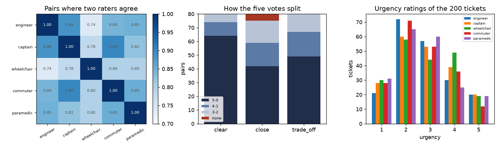
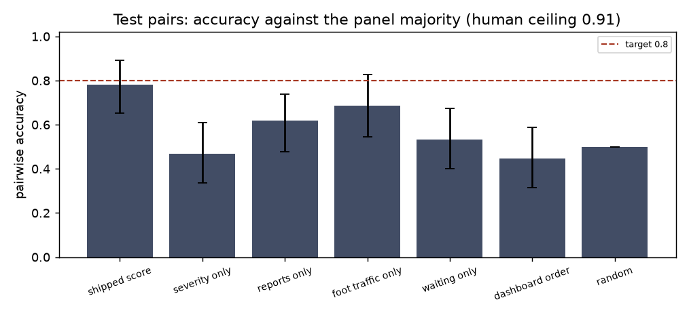
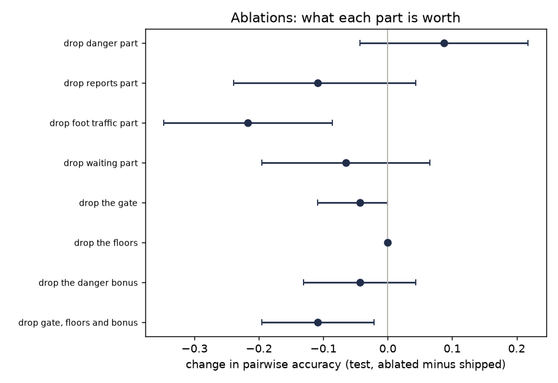
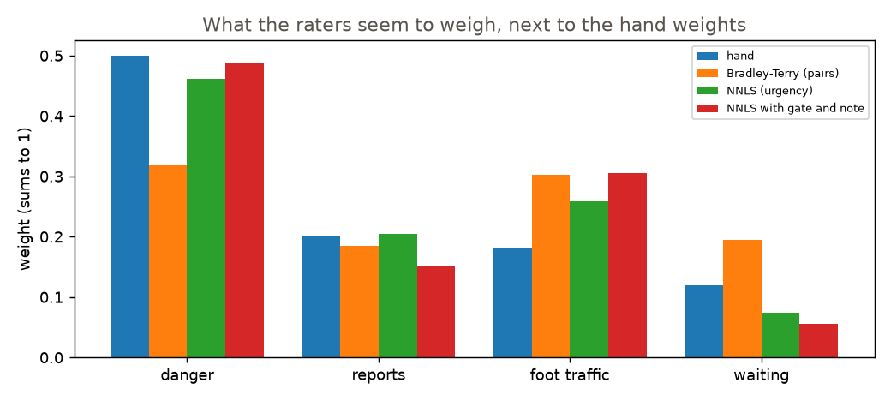
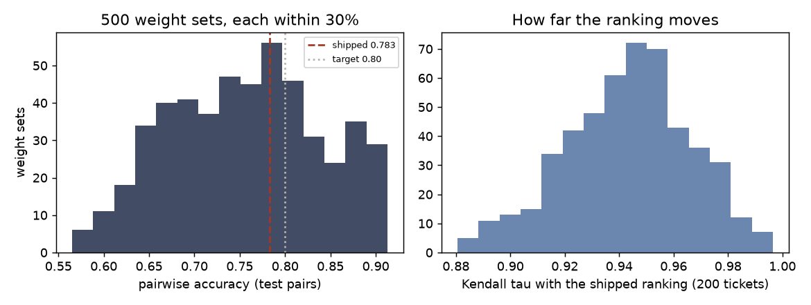

# Priority score against five raters: what agrees, what does not

Evaluation of `ranking/priority.py` (hand weights, as shipped) against the blind survey: 200 synthetic tickets, 240 pairs plus 40 swapped repeats, five AI raters (engineer, barangay captain, wheelchair user, commuter, paramedic). Targets are the pre-registered ones in `EVALUATION.md`. Everything comes from `results/ranking_*.json`; the code is `aggregate.py`, `fit.py`, `evaluate.py`.

Notation: `0.783 [0.652, 0.891]` is a value with its 95% bootstrap interval (1,000 resamples, over pairs for pair metrics, over tickets for ticket metrics). "Test" is the held-out split (40 tickets, 48 pairs, 46 with a label). "All" is the 235 labelled pairs of every split: the hand weights were never fitted to any of them, so it is a fair, larger sample for the shipped score, but it is not the pre-registered one. "Met" = the point estimate reaches the target; "clears" = the lower end of the interval does too.

## Summary

| Pre-registered target (test, hand weights) | Result | Verdict |
|---|---|---|
| Pairwise accuracy at least 0.80 | 0.783 [0.652, 0.891], 46 pairs | **missed** by 0.017 (one pair); the interval contains 0.80 |
| Accuracy at least 0.90 x the human ceiling | 0.783 / 0.908 = 0.862 [0.727, 0.988]; like for like 0.876 | **missed** by 0.038 (0.024 like for like) |
| Kendall tau-b at least 0.60 (mean urgency) | 0.584 [0.421, 0.729], 40 tickets | **missed** by 0.016 (0.664 on all 200 tickets) |
| NDCG@10 at least 0.85 | 0.945 [0.867, 0.988] | met, clears |
| Beats severity only, interval above 0 | +0.315 [0.185, 0.446] | met |
| Beats the dashboard order, interval above 0 | +0.337 [0.196, 0.468] | met |
| Fitted weights replace the hand weights only if +3 points on validation, non-negative | validation +4.2 points (2 pairs of 48), all weights >= 0 | rule says **replace**; read section 6 before acting on it |

Primary reading of "test pairs where the raters agree": every test pair that has a majority label (46 of 48). On the consensus (4 of 5, 41 pairs) and unanimous (31 pairs) subsets the 0.80 target is reached on the point estimate (0.805, 0.806) with the lower end of the interval at 0.68, and the ceiling ratio is missed (0.846, 0.806).

What the evidence says, in order of how much I trust it:

1. **Where the score has a clear opinion it agrees with the panel as well as the raters agree with each other.** Clear pairs (score gap over 15 points): 0.95 accuracy on all 80, ceiling 0.94. The whole shortfall is in the near-ties: close pairs (gap under 5) 0.56 on all 75 against a ceiling of 0.85, and 0.50 on the 14 test ones against 0.96. The raters mostly agree on those pairs; the score, by the way the survey was built, can hardly tell them apart and orders them wrongly.
2. **The score ranks flooded drains too high.** When a pair holds exactly one flooded drain, the panel picks it 27% of the time and the score 62% (gap -0.350 [-0.483, -0.217], 60 pairs on train and validation; -0.357 [-0.643, -0.143] on test). It is the score's pick in 29 of the 54 disagreements on train, validation and test, and the raters' pick in 3. On train and validation tickets with no note and no "gone" vote, raters give a flooded drain mean urgency 2.63 of 5 (15 tickets), about the same as a pothole (2.50, 18), a blocked sidewalk (2.64, 16) and a streetlight (2.45, 13); the table gives it 0.85 against 0.50 to 0.65. Open manholes (4.17) and "other" (1.99) are where the raters put the ends.
3. **The raters also lean harder than the score on danger notes, a named place nearby, blocked sidewalks and "other" with a note**, and each persona has its own lean (the wheelchair user picks the blocked sidewalk 83% of the time against the score's 44%).
4. **The shipped weights are not a lucky point.** Test accuracy under 500 random weight sets within 30% has a median of 0.761 (5th to 95th percentile 0.630 to 0.891) and the shipped value sits at the 56th percentile; the ranking of the 200 tickets barely moves (Kendall tau at least 0.88 with the shipped one). A third of the pairs are near-ties, so a few flips swing the accuracy by several points: a bar of 0.80 on this sample is knife-edge.
5. **Do not read the survey's accuracy as the accuracy on random pairs.** The survey draws a third each of clear, close and trade-off pairs; among all pairs of tickets 57% are clear, 15% close and 28% in between. Reweighted to that mix (in-between pairs assumed to behave like trade-offs) the shipped score would score 0.846 [0.802, 0.888], ratio 0.929 [0.883, 0.972]. That is a what-if, not a verdict, but it says the misses above are partly the stress-test mix.
6. **The "replace" outcome of the weights rule rests on the survey's near-tie pairs** (section 6): the fitted weights gain nothing on clear pairs and nothing reliable on trade-offs.

Recommendations (the maintainer decides; nothing under `models/tickets/` outside `eval/ranking/`, `eval/results/` was touched):

- Lower the flooded-drain severity from 0.85 towards the pothole's 0.65. It is the only change whose validation interval excludes zero (+0.083 [0.021, 0.167]; train +0.092 [0.043, 0.149]), it also lifts the ticket-level tau on validation from 0.630 to 0.724, and it rests on raters' per-ticket urgency, which no pair design touches. Whether a panel of AI personas is right about flooding in Metro Manila is a question for real people (EVALUATION.md, "What real validation still needs"); the safety floor of 48 would stay.
- Give foot traffic more weight: it is the part whose removal costs most (-0.102 [-0.153, -0.051] on all pairs) and both fits put it at 0.26 to 0.31 against 0.18. On danger and waiting the two fits disagree (section 6), so leave those.
- Keep the gate, the waiting cap of 14 days and the 3-level busy label as they are: nothing here says they cost agreement (section 8).
- Run the weights rule again on pairs drawn without looking at the score before promoting the fitted weights.

## 1. The raters



| rater | share A (240) | ties | confidence 1/2/3 (mean) | urgency mean | consistent on the 40 swaps | pair choice follows own urgency | agrees with the other four |
|---|---|---|---|---|---|---|---|
| engineer | 0.521 | 3 | 139/95/46 (1.67) | 2.78 | 39/40 | 0.971 (171) | 0.889 |
| captain | 0.521 | 2 | 122/99/59 (1.77) | 2.81 | 40/40 | 0.989 (177) | 0.925 |
| wheelchair | 0.550 | 2 | 88/110/82 (1.98) | 2.85 | 40/40 | 0.960 (177) | 0.816 |
| commuter | 0.512 | 4 | 104/115/61 (1.85) | 2.67 | 39/40 | 0.972 (176) | 0.933 |
| paramedic | 0.517 | 5 | 113/96/71 (1.85) | 2.68 | 40/40 | 0.982 (165) | 0.885 |

- **Position bias is absent.** Share of A is 0.512 to 0.550 (a coin-flip test gives p between 0.10 and 0.56). Over the 40 swapped repeats the five raters made 200 choices and never took the same letter twice for different tickets: 197 same ticket, 2 with a tie once, 1 tie both times. The panel's majority is the same ticket in 39 of 40 repeats and a tie both times in the other.
- **Ties are rare** (2 to 5 of 240), as instructed (at most one pair in ten).
- **Confidence is informative.** Agreement with the other four's majority rises with the rater's own confidence: at 1 it is 0.58 to 0.83, at 2 it is 0.85 to 1.00, at 3 it is 1.00 for all five raters.
- **Urgency scales differ a little** (histograms above): the wheelchair user uses 4 most (49 tickets) and the commuter 5 least (12).
- **Unusually consistent.** The pair choice follows the rater's own urgency of the two tickets in 96% to 99% of pairs where the urgencies differ, and the swaps are near perfect. Five AI personas behave like deterministic scorers. Real people would probably be noisier, so the ceiling below is probably higher than people would reach.

Agreement on the 240 base pairs (orientation: first listed wins / second wins / tie; recoding by lower ticket id moves kappa by under 0.005 because everyone saw the same order):

| pairs | n | Fleiss kappa | observed | chance | ceiling (leave one rater out) |
|---|---|---|---|---|---|
| all | 240 | 0.658 [0.594, 0.718] | 0.825 | 0.489 | 0.890 [0.863, 0.914] |
| train | 144 | 0.635 [0.553, 0.706] | 0.814 | 0.490 | 0.876 [0.840, 0.906] |
| validation | 48 | 0.709 [0.567, 0.827] | 0.854 | 0.499 | 0.913 [0.867, 0.953] |
| test | 48 | 0.673 [0.531, 0.785] | 0.829 | 0.477 | 0.908 [0.858, 0.948] |
| clear | 80 | 0.810 [0.720, 0.885] | 0.905 | 0.500 | 0.943 [0.913, 0.967] |
| close | 80 | 0.542 [0.439, 0.640] | 0.758 | 0.471 | 0.842 [0.783, 0.893] |
| trade-off | 80 | 0.625 [0.514, 0.724] | 0.812 | 0.500 | 0.878 [0.836, 0.917] |

Kappa 0.66 is substantial agreement, and it falls to 0.54 on the near-ties. The ceiling is each rater against the clear majority of the other four (a 2-2 split, or a majority that says tie, is skipped); the mean over the five raters is the number the score is compared with. Per rater on all pairs: captain 0.925, commuter 0.933, engineer 0.889, paramedic 0.885, wheelchair 0.816. Raw agreement between two raters runs from 0.738 (engineer and wheelchair user, Cohen kappa 0.48) to 0.900 (captain and commuter, 0.80); the full matrices are in `ranking_raters.json`. The five votes were 5-0 on 155 pairs, 4-1 on 45 and 3-2 on 35, with 5 pairs having no label; on close pairs 42 of 80 were unanimous, on clear pairs 64 of 80.

Urgency of the 200 tickets (1 to 5): Krippendorff alpha (ordinal) 0.870 [0.837, 0.895], ICC(2,1) 0.884, ICC(2,5) 0.974, Spearman between raters 0.832 to 0.918 (mean 0.878), each rater against the mean of the other four 0.90 to 0.93. Raters agree on what is urgent more than on which of two similar tickets goes first.

## 2. Labels

The label of a pair is the winner that at least 3 of 5 raters chose, on the 240 base pairs (the 40 repeats feed only the swap numbers). 5 pairs have none and are excluded: 4 with a tie majority, 1 split 2-2-1 with a tie. `data/consensus.json` holds the votes, labels and the mean urgency of every ticket.

| split | pairs | with a label | consensus (4 of 5) | unanimous | excluded |
|---|---|---|---|---|---|
| train | 144 | 141 | 116 | 91 | 2 tie majority, 1 no majority |
| validation | 48 | 48 | 43 | 33 | none |
| test | 48 | 46 | 41 | 31 | 2 tie majority |
| all | 240 | 235 | 200 | 155 | 4 tie majority, 1 no majority |

## 3. The shipped score on the test pairs

The score is `priority.score` called on a `TicketFacts` built from the answer key's attributes for every ticket; the stored scores were only cross-checked (largest difference 0.0).

| labels | pairs | accuracy | ceiling on the same pairs | accuracy / ceiling | the same, like for like |
|---|---|---|---|---|---|
| majority | 46 | 0.783 [0.652, 0.891] | 0.908 | 0.862 [0.727, 0.988] | 0.876 [0.727, 1.003] |
| consensus (4 of 5) | 41 | 0.805 [0.683, 0.927] | 0.951 | 0.846 [0.707, 0.974] | 0.846 [0.707, 0.974] |
| unanimous | 31 | 0.806 [0.677, 0.935] | 1.000 | 0.806 [0.677, 0.935] | 0.806 [0.677, 0.935] |

- The unanimous ceiling is 1.0 by construction (on a 5-0 pair every rater agrees with the other four), so that row is just the accuracy.
- The ceiling skips the pairs where the other four split 2-2, which are among the hardest, so it is measured on easier pairs than the score's accuracy. "Like for like" scores the shipped score against each rater's own leave-one-out majority, on the same (rater, pair) cells as the ceiling. It is a little higher (0.876) and still misses.
- The intervals treat pairs as independent. A ticket sits in up to 5 pairs; resampling tickets instead gives [0.583, 0.944] for the headline, wider than [0.652, 0.891]. With 46 pairs, one pair is 2.2 points.
- On the other splits: train 0.759 [0.688, 0.830] (141 pairs), validation 0.792 [0.667, 0.896] (48), all 0.770 [0.719, 0.826] (235; ratio 0.863 [0.806, 0.924] on a ceiling of 0.893). Test is not unusual.

Against the panel's mean urgency:

| tickets | n | Kendall tau-b | Spearman | NDCG@10 |
|---|---|---|---|---|
| test | 40 | 0.584 [0.421, 0.729] | 0.757 [0.567, 0.872] | 0.945 [0.867, 0.988] |
| all | 200 | 0.664 [0.606, 0.716] | 0.834 [0.775, 0.875] | 0.932 [0.838, 0.991] |

The top of the queue is right (NDCG@10); the full ordering is a little looser than the target asks on the 40 test tickets. For scale, each rater's Spearman with the mean of the other four is 0.90 to 0.93 on the 200 tickets, against the score's 0.834.

**By kind of pair** (test; the survey draws a third each):

| stratum | pairs | accuracy | ceiling | accuracy / ceiling | all splits |
|---|---|---|---|---|---|
| clear (gap over 15) | 16 | 0.938 [0.812, 1.000] | 0.889 | 1.055 [0.926, 1.177] | 0.950 (80 pairs) |
| close (gap under 5) | 14 | 0.500 [0.214, 0.786] | 0.957 | 0.522 [0.224, 0.797] | 0.560 (75) |
| trade-off | 16 | 0.875 [0.688, 1.000] | 0.880 | 0.994 [0.818, 1.154] | 0.787 (80) |

On all splits the ceilings are 0.94 (clear), 0.85 (close), 0.88 (trade-off), so the ratios are 1.01, 0.66 and 0.90: the score is at the human level on clear pairs, a little under it on trade-offs, and far under it on near-ties.

**By rater** (test, that rater's own choices, its ties left out) and, over all 240 pairs, relative to the rater's own ceiling:

| rater | pairs | accuracy | rater vs the other four | all pairs: accuracy / own ceiling |
|---|---|---|---|---|
| engineer | 47 | 0.809 [0.702, 0.915] | 0.976 | 0.751 / 0.889 = 0.845 |
| captain | 47 | 0.787 [0.681, 0.894] | 0.953 | 0.794 / 0.925 = 0.859 |
| wheelchair | 47 | 0.723 [0.596, 0.851] | 0.837 | 0.714 / 0.816 = 0.876 |
| commuter | 47 | 0.702 [0.574, 0.809] | 0.864 | 0.758 / 0.933 = 0.813 |
| paramedic | 46 | 0.739 [0.609, 0.848] | 0.907 | 0.732 / 0.885 = 0.827 |

**What the survey's mix does to these numbers.** The pairs were chosen with the score itself: close pairs are those the score ranks within 5 points, clear pairs more than 15 apart. Among all pairs of tickets the shares are clear 57%, close 15%, in between 28% (test tickets alone: 46%, 19%, 35%). Reweighting each stratum to that share, and assuming the in-between pairs the survey never drew behave like trade-offs:

| mix | accuracy | ceiling | ratio |
|---|---|---|---|
| survey (a third each), test | 0.783 | 0.908 | 0.862 |
| random pairs, test tickets' shares | 0.834 [0.735, 0.912] | 0.898 [0.838, 0.947] | 0.929 [0.830, 1.020] |
| random pairs, all tickets' shares | 0.846 [0.802, 0.888] | 0.911 [0.889, 0.930] | 0.929 [0.883, 0.972] |

If the in-between pairs were as hard as the near-ties the all-tickets figure would be 0.78, and if they were as easy as clear ones 0.89. So on random pairs the score probably meets both accuracy targets; on the survey as built it misses them. Both statements are true: the pre-registered verdict stays "missed".

## 4. Baselines

Pairwise comparators on the same pairs; a pair is called for the ticket with the larger number, equal numbers count half. The dashboard order is unresolved first (all survey tickets are open), then the integer severity 1 to 3 from `server/app/services/priority.py` (loaded from that file), then oldest first. Difference = shipped score minus the baseline, on the same resampled pairs; above 0 means the score wins.

| comparator | test accuracy (46) | shipped minus this (test) | all accuracy (235) | shipped minus this (all) |
|---|---|---|---|---|
| shipped score | 0.783 [0.652, 0.891] | | 0.770 [0.719, 0.826] | |
| severity only | 0.467 [0.337, 0.609] | +0.315 [0.185, 0.446] | 0.502 [0.440, 0.564] | +0.268 [0.200, 0.340] |
| dashboard order | 0.446 [0.315, 0.587] | +0.337 [0.196, 0.468] | 0.528 [0.466, 0.591] | +0.243 [0.174, 0.313] |
| reports only | 0.620 [0.478, 0.739] | +0.163 [0.000, 0.337] | 0.613 [0.562, 0.664] | +0.157 [0.089, 0.226] |
| foot traffic only | 0.685 [0.543, 0.826] | +0.098 [-0.076, 0.283] | 0.572 [0.515, 0.634] | +0.198 [0.115, 0.279] |
| waiting only | 0.533 [0.402, 0.674] | +0.250 [0.076, 0.424] | 0.557 [0.504, 0.615] | +0.213 [0.138, 0.283] |
| random | 0.500 | +0.283 [0.152, 0.391] | 0.500 | +0.270 [0.219, 0.326] |

- The score beats severity only and the dashboard order on the primary labels and on the consensus and unanimous subsets (test differences +0.329 and +0.354, then +0.339 and +0.403, all intervals above 0), and on all 235 pairs.
- It does **not** beat foot traffic only or reports only with an interval clear of zero on the 46 test pairs (foot traffic: +0.098 [-0.076, 0.283]; reports: +0.163, lower end 0.000). On all 235 pairs it does beat every single part.
- Severity only and the dashboard score under 0.5 on test. That is the survey's design, not a finding about severity: trade-off pairs were built so that severity-only is wrong in about half of them, and close pairs are the ones where the score's other parts offset a difference in severity (severity only gets 0.11 of the 14 test close pairs and 0.29 of the 75 close pairs overall). Reweighted to a random-pair mix (section 3) the dashboard order is 0.542 and severity only 0.563 on test tickets' shares, and the score still beats each by +0.29 and +0.27 with intervals above 0; with all tickets' shares by about +0.23 each.
- The "uncapped" diagnostics (people count with no cap at 8, days with no cap at 14) are in the JSON: 0.620 and 0.576 on test, no better than the capped parts.



## 5. Ablations

Each row switches off one thing (the real `priority.score` runs with the settings overridden; dropped weights are renormalised to sum to 1). Change = ablated accuracy minus shipped accuracy, paired over the same pairs; negative means the thing helps.

| ablation | test (46) | all (235) |
|---|---|---|
| drop the danger part | +0.087 [-0.043, 0.217] | +0.017 [-0.049, 0.085] |
| drop the reports part | -0.109 [-0.239, 0.043] | -0.043 [-0.102, 0.013] |
| drop the foot traffic part | -0.217 [-0.348, -0.086] | -0.102 [-0.153, -0.051] |
| drop the waiting part | -0.065 [-0.196, 0.065] | -0.064 [-0.115, -0.013] |
| drop the gate | -0.043 [-0.109, 0.000] | -0.077 [-0.119, -0.038] |
| drop the floors | 0.000 [0.000, 0.000] | -0.009 [-0.021, 0.000] |
| drop the danger bonus | -0.043 [-0.130, 0.043] | -0.055 [-0.094, -0.021] |
| drop gate, floors and bonus (the plain weighted sum) | -0.109 [-0.196, -0.022] | -0.153 [-0.209, -0.102] |



- **Foot traffic is the most valuable part**, then the gate, the waiting part and the bonus. The gate, floors and bonus together are worth 15 points over a plain weighted sum of the four parts, which is why a Bradley-Terry fit on the four parts alone (section 6) reaches only about 0.65 on its own pairs.
- **The danger part, half the weight, is not earning its keep on these pairs**: removing it does not lower agreement (+0.087 on test, +0.017 on all, both intervals contain 0). Manholes stay on top without it because the floor of 62 holds them; what the raters do not follow is the spread among the middle four kinds (section 6).
- **The floors almost never decide a labelled pair** (none on test, two on all). They are safety logic, not an accuracy device, and this survey cannot say whether they are right.
- Dropping the waiting part costs 6 points on all pairs even though the ticket ratings put less weight on waiting than the hand weights do (section 6): waiting breaks ties between otherwise equal tickets.

## 6. Fitted weights, and what the raters seem to care about

**Bradley-Terry.** `P(A first) = 1 / (1 + exp(-w . (parts(A) - parts(B))))` on the four parts, w >= 0, no intercept, fitted by L-BFGS-B with bounds on the 141 labelled train pairs, plus `lam * |w|^2`. `lam` is chosen on the 48 validation pairs by log-loss, not by accuracy, so the choice does not also pick the number the rule is judged on. The fitted weights are scaled to sum to 1 and put into the real score (gate, floors and bonus untouched).

| lam | danger | reports | foot traffic | waiting | validation log-loss | linear model, validation acc | full score, train acc | full score, validation acc |
|---|---|---|---|---|---|---|---|---|
| 0 | 0.373 | 0.160 | 0.287 | 0.179 | 0.648 | 0.625 | 0.833 | 0.854 |
| 0.1 | 0.365 | 0.163 | 0.290 | 0.181 | 0.640 | 0.625 | 0.812 | 0.854 |
| 0.3 | 0.352 | 0.169 | 0.294 | 0.185 | 0.634 | 0.646 | 0.812 | 0.833 |
| **1 (chosen)** | **0.318** | **0.184** | **0.303** | **0.194** | **0.631** | 0.646 | 0.816 | 0.833 |
| 3 | 0.267 | 0.211 | 0.313 | 0.209 | 0.642 | 0.708 | 0.798 | 0.833 |
| 10 | 0.207 | 0.243 | 0.322 | 0.228 | 0.664 | 0.750 | 0.787 | 0.854 |
| 100 | 0.158 | 0.269 | 0.328 | 0.245 | 0.689 | 0.750 | 0.773 | 0.875 |

(The hand weights score 0.759 on train and 0.792 on validation. All ten values of lam, 0 to 100, are in the JSON; every weight is non-negative at every lam and all of them beat the hand weights on validation.)

**The rule:** fitted weights win on validation by 0.833 - 0.792 = **+0.042**, which is at least 0.03, and every weight is non-negative: **replace**. That is two pairs of 48; the paired interval of the gain on validation is [-0.062, +0.167].

**Both on test, once** (the fit and lam were fixed before this was computed; later runs only added diagnostics and reproduce these numbers):

| weights | accuracy (46) | accuracy / ceiling | Kendall tau-b (40) | NDCG@10 |
|---|---|---|---|---|
| hand | 0.783 [0.652, 0.891] | 0.862 [0.727, 0.988] | 0.584 [0.421, 0.729] | 0.945 [0.867, 0.988] |
| fitted | 0.848 [0.739, 0.935] | 0.934 [0.820, 1.037] | 0.621 [0.459, 0.756] | 0.946 [0.840, 0.988] |

Fitted minus hand on test: +0.065 [-0.022, +0.174] on the majority labels (+0.073 on consensus, +0.065 on unanimous). If the fitted weights are adopted every ranking target is met on the point estimate (accuracy 0.848, ratio 0.934, tau 0.621, NDCG 0.946, beats severity only by +0.380 [0.239, 0.522] and the dashboard by +0.402 [0.261, 0.522]), but the interval of the gain over the hand weights contains zero.

**Why I would not take "replace" at face value.** Where each weight set is right (accuracy, pairs per cell in brackets):

| stratum | train hand | train fitted | validation hand | validation fitted | test hand | test fitted |
|---|---|---|---|---|---|---|
| clear | 0.958 (48) | 0.958 | 0.938 (16) | 0.938 | 0.938 (16) | 0.938 |
| close | 0.556 (45) | 0.667 | 0.625 (16) | 0.812 | 0.500 (14) | 0.786 |
| trade-off | 0.750 (48) | 0.812 | 0.812 (16) | 0.750 | 0.875 (16) | 0.812 |

The gain is all in the close pairs, which the survey built from the hand score's own near-ties. A scorer that is the hand score's equal in quality but different in its errors would also gain there, because on those pairs the hand score's difference is nearly pure noise by construction. Clear pairs are unchanged; trade-offs (chosen from the parts, not the weights) show -6 points on validation and on test and +6 on train. With the strata reweighted to a random-pair mix the test gain shrinks to +0.031 [-0.031, +0.093] (0.865 against 0.834). So: a small, probable gain, not a proven one. Ticket-level agreement, which no pair design touches, also moves the right way on every split (tau with mean urgency, hand to fitted: train 0.686 to 0.698, validation 0.630 to 0.681, test 0.584 to 0.621).

**Non-negative least squares of the mean urgency on the parts** (train tickets, with an intercept; weights scaled to sum to 1):

| part | hand | Bradley-Terry (pairs) | NNLS, four parts | NNLS, gated parts and a note column |
|---|---|---|---|---|
| danger | 0.500 | 0.318 | 0.462 | 0.488 |
| reports | 0.200 | 0.184 | 0.205 | 0.152 |
| foot traffic | 0.180 | 0.303 | 0.259 | 0.306 |
| waiting | 0.120 | 0.194 | 0.073 | 0.055 |
| danger-note bonus (points of 100) | 10 | not in the model | not in the model | 22.4 |
| R2 train / validation | | | 0.47 / 0.26 | 0.79 / 0.76 |



What the raters seem to care about, compared with what the weights assume:
- **Foot traffic more** (0.26 to 0.31 against 0.18, in both fits).
- **A danger note more**: about 22 points against 10 on the ticket ratings, and in pairs they pick the ticket with a note 66% of the time against the score's 52% (+0.131 [0.016, 0.246], 61 pairs).
- **Reports about as assumed** (0.15 to 0.21 against 0.20).
- **Waiting: the fits disagree** (0.06 to 0.07 from ticket ratings, 0.19 from pairs), so no direction; the 14-day cap itself is not the issue (section 8).
- **Danger: the fits disagree too** (0.46 to 0.49 from tickets, 0.32 from pairs). A reading that fits both: at the ticket level the open manhole is far above everything (mean urgency 4.17 against about 2.5 for the next kinds), which supports a large danger weight; in pairs the raters side with a lead in reports, foot traffic or waiting over a small severity edge, which supports a smaller one. What reconciles them is the shape of the table: the raters rate the four middle kinds alike.

Mean urgency by kind (train and validation tickets with no note and no "gone" vote), next to the danger value:

| kind | tickets | mean urgency (1 to 5) | table severity |
|---|---|---|---|
| open manhole | 21 | 4.17 | 1.00 |
| blocked sidewalk | 16 | 2.64 | 0.50 |
| flooded drain | 15 | 2.63 | 0.85 |
| pothole | 18 | 2.50 | 0.65 |
| broken streetlight | 13 | 2.45 | 0.55 |
| other | 15 | 1.99 | 0.25 |

## 7. Sensitivity

500 random weight sets, each weight times a factor within 0.7 to 1.3, renormalised to sum to 1, run through the real score.

| | min | 5th pct | median | 95th pct | max | shipped |
|---|---|---|---|---|---|---|
| test pairwise accuracy (46 pairs) | 0.565 | 0.630 | 0.761 | 0.891 | 0.913 | 0.783 |
| Kendall tau with the shipped ranking (200 tickets) | 0.881 | 0.901 | 0.945 | 0.980 | 0.996 | 1 |

44% of the weight sets score at least the shipped accuracy and 33% reach 0.80. The ranking of the tickets hardly moves (tau at least 0.88 for every set), but the accuracy on the survey's pairs swings by 10 points (standard deviation 0.078) because a third of the pairs are near-ties that a small change reorders. Two consequences: the shipped weights are in the middle of the cloud, not a tuned peak; and a target of 0.80 on 46 pairs cannot separate the shipped weights from their neighbours. This is descriptive: nothing was chosen from it.



## 8. Where the score and the panel disagree

Only **10** of the 46 labelled test pairs disagree (36 agree), not 15, so all ten are listed (strongest rater majority first). Seven are close pairs, two trade-offs, one clear. Score values are 0 to 100.

1. **p012**, close, 5-0. Raters chose (65.4): "Pothole. Near Ateneo Professional Schools, a moderately busy street. 7 people reported it. Open for 4 days. Everyone agrees it is still there." Score chose (70.0): "Flooded drain. Next to San Carlos Seminary, a very busy area. 1 person reported it. Open for 20 days. Everyone agrees it is still there."
2. **p215**, close, 5-0. Raters (58.0): "Other issue (type not given). Near Haven Montessori, a very busy area. 2 people reported it. Open for 24 days. Everyone agrees it is still there. A reporter wrote: "Broken glass all over where children play."" Score (62.4): "Flooded drain. On a quiet side street. 5 people reported it. Open for 2 days. Everyone agrees it is still there."
3. **p236**, close, 5-0. Raters (60.1): "Pothole. On a quiet side street. 5 people reported it. Open for 12 days. Everyone agrees it is still there." Score (63.0): "Flooded drain. On a quiet side street. 2 people reported it. Open for 25 days. Everyone agrees it is still there."
4. **p075**, close, 5-0. Raters (58.0): the same "Other issue ... Near Haven Montessori ... broken glass" ticket. Score (60.1): "Pothole. On a quiet side street. 5 people reported it. Open for 12 days. Everyone agrees it is still there."
5. **p185**, close, 5-0. Raters (39.4): "Other issue (type not given). Near Hercules bus stop, a moderately busy street. 2 people reported it. Open for 12 days. Everyone agrees it is still there." Score (41.4): "Broken streetlight. On a quiet side street. 1 person reported it. Open for 11 days. Everyone agrees it is still there."
6. **p010**, close, 5-0. Raters (65.4): "Pothole. Near Ateneo Professional Schools, a moderately busy street. 7 people reported it. Open for 4 days. Everyone agrees it is still there." Score (66.0): "Pothole. On a quiet side street. 7 people reported it. Open for 16 days. 1 person says it is gone."
7. **p088**, trade-off, 4-1. Raters (50.0): "Broken streetlight. Near Asia Pacific Medical and Diagnostic Services Inc., a moderately busy street. 3 people reported it. Open for 4 days. Everyone agrees it is still there." Score (54.9): "Flooded drain. Near St. Therese Private School, a moderately busy street. 1 person reported it. Open for 25 days. 1 person says it is gone. A reporter wrote: "Cars stall in the flood every time it rains.""
8. **p137**, close, 4-1. Raters (48.5): "Blocked sidewalk. Near Nicanor C. Garcia, Sr. Elementary School, a moderately busy street. 1 person reported it. Open for 15 days. Everyone agrees it is still there." Score (49.4): "Broken streetlight. On a moderately busy street. 3 people reported it. Open for 4 days. Everyone agrees it is still there."
9. **p267**, clear, 3-2 (the only large score gap, 27 points, and a split panel). Raters (42.7): "Blocked sidewalk. Near The Shops Ayala Triangle Gardens, a moderately busy street. 1 person reported it. Open for 10 days. Everyone agrees it is still there." Score (70.0): "Flooded drain. Next to San Carlos Seminary, a very busy area. 1 person reported it. Open for 20 days. Everyone agrees it is still there."
10. **p065**, trade-off, 3-2. Raters (55.2): "Other issue (type not given). Near Ponte bus stop, a moderately busy street. 12 people reported it. Open for 22 days. Everyone agrees it is still there." Score (65.4): "Pothole. Near Salcedo Village bus stop, a very busy area. 2 people reported it. Open for 11 days. Everyone agrees it is still there."

**Patterns**, counted on all 54 disagreements of train (34), validation (10) and test (10), with the one-sided "lean" on train and validation pairs (for each feature, among pairs where exactly one ticket has it: how often the panel picks that ticket, how often the score does) and its replication on test:

| pattern | in the disagreements (test / all three splits) | lean on train and validation: panel vs score, gap | on test |
|---|---|---|---|
| the score picked a flooded drain | 5 of 10 / 29 of 54 (the raters' pick: 0 / 3) | 0.27 vs 0.62, **-0.350 [-0.483, -0.217]** (60 pairs) | -0.357 [-0.643, -0.143] (14) |
| a named place nearby (the raters' pick lacks one in 1 / 13 of 54; the score's pick lacks one in 6 / 29 of 54) | | 0.65 vs 0.55, **+0.106 [0.010, 0.202]** (104) | +0.156 [0.062, 0.281] (32) |
| a danger note | on the raters' pick in 2 / 16 of 54, on the score's pick in 1 / 7 | 0.66 vs 0.52, **+0.131 [0.016, 0.246]** (61) | +0.083 [-0.167, 0.333] (12) |
| blocked sidewalk | raters' pick 2 / 13 of 54, score's 0 / 2 | 0.60 vs 0.43, **+0.170 [0.057, 0.283]** (53) | +0.154 [0.000, 0.385] (13) |
| "other" (no hazard type) | raters' pick 4 / 10 of 54, score's 0 / 1 | 0.50 vs 0.40, +0.104 [0.000, 0.208] (48) | +0.286 [0.071, 0.500] (14) |
| "N people say it is gone" | raters' pick 0 / 7, score's 2 / 9 | 0.15 vs 0.15, +0.000 [-0.083, 0.069] (72) | -0.222 [-0.556, 0.000] (9) |
| open past the 14-day cap | raters' pick 4 / 26, score's 5 / 30 | 0.58 vs 0.61, -0.030 [-0.120, 0.060] (100) | -0.036 [-0.250, 0.179] (28) |
| labelled a very busy area | not tallied | 0.62 vs 0.56, +0.051 [-0.051, 0.154] (78) | -0.053 [-0.263, 0.158] (19) |
| open manhole | not tallied | 0.73 vs 0.65, +0.076 [-0.030, 0.182] (66) | 0.00 (7) |

The first row stands out: about half of all disagreements are the score putting a flooded drain first. The next group (named place, note, sidewalk, "other") is the raters leaning on what they can read in a sentence (a school or clinic nearby, a story of someone hurt, a sidewalk that forces people into the road) harder than a number built from nearby places and a bonus of 10 points can. Seven of the ten test disagreements are near-ties, so the pattern is also "which of two similar tickets".

**The caveats the survey builder listed**, with what the data say:

- *The busy label has three levels and the named place is only the nearest one, while the score counts every place within 300 m.* This does not explain the disagreement. Giving the score only what the raters saw (the mean foot traffic of each of the three busy labels) changes agreement by -0.028 [-0.071, 0.014] on train and +0.021 [-0.062, 0.104] on validation. What does show is that raters read a named place as a strong cue: they pick the ticket with a named place 65% of the time against the score's 55% (above).
- *"N people say it is gone" can be read as already fixed.* On average the panel treats a ticket with "gone" votes as the gate does (0.15 against 0.15 on train and validation pairs), and the gate is worth 7.7 points on all pairs when it is kept [3.8, 11.9]. The engineer cools less than the gate on train and validation (+0.139 [0.042, 0.236]), which does not repeat on test (9 pairs). One test pair (p010) may be a case: the score gives the full gate to a ticket with one "gone" vote among seven reporters (belief 0.83, above the 0.80 at which the gate stops cutting), and the raters took the ticket with none 5-0 (that one also has a school nearby). One pair is a lead, not a finding.
- *The score stops counting waiting after 14 days, raters saw up to 30.* Among the 48 train and validation pairs where both tickets are past 14 days and differ in days, the panel picks the one open longer 54% of the time [40%, 69%] and the score 52% [40%, 65%]; counting waiting up to 30 days changes nothing (0.000 on train and on validation); the uncapped waiting comparator is no better than the capped one. The cap is not costing agreement.
- *85 tickets have no named place.* In 29 of the 54 disagreements the score's pick has none, against 13 of 54 for the raters' pick, which is the named-place lean again. The score still gives such a ticket foot traffic from unnamed places within 300 m, which the raters see only as the busy label, so some of this is the survey hiding information rather than the score being wrong.

**Does the score agree with each persona differently?** A little, and in different places. Score accuracy against each persona's own choices on the pairs where nobody tied, and minus its accuracy against the other four:

| persona | test (46 pairs) | minus other four (test) | all pairs (233) | minus other four (all) |
|---|---|---|---|---|
| engineer | 0.804 [0.674, 0.913] | +0.071 [0.011, 0.130] | 0.747 [0.691, 0.798] | -0.005 [-0.044, 0.031] |
| captain | 0.783 [0.652, 0.891] | +0.043 [-0.022, 0.109] | 0.794 [0.742, 0.845] | +0.054 [0.023, 0.088] |
| wheelchair | 0.717 [0.586, 0.848] | -0.038 [-0.152, 0.076] | 0.717 [0.661, 0.773] | -0.043 [-0.091, 0.009] |
| commuter | 0.696 [0.543, 0.826] | -0.065 [-0.168, 0.027] | 0.764 [0.708, 0.820] | +0.016 [-0.020, 0.053] |
| paramedic | 0.739 [0.609, 0.848] | -0.011 [-0.109, 0.065] | 0.734 [0.674, 0.790] | -0.021 [-0.061, 0.019] |

The captain agrees with the score most and the wheelchair user least; on all pairs only the captain's difference clears zero (on test the engineer's does too). Part of the wheelchair user's lower agreement is that rater being the odd one out (0.816 with the other four, against 0.885 to 0.933); relative to its own ceiling the score does as well for the wheelchair user as for anyone (0.876, the best of the five). The per-persona leans (train and validation pairs, test in brackets) show where each persona differs from the score:

| persona | leans harder than the score on | leans less than the score on |
|---|---|---|
| wheelchair | **blocked sidewalk: picks it 83% against the score's 44%, +0.389 [0.259, 0.519]** (test +0.462 [0.231, 0.692]) | broken streetlight -0.212 [-0.346, -0.096] (test -0.200); flooded drain -0.300 |
| engineer | danger note +0.262 [0.148, 0.377]; open manhole +0.182 [0.076, 0.303]; "gone" votes +0.139 (cools less than the gate) | flooded drain -0.203 [-0.356, -0.034] |
| captain | "other" +0.188 [0.083, 0.312] (test +0.286); danger note +0.164 | flooded drain -0.317 [-0.450, -0.183] |
| commuter | blocked sidewalk +0.170; broken streetlight +0.135 [0.019, 0.250]; danger note +0.131; "other" +0.125 | flooded drain -0.367 [-0.500, -0.250] |
| paramedic | danger note +0.180 [0.065, 0.311]; named place +0.154 [0.048, 0.250]; blocked sidewalk +0.170 | flooded drain -0.317 [-0.467, -0.167] (test -0.429) |

Every persona leans away from flooded drains, so that is not one persona's taste. The wheelchair user's blocked-sidewalk lean is the single largest persona effect and it replicates on test. If blocked sidewalks should rank higher for the people they trap, the survey says the table's 0.50 undersells them for that group; the other four put them nearer the score.

## 9. Targets, by how much, and what would help

Test split, hand weights as shipped.

| target | labels | pairs | value | interval | verdict | short by |
|---|---|---|---|---|---|---|
| accuracy >= 0.80 | majority | 46 | 0.783 | [0.652, 0.891] | missed | 0.017 |
| accuracy >= 0.80 | consensus | 41 | 0.805 | [0.683, 0.927] | met, does not clear | |
| accuracy >= 0.80 | unanimous | 31 | 0.806 | [0.677, 0.935] | met, does not clear | |
| accuracy >= 0.90 x ceiling | majority | 46 | 0.862 | [0.727, 0.988] | missed | 0.038 |
| the same, like for like | majority | 46 | 0.876 | [0.727, 1.003] | missed | 0.024 |
| accuracy >= 0.90 x ceiling | consensus | 41 | 0.846 | [0.707, 0.974] | missed | 0.054 |
| accuracy >= 0.90 x ceiling | unanimous | 31 | 0.806 | [0.677, 0.935] | missed | 0.094 |
| Kendall tau-b >= 0.60 | tickets | 40 | 0.584 | [0.421, 0.729] | missed | 0.016 |
| NDCG@10 >= 0.85 | tickets | 40 | 0.945 | [0.867, 0.988] | met, clears | |
| beats severity only | majority | 46 | +0.315 | [0.185, 0.446] | met, clears | |
| beats dashboard order | majority | 46 | +0.337 | [0.196, 0.468] | met, clears | |
| weights rule | validation | 48 | +0.042 | | replace | |

The first target needs both 0.80 and 0.90 x the ceiling; on the test pairs the second means an accuracy of 0.817 (0.90 x 0.908), so it is the binding one.

**By how much it misses.** One pair on the accuracy bar; two more correct pairs of 46 on the ceiling ratio; 0.016 on tau. The misses are close, and every interval contains the bar. The structure of the miss is clear, though: it is the near-ties (ratio 0.52 on test, 0.66 on all splits), not the pairs the score is confident about.

**What would help, with evidence from train and validation only** (the test split was not scored for any of these). Each row is one change to `settings.py`, scored with the real score. Validation is 48 pairs, one pair is 2.1 points, so read the intervals, not the points.

| change | train accuracy (141) | train change | validation accuracy (48) | validation change | tau with urgency, validation (was 0.630) |
|---|---|---|---|---|---|
| shipped | 0.759 | | 0.792 | | 0.630 |
| flooded drain severity 0.85 to 0.65 | 0.851 | +0.092 [0.043, 0.149] | 0.875 | **+0.083 [0.021, 0.167]** | 0.724 |
| the four middle kinds all at 0.60 | 0.887 | +0.128 [0.064, 0.191] | 0.854 | +0.062 [-0.042, 0.167] | 0.718 |
| danger bonus 10 to 20 | 0.794 | +0.035 [-0.007, 0.078] | 0.771 | -0.021 [-0.083, 0.042] | 0.710 |
| waiting counted to 30 days, not 14 | 0.759 | 0.000 | 0.792 | 0.000 [-0.083, 0.083] | 0.633 |
| foot traffic as the raters saw it | 0.730 | -0.028 [-0.071, 0.014] | 0.812 | +0.021 [-0.062, 0.104] | 0.633 |
| waiting weight halved | 0.766 | +0.007 | 0.708 | -0.083 [-0.167, -0.021] | 0.638 |
| Bradley-Terry fitted weights | 0.816 | +0.057 [-0.018, 0.124] | 0.833 | +0.042 [-0.062, 0.167] | 0.681 |
| flooded drain 0.65 and bonus 20 | 0.858 | +0.099 [0.043, 0.163] | 0.854 | +0.062 [-0.042, 0.188] | 0.785 |

The flooded-drain severity is the one change that is positive on both splits with an interval above zero, also in a stratum that is not the near-ties (trade-offs: +0.062 on train, +0.063 on validation), and in the ticket-level tau. The curve is not a lucky value: accuracy on train goes 0.759, 0.801, 0.844, 0.851 as the severity falls 0.85, 0.80, 0.75, 0.70 and stays at 0.851 down to 0.55; on validation it goes 0.792, 0.833, 0.833, 0.833, 0.875 and stays at 0.875. The danger bonus is mixed (better ticket tau, no better pairs). Nothing helps from the cap, the 3-level label, or less weight on waiting.

On test, and only as a consequence of the rule being met, the fitted weights would clear all of the misses on the point estimate (section 6), with the caveats there.

## 10. Limits

- **The raters are AI personas.** Their agreement (kappa 0.66, ceiling 0.89) and their near-perfect self-consistency are properties of that, and people will not match them. "The score agrees with the panel" and "the score is right" are different statements; flooded drains are the clearest place where they may diverge.
- **Small samples.** 46 test pairs and 40 test tickets: intervals are about plus or minus 0.12 on accuracy and 0.15 on tau. Ticket reuse makes the pair intervals too narrow (the ticket-resampled one is about 1.5 times wider).
- **The survey was built with the score** (strata by score gap), which favours any rival of the score on near-ties and over-represents them. The reweighted figures in sections 3 and 6 show the size of that effect; they rest on an assumption about pairs the survey never drew.
- **Synthetic tickets** with English notes written to show danger; a note is a stronger cue here than a real report would be, and the raters see plain words, not photos.
- **The pre-registered rule for the weights** compares two weight sets on 48 validation pairs with a margin of about 1.4 pairs, on a sample that favours the challenger.
- **Candidate changes were scored on train and validation only**, never on test; the test split was read for the shipped score (fixed) and, after the fit and lam were fixed, once for the hand and fitted weights.

## 11. Files

Code, in run order (from the repo root):

```
models/.venv/bin/python -m models.tickets.eval.ranking.aggregate   # labels, rater tables: data/consensus.json, results/ranking_raters.*
models/.venv/bin/python -m models.tickets.eval.ranking.fit         # Bradley-Terry, NNLS, candidates: results/ranking_fit.*
models/.venv/bin/python -m models.tickets.eval.ranking.evaluate    # everything else: results/ranking_{score,baselines,personas,disagreements,sensitivity,targets}.json and the other plots
models/.venv/bin/pytest models/tickets/eval/ranking -q -p no:warnings
```

`evaluate` reads `results/ranking_fit.json` for the weights row of the targets, so run `fit` first. Tests: `tests/test_aggregate.py` (Fleiss kappa against a published example and a hand-made set, the leave-one-rater-out ceiling by hand, majority, consensus and tie labelling, swap consistency, Krippendorff alpha by hand and by brute force, ICC against Shrout and Fleiss, the real survey), `tests/test_evaluate.py` (every comparator on hand-made tickets, ablations, sensitivity, disagreements, the split each number is on, checked by moving other splits' ratings and seeing nothing move), `tests/test_fit.py` (non-negative weights, agreement with scikit-learn, the rule at its boundary, a fit that never reads test, NNLS on exact data), `tests/helpers.py`.

Results: `results/ranking_raters.json .png`, `ranking_score.json`, `ranking_baselines.json .png`, `ranking_ablations.png`, `ranking_fit.json .png`, `ranking_personas.json`, `ranking_disagreements.json`, `ranking_sensitivity.json .png`, `ranking_targets.json`. Derived labels: `data/consensus.json`.
